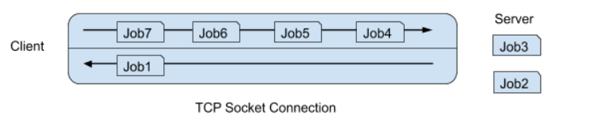

# Berkeley CS162 Summer 2019: Midterm 1: Questions

> Copied from the original: <https://hkn.eecs.berkeley.edu/exams/course/cs/162>. Text and figures are taken from the PDF as is; nothing was answered or rewritten. The original PDF is in this folder.

---

**Page 1**

&emsp;&emsp;&emsp;&emsp;&emsp;&emsp;&emsp;&emsp;University of California, Berkeley 
&emsp;&emsp;&emsp;&emsp;&emsp;&emsp;&emsp;&emsp;College of Engineering 
&emsp;&emsp;&emsp;&emsp;&emsp;&emsp;&emsp;&emsp;Computer Science Division: EECS 
Summer 2019   Jack Kolb 
&emsp;&emsp;&emsp;&emsp;&emsp;&emsp;&emsp;&emsp;Midterm I 
&emsp;&emsp;&emsp;&emsp;&emsp;&emsp;&emsp;&emsp;July 18th, 2019 
&emsp;&emsp;&emsp;&emsp;&emsp;&emsp;&emsp;CS162: Operating Systems and Systems Programming

&emsp;&emsp;&emsp;&emsp;Your Name: 
&emsp;&emsp;SID AND 162 Login 
&emsp;&emsp;(e.g. s042): 
&emsp;&emsp;TA Name: 
&emsp;&emsp;Discussion Section 
&emsp;&emsp;Time:

General Information: 
This is a **closed book** exam. You are allowed 1 page of handwritten notes (both sides). You have 
two (2) hours to complete as much of the exam as possible. Make sure to read all of the questions 
first, as some of the questions are substantially more time consuming. 
Write all of your answers directly on this paper. Make your answers as concise as possible. On 
programming questions, we will be looking for performance as well as correctness, so think through 
your answers carefully. If there is something about the questions that you believe is open to 
interpretation, please ask us about it!

&emsp;&emsp;&emsp;&emsp;&emsp;&emsp;&emsp;&emsp;**Problem**    **Possible**    **Score**

&emsp;&emsp;&emsp;&emsp;&emsp;&emsp;&emsp;&emsp;1    22

&emsp;&emsp;&emsp;&emsp;&emsp;&emsp;&emsp;&emsp;2    12

&emsp;&emsp;&emsp;&emsp;&emsp;&emsp;&emsp;&emsp;3    16

&emsp;&emsp;&emsp;&emsp;&emsp;&emsp;&emsp;&emsp;4    16

&emsp;&emsp;&emsp;&emsp;&emsp;&emsp;&emsp;&emsp;5    16

&emsp;&emsp;&emsp;&emsp;&emsp;&emsp;&emsp;&emsp;Total    82

&emsp;&emsp;&emsp;&emsp;&emsp;&emsp;&emsp;&emsp;Page 1/17

---

**Page 2**

CS 162 Summer 2019 Midterm   July 18th, 2019

### Problem 1: True/False \[22 pts\]

Please **explain** your answer in **two sentences or fewer** (Answers longer than this may not get 
credit!).  Also, answers without an explanation **get no credit**.

### **Problem 1a\[2pts\]:** The number of allocated kernel stacks is always equal to the number of allocated

userspace stacks. 
⬜ True  ⬜ False 
Explain:

### **Problem 1b\[2pts\]:** When using a simple “Base and Bound” scheme to enforce memory protection, the

CPU only sees virtual memory addresses. 
⬜ True  ⬜ False 
Explain:

### **Problem 1c\[2pts\]:** When fork returns a negative integer, an error has occurred that must be dealt with in

both the parent and child process. 
⬜ True  ⬜ False 
Explain:

### **Problem 1d\[2pts\]:** Switching between two threads within the same process is generally more efficient

than switching between two threads belonging to different processes. 
⬜ True  ⬜ False 
Explain:

&emsp;&emsp;&emsp;&emsp;&emsp;&emsp;&emsp;&emsp;Page 2/17

---

**Page 3**

CS 162 Summer 2019 Midterm   July 18th, 2019

### **Problem 1e\[2pts\]:** The Linux Completely Fair Scheduler always gives a shorter time slice to lower

priority threads. 
⬜ True  ⬜ False 
Explain:

### **Problem 1f\[2pts\]:** When using an atomic operation like test&set to implement a lock, we must apply

the test&set operation to check the lock’s state (either BUSY or FREE) within a “spin loop.” 
⬜ True  ⬜ False 
Explain:

### **Problem 1g\[2pts\]:** Locks can prevent a thread from being preempted.

⬜ True  ⬜ False 
Explain:

### **Problem 1h\[2pts\]:** If the Banker’s algorithm blocks a request for a resource, then granting that request

would have caused the system to deadlock. 
⬜ True  ⬜ False 
Explain:

### **Problem 1i\[2pts\]:** Synchronization primitives in base Pintos are implemented with test&set.

⬜ True  ⬜ False 
Explain:

&emsp;&emsp;&emsp;&emsp;&emsp;&emsp;&emsp;&emsp;Page 3/17

---

**Page 4**

CS 162 Summer 2019 Midterm   July 18th, 2019

### **Problem 1j\[2pts\]:** According to the End-to-End Principle, reliable transport should be implemented by the

two communications endpoints, not the network infrastructure. 
⬜ True  ⬜ False 
Explain:

### **Problem 1k\[2pts\]:** After a call to fork, stdin, stdout, and stderr are reset to their default states in

the child process. 
⬜ True  ⬜ False 
Explain:

&emsp;&emsp;&emsp;&emsp;&emsp;&emsp;&emsp;&emsp;Page 4/17

---

**Page 5**

CS 162 Summer 2019 Midterm   July 18th, 2019

### Problem 2: Short Answer \[12 pts\]

### **Problem 2a\[3pts\]:** What is the Interrupt Vector Table and what role does it play in protecting the kernel?

### **Problem 2b\[3pts\]:** Why are device drivers divided into a top half and bottom half? What is each half

responsible for?

### **Problem 2c\[3pts\]:** In Pintos, how would we allow a struct thread to be an element of two lists at the

same time?

### **Problem 2d\[3pts\]:** Does First-Come First-Served or Round-Robin scheduling have lower overhead?

Explain.

&emsp;&emsp;&emsp;&emsp;&emsp;&emsp;&emsp;&emsp;Page 5/17

---

**Page 6**

CS 162 Summer 2019 Midterm   July 18th, 2019

### Problem 3: Processes and Syscalls \[16 pts\]

Assume that we have the following two pieces of code (with all header files included): 
**write\_and\_print.c, compiled to the binary file write\_and\_print** 
/\* Takes a file descriptor (int) and a buffer (string) as input and 
writes the buffer into the provided file descriptor. **ALSO prints** 
**out the buffer to stdout**. \*/ 
**main.c, compiled to the binary file main** 
int new\_fd = -1;

void signal\_handler(int sig) { 
dup2(new\_fd, STDOUT\_FILENO); 
}

int main() { 
int hello\_fd = open("greetings.txt", O\_WRONLY \| O\_CREAT \| O\_TRUNC); 
char \*child\_buf = "Child hello!"; 
char \*parent\_buf = "Parent howdy!"; 
/\* Assume char \*arguments\[\] is correctly formed with **./write\_and\_print** 
**hello\_fd**, and **child\_buf** as arguments \*/ 
new\_fd = dup(STDOUT\_FILENO); 
dup2(hello\_fd, STDOUT\_FILENO);

struct sigaction sa; 
sa.sa\_flags = 0; 
sa.sa\_handler = &signal\_handler; 
sigemptyset(&sa.sa\_mask); 
sigaction(SIGTERM, &sa, NULL);

pid\_t pid = fork(); 
if (pid == 0) { 
execv(arguments\[0\], arguments); 
kill(getppid(), SIGTERM); 
} else { 
kill(pid, SIGTERM); 
wait(NULL); 
dprintf(hello\_fd, "%s: %d\\n", parent\_buf, pid); 
printf("%s: %d\\n", parent\_buf, pid); 
}

return 0; 
}

&emsp;&emsp;&emsp;&emsp;&emsp;&emsp;&emsp;&emsp;Page 6/17

---

**Page 7**

CS 162 Summer 2019 Midterm   July 18th, 2019

List all possible outputs of the main program in each row of the table below (where one row corresponds to 
one run of the program). You may not need all the tables provided. Assume that all system calls succeed 
EXCEPT that execv() may possibly fail and assume that the child’s PID is 162.

Standard Output    greetings.txt

&emsp;&emsp;&emsp;&emsp;&emsp;&emsp;&emsp;&emsp;Page 7/17

---

**Page 8**

CS 162 Summer 2019 Midterm   July 18th, 2019

### Problem 4: DeadLockList \[16 pts\]

Thanos needs to collect all 6 Infinity Locks. He creates a new structure called a locklist to manage the 
locks he has acquired or still needs. Instead of just acquiring one lock, threads now have to acquire a series of 
locks to ‘lock’ the locklist structure. Think of this as needing a collection of resources before being able 
to perform your operations. For all questions, assume the locklist has already been initialized for you and 
that we cannot preempt locks.

#DEFINE NUM\_LOCKS 6 
struct locklist { 
&emsp;&emsp;lock my\_locks\[NUM\_LOCKS\]; 
&emsp;&emsp;int magic; 
};

### **Problem 4a\[2pts\]:** If all locks are released one after another with no other operations between them, does

the sequence they are released in matter with respect to deadlock? (Short Answer)

### **Problem 4b\[2pts\]:** Does the lock release order matter with respect to performance? Explain. (Short Ans.)

&emsp;&emsp;&emsp;&emsp;&emsp;&emsp;&emsp;&emsp;Page 8/17

---

**Page 9**

CS 162 Summer 2019 Midterm   July 18th, 2019 
Thanos is now trying to decide in what order to lock the Infinity Locks in the locklist. Which of the 
following definitions of lock\_locklist can cause deadlock? Explain your answer for each selection. If 
deadlock is possible, please provide an acquisition ordering in your explanation.

### **Problem 4c\[2pts\]:** Lock acquisition code:

void lock\_locklist(struct locklist \*list) { 
&emsp;&emsp;int start = 0; 
&emsp;&emsp;for (int i = start; i \< NUM\_LOCKS; i++) { 
&emsp;&emsp;&emsp;&emsp;&emsp;int index = i; 
&emsp;&emsp;&emsp;&emsp;&emsp;lock\_acquire (list-\>my\_locks + index); 
&emsp;&emsp;} 
} 
⬜ Can Cause Deadlock      ⬜ Cannot Cause Deadlock 
Explain:

### **Problem 4d\[2pts\]:** Lock acquisition code:

void lock\_locklist(struct locklist \*list) { 
&emsp;&emsp;int start = getpid() % NUM\_LOCKS; 
&emsp;&emsp;for (int i = start; i \< start + NUM\_LOCKS; i++) { 
&emsp;&emsp;&emsp;&emsp;&emsp;int index = i % NUM\_LOCKS; 
&emsp;&emsp;&emsp;&emsp;&emsp;lock\_acquire (list-\>my\_locks + index); 
&emsp;&emsp;} 
} 
⬜ Can Cause Deadlock      ⬜ Cannot Cause Deadlock 
Explain:

&emsp;&emsp;&emsp;&emsp;&emsp;&emsp;&emsp;&emsp;Page 9/17

---

**Page 10**

CS 162 Summer 2019 Midterm   July 18th, 2019

### **Problem 4e\[2pts\]:** Lock acquisition code:

void lock\_locklist(struct locklist \*list) { 
&emsp;&emsp;int start = NUM\_LOCKS - 1; 
&emsp;&emsp;for (int i = start; i \>= 0; i--) { 
&emsp;&emsp;&emsp;&emsp;&emsp;int index = i; 
&emsp;&emsp;&emsp;&emsp;&emsp;lock\_acquire (list-\>my\_locks + index); 
&emsp;&emsp;} 
} 
⬜ Can Cause Deadlock      ⬜ Cannot Cause Deadlock 
Explain:

### **Problem 4f\[2pts\]:** Lock acquisition code:

void lock\_locklist(struct locklist \*list) { 
&emsp;&emsp;int start = NUM\_LOCKS/2; 
&emsp;&emsp;for (int i = start; i \< start + NUM\_LOCKS; i++) { 
&emsp;&emsp;&emsp;&emsp;&emsp;int index = i % NUM\_LOCKS; 
&emsp;&emsp;&emsp;&emsp;&emsp;lock\_acquire (list-\>my\_locks + index); 
&emsp;&emsp;} 
} 
⬜ Can Cause Deadlock      ⬜ Cannot Cause Deadlock 
Explain:

&emsp;&emsp;&emsp;&emsp;&emsp;&emsp;&emsp;&emsp;Page 10/17

---

**Page 11**

CS 162 Summer 2019 Midterm   July 18th, 2019 
Thinking about how much work it will take to lock the locklist structure, Thanos doesn’t always want to 
go through the trouble of acquiring all the Infinity Locks. He decides to create the following function to 
access the structure faster, acquiring just one lock and later releasing it. **Assume all other threads execute** 
**the code from problem 4c when using the locklist.** 
void snap(struct locklist \*list) { 
&emsp;&emsp;lock\_acquire (list-\>my\_locks + OFFSET); 
}

### **Problem 4g\[2pts\]:**  If OFFSET = 0, can snap cause deadlock to happen? If so, provide an example

execution order that leads to deadlock. If not, explain why deadlock is not possible. (Short Answer)

### **Problem 4h\[2pts\]:** If OFFSET = NUM\_LOCKS - 1, can snap cause deadlock to happen? If so, provide

an example execution order that leads to deadlock. If not, explain why deadlock is not possible. (Short 
Answer)

&emsp;&emsp;&emsp;&emsp;&emsp;&emsp;&emsp;&emsp;Page 11/17

---

**Page 12**

CS 162 Summer 2019 Midterm   July 18th, 2019

### Problem 5: Just One TCP Connection \[16 pts\]

Bob is trying to build a system which helps people process jobs. After learning about how sockets work in 
CS162, he wants to write a server program which listens on port 162 and takes jobs from clients. Each job is 
represented by the following data structure:

struct Job { 
int job\_number; 
char job\_details\[200\]; 
int result; 
};

However, Bob thinks that having clients make a new connection for each job they want the server to process 
seems to be an inefficient design because it consumes resources unnecessarily.

### **Problem 5a\[2pts\]:** Briefly explain why establishing new connections consumes additional resources in

userspace.

### **Problem 5b\[2pts\]:** Briefly explain why establishing new connections consumes additional resources in the

OS kernel.

Bob comes up with a scheme where the server just needs to maintain, for each client, a single connection 
through which multiple jobs can be sent and through which processed jobs can be sent back. More 
specifically, each connection is managed by one thread and whenever a new job is received, a new thread is 
created to do the work in parallel and then send back the results via the same connection. 
Graphically, it looks like this:

### **Problem 5c\[2pts\]:** Bob approaches you for help with implementing his design. He’s done most of the

coding but left out some critical functions. You are required to fill in the missing lines below. Note that you 
might not need all the lines provided.

&emsp;&emsp;&emsp;&emsp;&emsp;&emsp;&emsp;&emsp;Page 12/17

---

**Page 13**

CS 162 Summer 2019 Midterm   July 18th, 2019

Assumptions: 
&emsp;1\.   When you call ssize\_t read(int fd, void \*buf, size\_t count), it always reads count 
&emsp;&emsp;bytes if there is data available. Otherwise, the call blocks. 
&emsp;2\.   When you call ssize\_t write(int fd, const void \*buf, size\_t count), it always 
&emsp;&emsp;writes count bytes successfully. You do not have to handle the case when read fails because of 
&emsp;&emsp;client disconnection.

&emsp;**1. struct Job {** 
&emsp;**2.   int job\_number;** 
&emsp;**3.   char job\_details\[200\];** 
&emsp;**4.   int result;** 
&emsp;**5. };** 
&emsp;**6.** 
&emsp;**7. struct Arg\_struct{** 
&emsp;**8.  Job \*job;** 
&emsp;**9.  int socket\_fd;** 
&emsp;**10. }** 
&emsp;**11.** 
&emsp;**12. void do\_work (Job \*job) {** 
&emsp;**13.  /\* This function does the work and set the result back into job \*/** 
&emsp;**14.  /\* This function is compute-intensive \*/** 
&emsp;**15. }** 
&emsp;**16.** 
&emsp;**17. void \*new\_conn(void \*arg) {** 
&emsp;**18.  /\* Handles a new client connection \*/** 
&emsp;**19.  struct  Job         \*new\_job;** 
&emsp;**20.  struct  Arg\_struct  \*new\_args;** 
&emsp;**21.  ssize\_t bytes\_read;** 
&emsp;**22.** 
&emsp;**23.  int**   **con\_sockfd = (int) arg;** 
&emsp;**24.  int pending\_jobs = 0;** 
&emsp;**25.  while (1) {** 
&emsp;**26.** 
&emsp;**27.    new\_job = \_\_\_\_\_\_\_\_\_\_\_\_\_\_\_\_\_\_\_\_\_\_\_\_\_\_\_\_\_\_\_\_\_\_\_\_\_\_\_\_\_\_\_\_\_\_\_\_\_\_\_** 
&emsp;**28.** 
&emsp;**29.    bytes\_read = \_\_\_\_\_\_\_\_\_\_\_\_\_\_\_\_\_\_\_\_\_\_\_\_\_\_\_\_\_\_\_\_\_\_\_\_\_\_\_\_\_\_\_\_\_\_\_\_** 
&emsp;**30.** 
&emsp;**31.    new\_args = \_\_\_\_\_\_\_\_\_\_\_\_\_\_\_\_\_\_\_\_\_\_\_\_\_\_\_\_\_\_\_\_\_\_\_\_\_\_\_\_\_\_\_\_\_\_\_\_\_\_** 
&emsp;**32.** 
&emsp;**33.    new\_args-\>job = new\_job;** 
&emsp;**34.    new\_args-\>socket\_fd = con\_sockfd;** 
&emsp;**35.    pthread\_create(&thread, NULL, process\_job, (void\*) new\_job);** 
&emsp;**36.  }** 
&emsp;**37. }**

**Code Continues on Next Page...**

&emsp;&emsp;&emsp;&emsp;&emsp;&emsp;&emsp;&emsp;Page 13/17

---

**Page 14**

CS 162 Summer 2019 Midterm   July 18th, 2019

&emsp;**38. void \*process\_job(void \*arg) {** 
&emsp;**39.  struct Arg\_struct \*new\_args = (struct Arg\_struct\*) arg;** 
&emsp;**40.** 
&emsp;**41.  /\* Do the work by calling do\_work() and send back response \*/** 
&emsp;**42.** 
&emsp;**43.  \_\_\_\_\_\_\_\_\_\_\_\_\_\_\_\_\_\_\_\_\_\_\_\_\_\_\_\_\_\_\_\_\_\_\_\_\_\_\_\_\_\_\_\_\_\_\_\_\_\_\_** 
&emsp;**44.** 
&emsp;**45.  \_\_\_\_\_\_\_\_\_\_\_\_\_\_\_\_\_\_\_\_\_\_\_\_\_\_\_\_\_\_\_\_\_\_\_\_\_\_\_\_\_\_\_\_\_\_\_\_\_\_\_** 
&emsp;**46.** 
&emsp;**47.  \_\_\_\_\_\_\_\_\_\_\_\_\_\_\_\_\_\_\_\_\_\_\_\_\_\_\_\_\_\_\_\_\_\_\_\_\_\_\_\_\_\_\_\_\_\_\_\_\_\_\_** 
&emsp;**48.** 
&emsp;**49.** 
&emsp;**50.  /\* Free resources \*/** 
&emsp;**51.** 
&emsp;**52.  \_\_\_\_\_\_\_\_\_\_\_\_\_\_\_\_\_\_\_\_\_\_\_\_\_\_\_\_\_\_\_\_\_\_\_\_\_\_\_\_\_\_\_\_\_\_\_\_\_\_\_** 
&emsp;**53.** 
&emsp;**54.  \_\_\_\_\_\_\_\_\_\_\_\_\_\_\_\_\_\_\_\_\_\_\_\_\_\_\_\_\_\_\_\_\_\_\_\_\_\_\_\_\_\_\_\_\_\_\_\_\_\_\_** 
&emsp;**55.** 
&emsp;**56. }** 
&emsp;**57.** 
&emsp;**58. /\* Code Segment in main() \*/** 
&emsp;**59. /\* Assume bind() and listen() have been called \*/** 
&emsp;**60.** 
&emsp;**61. while (1) {** 
&emsp;**62.  /\* When a new client connects \*/** 
&emsp;**63.** 
&emsp;**64.  con\_sockfd = \_\_\_\_\_\_\_\_\_(lstn\_sockfd, NULL, NULL);** 
&emsp;**65.  pthread\_create(&thread, NULL, new\_conn, (void\*) con\_sockfd);** 
&emsp;**66. }** 
&emsp;**67.** 
&emsp;**68. close(lstn\_sockfd);**

After you are done writing the program, you realize that it doesn’t work. Clients are receiving gibberish 
when they try to read each struct that is sent back. You show it to master systems programmer Jeff Dean, 
who sees two problems in the code that cause the program to fail. 
Firstly, the assumptions that read and write will always return count bytes do not hold. In fact, these sys 
calls often read/write fewer than count bytes before returning.

### **Problem 5d\[2pts\]:** Provide a reason why a write system call might write fewer than count bytes.

&emsp;&emsp;&emsp;&emsp;&emsp;&emsp;&emsp;&emsp;Page 14/17

---

**Page 15**

CS 162 Summer 2019 Midterm   July 18th, 2019

### **Problem 5e\[2pts\]:** To solve this problem, Bob proposes writing a new function with the signature:

&emsp;&emsp;&emsp;&emsp;&emsp;write\_bob(int fd, const void\* buf, size\_t count) 
write\_bob makes use of write syscall in its implementation and makes sure that it always writes count 
bytes before returns. Provide an implementation for write\_bob**:** 
Hint: If write returns 3, then 3 bytes are already written. You don't have to write them again.

void write\_bob(int fd, const void \*buf, size\_t count) { 
char \*buffer = (char\*) buf; 
/\* Your code below \*/

}

### **Problem 5f\[3pts\]:** Jeff Dean points out a new problem with the code, because the threads share the same

connection socket. Bob proposes solving this problem with a mutex lock. List between which of the lines 
above you need to add lock\_acquire() and lock\_release() with a global mutex to solve Jeff’s 
problem. For instance, if you needed a lock\_acquire() between lines 1 and 2, you would write (1, 2) 
under lock\_acquire() below. You may not need all six spaces. 
lock\_acquire()

(\_\_\_\_\_\_\_\_\_\_, \_\_\_\_\_\_\_\_\_\_)                (\_\_\_\_\_\_\_\_\_\_, \_\_\_\_\_\_\_\_\_\_)                (\_\_\_\_\_\_\_\_\_\_, \_\_\_\_\_\_\_\_\_\_)

lock\_release()

(\_\_\_\_\_\_\_\_\_\_, \_\_\_\_\_\_\_\_\_\_)                (\_\_\_\_\_\_\_\_\_\_, \_\_\_\_\_\_\_\_\_\_)                (\_\_\_\_\_\_\_\_\_\_, \_\_\_\_\_\_\_\_\_\_)

### **Problem 5g\[3pts\]:** Bob successfully builds the server above, but his computer is slow, and can only handle

up to 5 jobs being processed concurrently per connection. Jeff proposes a solution where a semaphore would 
block new jobs from being processed if 5 other jobs are already being processed, and only allow new jobs to 
start once an existing job is finished. Assume each thread has a semaphore initialized to 5 and that the line 
numbers are as originally (ignore the lock operations above). List between which lines you need to add 
sema\_up() and sema\_down() to allow only  up to 5 jobs to be concurrently processed per connection. 
sema\_down()

(\_\_\_\_\_\_\_\_\_\_, \_\_\_\_\_\_\_\_\_\_)                (\_\_\_\_\_\_\_\_\_\_, \_\_\_\_\_\_\_\_\_\_)                (\_\_\_\_\_\_\_\_\_\_, \_\_\_\_\_\_\_\_\_\_)

sema\_up() 
(\_\_\_\_\_\_\_\_\_\_, \_\_\_\_\_\_\_\_\_\_)                (\_\_\_\_\_\_\_\_\_\_, \_\_\_\_\_\_\_\_\_\_)                (\_\_\_\_\_\_\_\_\_\_, \_\_\_\_\_\_\_\_\_\_)

&emsp;&emsp;&emsp;&emsp;&emsp;&emsp;&emsp;&emsp;Page 15/17

---

**Page 16**

CS 162 Summer 2019 Midterm   July 18th, 2019 
&emsp;&emsp;&emsp;&emsp;&emsp;&emsp;&emsp;\[Scratch Page: Do not put answers here!\]

&emsp;&emsp;&emsp;&emsp;&emsp;&emsp;&emsp;&emsp;Page 16/17

---

**Page 17**

CS 162 Summer 2019 Midterm   July 18th, 2019 
&emsp;&emsp;&emsp;&emsp;&emsp;&emsp;&emsp;\[Scratch Page: Do not put answers here!\]

&emsp;&emsp;&emsp;&emsp;&emsp;&emsp;&emsp;&emsp;Page 17/17

