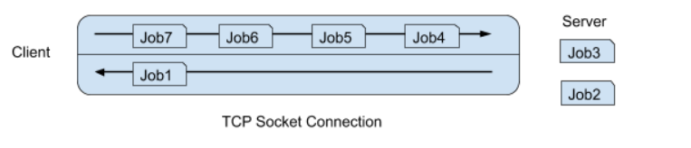

# Berkeley CS162 Summer 2019: Midterm 1: Official solutions

> Copied from the original: <https://hkn.eecs.berkeley.edu/exams/course/cs/162>. Text and figures are taken from the PDF as is; nothing was answered or rewritten. The original PDF is in this folder.

---

**Page 1**

&emsp;&emsp;&emsp;&emsp;&emsp;&emsp;&emsp;&emsp;University of California, Berkeley 
&emsp;&emsp;&emsp;&emsp;&emsp;&emsp;&emsp;&emsp;College of Engineering 
&emsp;&emsp;&emsp;&emsp;&emsp;&emsp;&emsp;&emsp;Computer Science Division: EECS 
Summer 2019   Jack Kolb 
&emsp;&emsp;&emsp;&emsp;&emsp;&emsp;&emsp;&emsp;Midterm I SOLUTIONS 
&emsp;&emsp;&emsp;&emsp;&emsp;&emsp;&emsp;&emsp;July 18th, 2019 
&emsp;&emsp;&emsp;&emsp;&emsp;&emsp;&emsp;CS162: Operating Systems and Systems Programming

&emsp;&emsp;&emsp;&emsp;Your Name: 
&emsp;&emsp;SID AND 162 Login 
&emsp;&emsp;(e.g. s042): 
&emsp;&emsp;TA Name: 
&emsp;&emsp;Discussion Section 
&emsp;&emsp;Time:

General Information: 
This is a **closed book** exam. You are allowed 1 page of handwritten notes (both sides). You have 
two (2) hours to complete as much of the exam as possible. Make sure to read all of the questions 
first, as some of the questions are substantially more time consuming. 
Write all of your answers directly on this paper. Make your answers as concise as possible. On 
programming questions, we will be looking for performance as well as correctness, so think through 
your answers carefully. If there is something about the questions that you believe is open to 
interpretation, please ask us about it!

&emsp;&emsp;&emsp;&emsp;&emsp;&emsp;&emsp;&emsp;**Problem**    **Possible**    **Score**

&emsp;&emsp;&emsp;&emsp;&emsp;&emsp;&emsp;&emsp;1    22

&emsp;&emsp;&emsp;&emsp;&emsp;&emsp;&emsp;&emsp;2    12

&emsp;&emsp;&emsp;&emsp;&emsp;&emsp;&emsp;&emsp;3    16

&emsp;&emsp;&emsp;&emsp;&emsp;&emsp;&emsp;&emsp;4    16

&emsp;&emsp;&emsp;&emsp;&emsp;&emsp;&emsp;&emsp;5    16

&emsp;&emsp;&emsp;&emsp;&emsp;&emsp;&emsp;&emsp;Total    82

&emsp;&emsp;&emsp;&emsp;&emsp;&emsp;&emsp;&emsp;Page 1/19

---

**Page 2**

CS 162 Summer 2019 Midterm   July 18th, 2019

### Problem 1: True/False \[22 pts\]

Please **explain** your answer in **two sentences or fewer** (Answers longer than this may not get 
credit!).  Also, answers without an explanation **get no credit**.

### **Problem 1a\[2pts\]:** The number of allocated kernel stacks is always equal to the number of allocated

userspace stacks. 
⬜ True  X False 
Explain: 
If a process is running a user-level threading library, then there can be more stacks in userspace (one per 
user-level thread) than in the kernel (just on kernel thread for the process). Additionally, there are kernel 
threads that perform tasks entirely within the operating system and do not require a userspace stack.

### **Problem 1b\[2pts\]:** When using a simple “Base and Bound” scheme to enforce memory protection, the

CPU only sees virtual memory addresses. 
⬜ True  X False 
Explain: 
This depends on how the Base and Bound scheme is implemented. If memory addresses are translated at run 
time (adding the Base value to each address referenced before it is passed on to the memory controller), then 
the CPU does only see virtual memory addresses. However, if instead a program’s instructions are relocated 
at load time, then the CPU still uses physical addresses directly.

### **Problem 1c\[2pts\]:** When fork returns a negative integer, an error has occurred that must be dealt with in

both the parent and child process. 
⬜ True  X False 
Explain: 
When fork returns a negative integer, an error has occurred, but no child process is actually created.

### **Problem 1d\[2pts\]:** Switching between two threads within the same process is generally more efficient

than switching between two threads belonging to different processes. 
X True⬜ False 
Explain: 
Switching between two threads always requires changing the execution context (registers, stack pointer, 
program counter, etc.). For two threads belonging to different processes, the OS must also change the current 
address space, which incurs an additional cost.

&emsp;&emsp;&emsp;&emsp;&emsp;&emsp;&emsp;&emsp;Page 2/19

---

**Page 3**

CS 162 Summer 2019 Midterm   July 18th, 2019

### **Problem 1e\[2pts\]:** The Linux Completely Fair Scheduler always gives a shorter time slice to lower

priority threads. 
⬜ True  X False 
Explain: 
Imagine we have three threads t1, t2, and t3 with weights 17, 2, and 1, with a latency target of 10ms and a 
minimum granularity of 1ms. 
&emsp;1\.   t1 gets a time slice of 17/(17+ 2 + 1) \* 10 = 8.5 ms. 
&emsp;2\.   t2 gets a time slice of 2/(17 + 2 + 1) \* 10 = 1 ms. 
&emsp;3.t3 gets a time slice of 1/(17 + 2 + 1) \* 10 = 0.5ms **except** now the minimum granularity takes effect, 
&emsp;&emsp;and t3’s time slice becomes 1ms.

### **Problem 1f\[2pts\]:** When using an atomic operation like test&set to implement a lock, we must apply

the test&set operation to check the lock’s state (either BUSY or FREE) within a “spin loop.” 
⬜ True  X False 
Explain: 
This implementation would force the waiting thread to spin wait while the lock owner is in the critical 
section. Instead, we can use a guard variable in the lock’s implementation, as demonstrated in lecture. We 
use test&set within a loop to check the value of guard rather than the lock’s state. This means one thread 
will spin wait while any other thread is in the middle of acquire or release, but sleep on a queue while 
the lock’s owner is inside the critical section.

### **Problem 1g\[2pts\]:** Locks can prevent a thread from being preempted.

⬜ True  X False 
Explain: 
Locks do not prevent a thread from being preempted. Threads can be interrupted during a critical section. 
Locks only guarantee that the critical section is only entered by one thread at a time.

### **Problem 1h\[2pts\]:** If the Banker’s algorithm blocks a request for a resource, then granting that request

would have caused the system to deadlock. 
⬜ True  X False 
Explain: 
When the Banker’s algorithm blocks a request, the system would have entered an unsafe state in which 
deadlock is possible, but not certain.

&emsp;&emsp;&emsp;&emsp;&emsp;&emsp;&emsp;&emsp;Page 3/19

---

**Page 4**

CS 162 Summer 2019 Midterm   July 18th, 2019

### **Problem 1i\[2pts\]:** Synchronization primitives in base Pintos are implemented with test&set.

⬜ True  X False 
Explain: 
The synchronization primitives in synch.c are implemented by disabling interrupts.

### **Problem 1j\[2pts\]:** According to the End-to-End Principle, reliable transport should be implemented by the

two communications endpoints, not the network infrastructure. 
X True⬜ False 
Explain: 
The End-to-End Principle states that many features should be implemented by end hosts on a computer 
network, rather than built in to the network infrastructure itself. Reliable transport is a good example of such 
a feature, and we saw how TCP achieves this in lecture.

### **Problem 1k\[2pts\]:** After a call to fork, stdin, stdout, and stderr are reset to their default states in

the child process. 
⬜ True  X False 
Explain: 
A newly-forked child process inherits the file descriptors of its parents, including the descriptors for stdin, 
stdout, and stderr.

&emsp;&emsp;&emsp;&emsp;&emsp;&emsp;&emsp;&emsp;Page 4/19

---

**Page 5**

CS 162 Summer 2019 Midterm   July 18th, 2019

### Problem 2: Short Answer \[12 pts\]

### **Problem 2a\[3pts\]:** What is the Interrupt Vector Table and what role does it play in protecting the kernel?

The Interrupt Vector Table is a mapping from interrupt type (expressed as a number) to the proper handler 
for that interrupt (typically expressed as an address in memory to jump to). This ensures that we start 
executing kernel code only at predefined entry points.

### **Problem 2b\[3pts\]:** Why are device drivers divided into a top half and bottom half? What is each half

responsible for? 
Device drivers execute on two separate occasions. First, the top half is invoked by the kernel’s IO subsystem 
to issue a request to hardware, say to read or write data on a hard drive. Second, the bottom half is invoked 
by an interrupt handler, after the hardware has fulfilled the original request. The bottom half does the work 
required to copy data off of the device and back into kernel memory (this is usually not something we want 
to do within the interrupt handler itself).

### **Problem 2c\[3pts\]:** In Pintos, how would we allow a struct thread to be an element of two lists at the

same time? 
We can allow this by adding a second struct list\_elem member to struct thread.

### **Problem 2d\[3pts\]:** Does First-Come First-Served or Round-Robin scheduling have lower overhead?

Explain. 
First-come first-served scheduling has lower overhead because it will require fewer context switches 
between threads. Because FCFS is non-preemptive, a context switch will only occur when one thread 
terminates and the scheduler needs to pick a new thread to run. Round-Robin scheduling is preemptive and 
will context switch between threads whenever the running thread’s quantum has expired.

&emsp;&emsp;&emsp;&emsp;&emsp;&emsp;&emsp;&emsp;Page 5/19

---

**Page 6**

CS 162 Summer 2019 Midterm   July 18th, 2019

### Problem 3: Processes and Syscalls \[16 pts\]

Assume that we have the following two pieces of code (with all header files included): 
**write\_and\_print.c, compiled to the binary file write\_and\_print** 
/\* Takes a file descriptor (int) and a buffer (string) as input and 
writes the buffer into the provided file descriptor. **ALSO prints** 
**out the buffer to stdout**. \*/ 
**main.c, compiled to the binary file main** 
int new\_fd = -1;

void signal\_handler(int sig) { 
dup2(new\_fd, STDOUT\_FILENO); 
}

int main() { 
int hello\_fd = open("greetings.txt", O\_WRONLY \| O\_CREAT \| O\_TRUNC); 
char \*child\_buf = "Child hello!"; 
char \*parent\_buf = "Parent howdy!"; 
/\* Assume char \*arguments\[\] is correctly formed with **./write\_and\_print** 
**hello\_fd**, and **child\_buf** as arguments \*/ 
new\_fd = dup(STDOUT\_FILENO); 
dup2(hello\_fd, STDOUT\_FILENO);

struct sigaction sa; 
sa.sa\_flags = 0; 
sa.sa\_handler = &signal\_handler; 
sigemptyset(&sa.sa\_mask); 
sigaction(SIGTERM, &sa, NULL);

pid\_t pid = fork(); 
if (pid == 0) { 
execv(arguments\[0\], arguments); 
kill(getppid(), SIGTERM); 
} else { 
kill(pid, SIGTERM); 
wait(NULL); 
dprintf(hello\_fd, "%s: %d\\n", parent\_buf, pid); 
printf("%s: %d\\n", parent\_buf, pid); 
}

return 0; 
}

&emsp;&emsp;&emsp;&emsp;&emsp;&emsp;&emsp;&emsp;Page 6/19

---

**Page 7**

CS 162 Summer 2019 Midterm   July 18th, 2019

List all possible outputs of the main program in each row of the table below (where one row corresponds to 
one run of the program). You may not need all the tables provided. Assume that all system calls succeed 
EXCEPT that execv() may possibly fail and assume that the child’s PID is 162.

Standard Output    greetings.txt 
Parent howdy!: 162    Parent howdy!: 162

Child hello!    Child hello! 
Parent howdy!: 162 
Parent howdy!: 162

Child hello! 
Child hello! 
Parent howdy!: 162 
&emsp;&emsp;&emsp;&emsp;&emsp;&emsp;&emsp;&emsp;Parent howdy!: 162

Case 1: After the parent process forks, the child process fails to execv, prompting the child process to send a 
SIGTERM signal to the parent process. The parent process invokes signal\_handler() upon returning, 
restoring file descriptor 1 to stdout. The parent process then prints “Parent howdy!: 162” to both 
stdout and greetings.txt. 
Case 2: After the parent process forks, it continues execution and sends a SIGTERM signal to the child 
process. The parent process calls wait, context switching back to the child process. Upon executing, the 
child process invokes signal\_handler() and restores file descriptor 1 to stdout. Thus, the child process 
prints “Child hello!” to both stdout and greetings.txt. When the parent process returns from 
&emsp;&emsp;&emsp;&emsp;&emsp;&emsp;&emsp;&emsp;Page 7/19

---

**Page 8**

CS 162 Summer 2019 Midterm   July 18th, 2019 
wait, it prints “Parent howdy!: 162” to greetings.txt twice because its file descriptor 1 never got 
restored to stdout. 
Case 3:After the parent process forks, the child process continues execution and writes “Child hello!” 
twice to greetings.txt. The child then exits, context switching back to the parent process. The parent 
process sends a SIGTERM signal to zombie child process, which has no effect because the child process is no 
longer running. The parent process calls wait, returning right away. The parent process then prints “Parent 
howdy!: 162” twice to greetings.txt. 
Common Mistakes: 
&emsp;●   Students would often mix the output of greetings.txt with the output of stdout. 
&emsp;●   Some students would print the parent process’s greeting before the child process’s greeting, but the 
&emsp;&emsp;wait call in the parent process prevents it from writing any output before the child process exits.

&emsp;&emsp;&emsp;&emsp;&emsp;&emsp;&emsp;&emsp;Page 8/19

---

**Page 9**

CS 162 Summer 2019 Midterm   July 18th, 2019

### Problem 4: DeadLockList \[16 pts\]

Thanos needs to collect all 6 Infinity Locks. He creates a new structure called a locklist to manage the 
locks he has acquired or still needs. Instead of just acquiring one lock, threads now have to acquire a series of 
locks to ‘lock’ the locklist structure. Think of this as needing a collection of resources before being able 
to perform your operations. For all questions, assume the locklist has already been initialized for you and 
that we cannot preempt locks.

#DEFINE NUM\_LOCKS 6 
struct locklist { 
&emsp;&emsp;lock my\_locks\[NUM\_LOCKS\]; 
&emsp;&emsp;int magic; 
};

### **Problem 4a\[2pts\]:** If all locks are released one after another with no other operations between them, does

the sequence they are released in matter with respect to deadlock? (Short Answer) 
No. There is no situation where unlocking locks can lead to deadlock. The thread has ownership over the 
locks already and is not waiting on a lock it does not own.

### **Problem 4b\[2pts\]:** Does the lock release order matter with respect to performance? Explain. (Short Ans.)

Yes. Context switching is highly inefficient. If we unlock the locks in the same order we acquire them, there 
is the possibility that a different thread (also trying to lock the locklist structure) starts to acquire some of the 
locks before all are free. It would then partially acquire the locks in the locklist, but it wouldn’t be able to 
finish. We would have to switch back to unlock the rest, which is very inefficient. If we unlocked it in 
reverse order of acquisition, no threads will be unblocked before.

&emsp;&emsp;&emsp;&emsp;&emsp;&emsp;&emsp;&emsp;Page 9/19

---

**Page 10**

CS 162 Summer 2019 Midterm   July 18th, 2019

Thanos is now trying to decide in what order to lock the Infinity Locks in the locklist. Which of the 
following definitions of lock\_locklist can cause deadlock? Explain your answer for each selection. If 
deadlock is possible, please provide an acquisition ordering in your explanation.

### **Problem 4c\[2pts\]:** Lock acquisition code:

void lock\_locklist(struct locklist \*list) { 
&emsp;&emsp;int start = 0; 
&emsp;&emsp;for (int i = start; i \< NUM\_LOCKS; i++) { 
&emsp;&emsp;&emsp;&emsp;&emsp;int index = i; 
&emsp;&emsp;&emsp;&emsp;&emsp;lock\_acquire (list-\>my\_locks + index); 
&emsp;&emsp;} 
} 
⬜ Can Cause Deadlock      X Cannot Cause Deadlock 
Explain: 
This cannot cause deadlock. The preference order for each thread is the same (acquiring lower indices first), 
so we will never cause deadlock.

### **Problem 4d\[2pts\]:** Lock acquisition code:

void lock\_locklist(struct locklist \*list) { 
&emsp;&emsp;int start = getpid() % NUM\_LOCKS; 
&emsp;&emsp;for (int i = start; i \< start + NUM\_LOCKS; i++) { 
&emsp;&emsp;&emsp;&emsp;&emsp;int index = i % NUM\_LOCKS; 
&emsp;&emsp;&emsp;&emsp;&emsp;lock\_acquire (list-\>my\_locks + index); 
&emsp;&emsp;} 
} 
X Can Cause Deadlock⬜ Cannot Cause Deadlock 
Explain: 
Example: thread 1 acquires lock 1, thread 2 acquires lock 2. Thread 1 blocks waiting for lock 2. Thread 2 
acquires locks 3-5, but blocks on acquiring lock 1. 
This can cause deadlock. The preference order for each thread is different, so we acquire locks in different 
orders and can end up with deadlock.

&emsp;&emsp;&emsp;&emsp;&emsp;&emsp;&emsp;&emsp;Page 10/19

---

**Page 11**

CS 162 Summer 2019 Midterm   July 18th, 2019

### **Problem 4e\[2pts\]:** Lock acquisition code:

void lock\_locklist(struct locklist \*list) { 
&emsp;&emsp;int start = NUM\_LOCKS - 1; 
&emsp;&emsp;for (int i = start; i \>= 0; i--) { 
&emsp;&emsp;&emsp;&emsp;&emsp;int index = i; 
&emsp;&emsp;&emsp;&emsp;&emsp;lock\_acquire (list-\>my\_locks + index); 
&emsp;&emsp;} 
} 
⬜ Can Cause Deadlock      X Cannot Cause Deadlock 
Explain: 
This cannot cause deadlock. The preference order for each thread is the same (acquiring higher indices first), 
so we will never cause deadlock.

### **Problem 4f\[2pts\]:** Lock acquisition code:

void lock\_locklist(struct locklist \*list) { 
&emsp;&emsp;int start = NUM\_LOCKS/2; 
&emsp;&emsp;for (int i = start; i \< start + NUM\_LOCKS; i++) { 
&emsp;&emsp;&emsp;&emsp;&emsp;int index = i % NUM\_LOCKS; 
&emsp;&emsp;&emsp;&emsp;&emsp;lock\_acquire (list-\>my\_locks + index); 
&emsp;&emsp;} 
} 
⬜ Can Cause Deadlock      X Cannot Cause Deadlock 
Explain: 
This cannot cause deadlock. The preference order for each thread is the same (starting from the middle 
indices first), so we will never cause deadlock.

&emsp;&emsp;&emsp;&emsp;&emsp;&emsp;&emsp;&emsp;Page 11/19

---

**Page 12**

CS 162 Summer 2019 Midterm   July 18th, 2019 
Thinking about how much work it will take to lock the locklist structure, Thanos doesn’t always want to 
go through the trouble of acquiring all the Infinity Locks. He decides to create the following function to 
access the structure faster, acquiring just one lock and later releasing it. **Assume all other threads execute** 
**the code from problem 4c when using the locklist.** 
void snap(struct locklist \*list) { 
&emsp;&emsp;lock\_acquire (list-\>my\_locks + OFFSET); 
}

### **Problem 4g\[2pts\]:**  If OFFSET = 0, can snap cause deadlock to happen? If so, provide an example

execution order that leads to deadlock. If not, explain why deadlock is not possible. (Short Answer) 
Deadlock is not possible. Since snap is only acquiring one lock, its order of preference will always be 
consistent with the other threads. This means having this function will not cause deadlock.

### **Problem 4h\[2pts\]:** If OFFSET = NUM\_LOCKS - 1, can snap cause deadlock to happen? If so, provide

an example execution order that leads to deadlock. If not, explain why deadlock is not possible. (Short 
Answer) 
Same as the previous answer.

&emsp;&emsp;&emsp;&emsp;&emsp;&emsp;&emsp;&emsp;Page 12/19

---

**Page 13**

CS 162 Summer 2019 Midterm   July 18th, 2019

### Problem 5: Just One TCP Connection \[16 pts\]

Bob is trying to build a system which helps people process jobs. After learning about how sockets work in 
CS162, he wants to write a server program which listens on port 162 and takes jobs from clients. Each job is 
represented by the following data structure:

struct Job { 
int job\_number; 
char job\_details\[200\]; 
int result; 
};

However, Bob thinks that having clients make a new connection for each job they want the server to process 
seems to be an inefficient design because it consumes resources unnecessarily.

For 5a and 5b, full points are awarded to answers which have demonstrated not only correct conceptual 
understandings but also clarity in the expression. Students need to both identify the resource constraints and 
then elaborate on why establishing new connections will consume that scarce resource.

### **Problem 5a\[2pts\]:** Briefly explain why establishing new connections consumes additional resources in

userspace. 
Acceptable answers include: More memory needed to manage the connection (e.g., int for the file 
descriptor), more userspace buffers to store contents sent to or received from each connection, and 
potentially more threads to work with connections concurrently, which consumes memory.

Common Mistakes: 
&emsp;1\.   Not clear about the scarce resource. e.g. Memory, CPU time, bandwidth, disk, ... 
&emsp;2\.   We do not consider the time taken to process a new user connection as a resource. You have to point 
&emsp;&emsp;out clearly that the CPU time is the scarce resource here 
&emsp;3.When talking about buffer, answers need to highlight that they are referring to userspace buffer 
&emsp;4\.   TCP state management (e.g. ACK, retries, seq number …) is in the kernel space 
&emsp;5\.   “because we need to establish sockets” is too vague

### **Problem 5b\[2pts\]:** Briefly explain why establishing new connections consumes additional resources in the

OS kernel. 
Acceptable answers include: More elements in the process’s file descriptor table, more elements in the 
OS-wide file description table, and more kernel buffers to store data sent to or received from the network 
interface card.

Common Mistakes: 
&emsp;1\.   Unclear about the scarce resource. e.g. Memory, CPU time, bandwidth, disk, ... 
&emsp;2\.   Discussions of an “inode table” are not relevant, as this is a network socket. 
&emsp;3\.   Statements like “the OS needs to do more work” do not specify a scarce resource 
&emsp;4\.   Some answers mentioned additional interrupts but did not specify where they would come from

&emsp;&emsp;&emsp;&emsp;&emsp;&emsp;&emsp;&emsp;Page 13/19

---

**Page 14**

CS 162 Summer 2019 Midterm   July 18th, 2019

Bob comes up with a scheme where the server just needs to maintain, for each client, a single connection 
through which multiple jobs can be sent and through which processed jobs can be sent back. More 
specifically, each connection is managed by one thread and whenever a new job is received, a new thread is 
created to do the work in parallel and then send back the results via the same connection. 
Graphically, it looks like this:

### **Problem 5c\[2pts\]:** Bob approaches you for help with implementing his design. He’s done most of the

coding but left out some critical functions. You are required to fill in the missing lines below. Note that you 
might not need all the lines provided.

Assumptions: 
&emsp;1\.   When you call ssize\_t read(int fd, void \*buf, size\_t count), it always reads count 
&emsp;&emsp;bytes if there is data available. Otherwise, the call blocks. 
&emsp;2\.   When you call ssize\_t write(int fd, const void \*buf, size\_t count), it always 
&emsp;&emsp;writes count bytes successfully. You do not have to handle the case when read fails because of 
&emsp;&emsp;client disconnection.

&emsp;**1. struct Job {** 
&emsp;**2.   int job\_number;** 
&emsp;**3.   char job\_details\[200\];** 
&emsp;**4.   int result;** 
&emsp;**5. };** 
&emsp;**6.** 
&emsp;**7. struct Arg\_struct{** 
&emsp;**8.  Job \*job;** 
&emsp;**9.  int socket\_fd;** 
&emsp;**10. }** 
&emsp;**11.** 
&emsp;**12. void do\_work (struct Job \*job) {** 
&emsp;**13.  /\* This function does the work and set the result back into job \*/** 
&emsp;**14.  /\* This function is compute-intensive \*/** 
&emsp;**15. }** 
&emsp;**16.** 
&emsp;**17. void \*new\_conn(void \*arg) {** 
&emsp;**18.  /\* Handles a new client connection \*/** 
&emsp;**19.  struct  Job         \*new\_job;** 
&emsp;**20.  struct  Arg\_struct  \*new\_args;** 
&emsp;**21.  ssize\_t bytes\_read;** 
&emsp;**22.** 
&emsp;**23.  int**   **con\_sockfd = (int) arg;** 
&emsp;**24.  while (1) {** 
&emsp;&emsp;&emsp;&emsp;&emsp;&emsp;&emsp;&emsp;Page 14/19

---

**Page 15**

CS 162 Summer 2019 Midterm   July 18th, 2019

&emsp;**25.** 
&emsp;**26.    new\_job = malloc(sizeof(struct Job));** 
&emsp;**27.** 
&emsp;**28.    bytes\_read = read(con\_sockfd, new\_job, sizeof(struct Job));** 
&emsp;**29.** 
&emsp;**30.    new\_args = malloc(sizeof(struct Arg\_struct));** 
&emsp;**31.** 
&emsp;**32.    new\_args-\>job = new\_job;** 
&emsp;**33.    new\_args-\>socket\_fd = con\_sockfd;** 
&emsp;**34.    pthread\_create(&thread, NULL, process\_job, (void\*) new\_args);** 
&emsp;**35.  }** 
&emsp;**36. }** 
&emsp;**37. void \*process\_job(void \*arg) {** 
&emsp;**38.  struct Arg\_struct \*new\_args = (struct Arg\_struct\*) arg;** 
&emsp;**39.** 
&emsp;**40.  /\* Do the work by calling do\_work() and send back response \*/** 
&emsp;**41.** 
&emsp;**42.**  **do\_work(new\_args-\>job);** 
&emsp;**43.** 
&emsp;**44.**  **write(new\_args-\>socket\_fd, new\_args-\>job, sizeof(struct Job));** 
&emsp;**45.** 
&emsp;**46.** 
&emsp;**47.** 
&emsp;**48.** 
&emsp;**49.  /\* Free resources \*/** 
&emsp;**50.** 
&emsp;**51.**  **free(new\_args-\>job);** 
&emsp;**52.** 
&emsp;**53.**  **free(new\_args);** 
&emsp;**54.** 
&emsp;**55. }** 
&emsp;**56.** 
&emsp;**57. /\* Code Segment in main() \*/** 
&emsp;**58. /\* Assume bind() and listen() have been called \*/** 
&emsp;**59.** 
&emsp;**60. while (1) {** 
&emsp;**61.  /\* When a new client connects \*/** 
&emsp;**62.** 
&emsp;**63.  con\_sockfd = accept(lstn\_sockfd, NULL, NULL);** 
&emsp;**64.  pthread\_create(&thread, NULL, new\_conn, (void\*) con\_sockfd);** 
&emsp;**65. }** 
&emsp;**66.** 
&emsp;**67. close(lstn\_sockfd);**

Common Mistakes: 
&emsp;1.For sizeof, the argument must be struct Job, not just Job. 
&emsp;2.Many answers did not read/write the whole struct. For example, job\_number is an important 
&emsp;&emsp;field to return to the client as well. Since the client is submitting jobs asynchronously, the client 
&emsp;&emsp;needs to generate a client-side id to keep track of the new jobs sent and completed jobs received. The 
&emsp;&emsp;idea of client-side ids is important in RPC calls. 
&emsp;3\.   Students should read clearly what each function reads and returns.

&emsp;&emsp;&emsp;&emsp;&emsp;&emsp;&emsp;&emsp;Page 15/19

---

**Page 16**

CS 162 Summer 2019 Midterm   July 18th, 2019

After you are done writing the program, you realize that it doesn’t work. Clients are receiving gibberish 
when they try to read each struct that is sent back. You show it to master systems programmer Jeff Dean, 
who sees two problems in the code that cause the program to fail. 
Firstly, the assumptions that read and write will always return count bytes do not hold. In fact, these sys 
calls often read/write fewer than count bytes before returning.

### **Problem 5d\[2pts\]:** Provide a reason why a write system call might write fewer than count bytes.

The write system call may be interrupted while in progress by a signal, in which case some of the requested 
bytes will not be written. 
Common Mistakes: 
&emsp;1.\\x00 does not stop the write call from continuing. 
&emsp;2.If the user buffer passed in as the argument for write is shorter than count, this could lead to 
&emsp;&emsp;access of an invalid portion of memory and cause the program to crash.

### **Problem 5e\[2pts\]:** To solve this problem, Bob proposes writing a new function with the signature:

&emsp;&emsp;&emsp;&emsp;&emsp;write\_bob(int fd, const void\* buf, size\_t count) 
write\_bob makes use of write syscall in its implementation and makes sure that it always writes count 
bytes before returns. Provide an implementation for write\_bob**:** 
Hint: If write returns 3, then 3 bytes are already written. You don't have to write them again.

void write\_bob(int fd, const void \*buf, size\_t count) { 
char \*buffer = (char\*) buf; 
/\* Your code below \*/ 
while (bytes\_written \< count){ 
bytes\_written += write(fd, buffer + bytes\_written, count – bytes\_written) 
} 
Common Mistakes: 
&emsp;1\.   Arithmetic on a void pointer is invalid. Therefore, buffer, instead of buf, should be used. To 
&emsp;&emsp;make things simpler, we cast the pointer for you on the first line as a hint. 
&emsp;2\.   Making the write call twice doesn’t guarantee successful writing of the full buffer. Even repeating 
&emsp;&emsp;write ten times may not work. 
&emsp;3\.   Do not write again whatever is already written. 
&emsp;4\.   This function returns void, so there is no need to return an integer. 
&emsp;5\.   fflush and fsync are not relevant in this context. 
Your temporary variable should use ssize\_t instead of int. Otherwise there could be a buffer overflow 
vulnerability.  However, we did not deduct points for this.

&emsp;&emsp;&emsp;&emsp;&emsp;&emsp;&emsp;&emsp;Page 16/19

---

**Page 17**

CS 162 Summer 2019 Midterm   July 18th, 2019

### **Problem 5f\[3pts\]:** Jeff Dean points out a new problem with the code, because the threads share the same

connection socket. Bob proposes solving this problem with a mutex lock. List between which of the lines 
above you need to add lock\_acquire() and lock\_release() with a global mutex to solve Jeff’s 
problem. For instance, if you needed a lock\_acquire() between lines 1 and 2, you would write (1, 2) 
under lock\_acquire() below. You may not need all six spaces. 
lock\_acquire() 
(\_\_\_\_\_43\_\_\_\_\_, \_\_\_\_\_44\_\_\_\_\_)                (\_\_\_\_\_\_\_\_\_\_, \_\_\_\_\_\_\_\_\_\_)                (\_\_\_\_\_\_\_\_\_\_, \_\_\_\_\_\_\_\_\_\_) 
lock\_release() 
(\_\_\_\_\_44\_\_\_\_\_, \_\_\_\_\_45\_\_\_\_\_)                (\_\_\_\_\_\_\_\_\_\_, \_\_\_\_\_\_\_\_\_\_)                (\_\_\_\_\_\_\_\_\_\_, \_\_\_\_\_\_\_\_\_\_) 
You must acquire a lock before the call to  write and release it after the write. 
We took away one point if any unnecessary locks were added. Locking around read is unnecessary since 
only a single thread is reading from that connection. This, however, is not true for write.

### **Problem 5g\[3pts\]:** Bob successfully builds the server above, but his computer is slow, and can only handle

up to 5 jobs being processed concurrently per connection. Jeff proposes a solution where a semaphore would 
block new jobs from being processed if 5 other jobs are already being processed, and only allow new jobs to 
start once an existing job is finished. Assume each thread has a semaphore initialized to 5 and that the line 
numbers are as originally (ignore the lock operations above). List between which lines you need to add 
sema\_up() and sema\_down() to allow only  up to 5 jobs to be concurrently processed per connection. 
sema\_down() 
(\_\_\_\_\_41\_\_\_\_\_, \_\_\_\_42\_\_\_\_\_\_)                (\_\_\_\_\_\_\_\_\_\_, \_\_\_\_\_\_\_\_\_\_)                (\_\_\_\_\_\_\_\_\_\_, \_\_\_\_\_\_\_\_\_\_) 
sema\_up() 
(\_\_\_\_\_42\_\_\_\_\_, \_\_\_\_\_43\_\_\_\_\_)                (\_\_\_\_\_\_\_\_\_\_, \_\_\_\_\_\_\_\_\_\_)                (\_\_\_\_\_\_\_\_\_\_, \_\_\_\_\_\_\_\_\_\_) 
Call sema\_up before do\_work and call sema\_down after do\_work. 
We took away one point if any unnecessary semaphores were added.  If the unnecessary semaphores have 
the potential to cause deadlock, the answer was not given any points.

&emsp;&emsp;&emsp;&emsp;&emsp;&emsp;&emsp;&emsp;Page 17/19

---

**Page 18**

CS 162 Summer 2019 Midterm   July 18th, 2019 
&emsp;&emsp;&emsp;&emsp;&emsp;&emsp;&emsp;\[Scratch Page: Do not put answers here!\]

&emsp;&emsp;&emsp;&emsp;&emsp;&emsp;&emsp;&emsp;Page 18/19

---

**Page 19**

CS 162 Summer 2019 Midterm   July 18th, 2019 
&emsp;&emsp;&emsp;&emsp;&emsp;&emsp;&emsp;\[Scratch Page: Do not put answers here!\]

&emsp;&emsp;&emsp;&emsp;&emsp;&emsp;&emsp;&emsp;Page 19/19

