# GeeksforGeeks: Operating systems interview questions

> Copied from <https://www.geeksforgeeks.org/operating-systems/operating-systems-interview-questions/>. Questions and answers are the source's own; nothing was answered or rewritten here. Each answer is written right under its question, as on the site.

Operating Systems manage processes, memory, files, input/output devices, and multitasking. These concepts are frequently asked in technical interviews because they explain how a computer runs programs efficiently and safely.

- An operating system acts as an interface between users, applications, and hardware.
- It improves resource utilisation, process management, memory handling, and system performance.
- Examples: Windows, Linux, macOS, Android, and Unix.

### 1. What is a Process and Process Table?

A process is an instance of a program that is currently being executed. It includes the program code, data, and the resources required for execution. The [operating system](https://www.geeksforgeeks.org/operating-systems/introduction-of-operating-system-set-1/) manages all active processes and keeps track of them using a process table, which stores information about each process.

- A process is a program in execution.
- The operating system allocates CPU time, memory, and other resources to each process.
- The process table stores details such as the Process ID (PID), process state, and allocated resources.

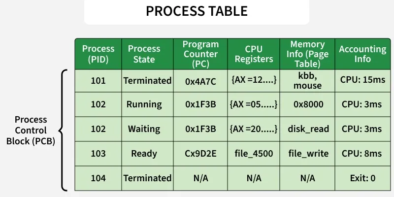

Process Table

### 2. What are the Different States of a Process?

A process passes through different states during its execution, depending on whether it is waiting for the CPU, executing, or waiting for an event. These states help the operating system schedule and manage processes efficiently.

- **Ready:** The process is waiting for CPU allocation.
- **Running:** The process is currently executing on the CPU.
- **Waiting (Blocked):** The process is waiting for an event, such as I/O completion or user input.

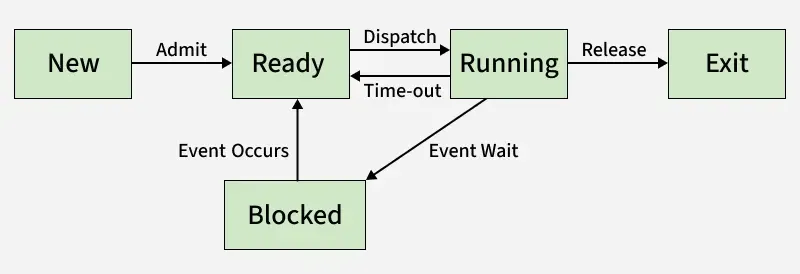

Different states of a process

### 3. What is a Thread?

A [thread](https://www.geeksforgeeks.org/operating-systems/thread-in-operating-system/) is the smallest unit of execution within a process. Multiple threads can exist in the same process, sharing resources such as memory while executing different tasks independently. Threads improve application performance by enabling concurrent execution.

- A thread is the smallest unit of CPU execution.
- Threads within the same process share memory and other resources.
- Threads improve performance by allowing multiple tasks to run concurrently.

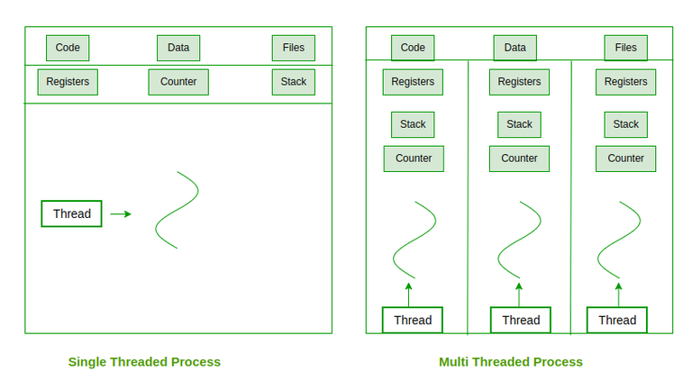

Threads

### 4. What are the differences between process and thread?

**Process**

- A process is an independent program under execution managed by the operating system.
- A process has its own address space, including code, data, stack, and heap.
- Processes communicate using Inter-Process Communication (IPC) methods, which are generally slower.
- Context switching is heavy because the complete process state must be saved and restored.

**Thread**

- A thread is the smallest unit of CPU scheduling that runs within a process.
- A thread shares code, data, and heap with other threads of the same process, but has its own stack and registers.
- Threads communicate through shared memory, so communication is faster.
- Context switching is lightweight because only thread-specific information is switched.

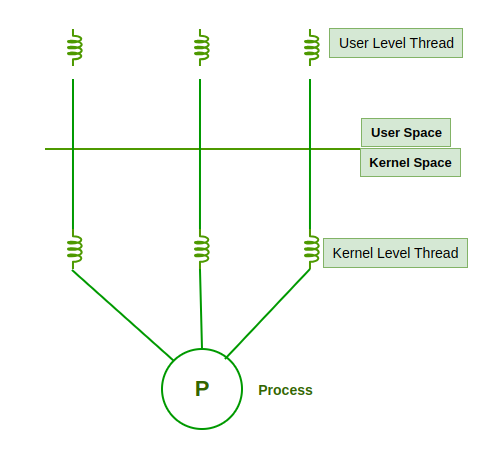

### 5. What are the Benefits of Multithreaded Programming?

[Multithreaded programming](https://www.geeksforgeeks.org/operating-systems/multithreading-in-operating-system/) allows multiple threads within the same process to execute concurrently. It improves application performance by making better use of CPU resources and allowing multiple tasks to run at the same time.

- Improves system responsiveness.
- Enables resource sharing among threads.
- Increases CPU utilization and overall performance.

### 6. What is Thrashing?

[Thrashing](https://www.geeksforgeeks.org/operating-systems/techniques-to-handle-thrashing/) is a condition in which the operating system spends more time handling page faults than executing processes. It usually occurs when there is insufficient physical memory, causing excessive swapping of pages between RAM and disk, which significantly degrades system performance.

- Caused by a high page fault rate.
- Results in excessive paging between memory and disk.
- Leads to poor system performance.

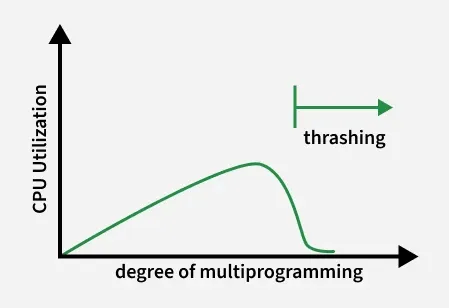

Curve of thrashing

### 7. What is a Buffer?

A [buffer](https://www.geeksforgeeks.org/operating-systems/buffering-in-os/) is a temporary storage area in memory that holds data while it is being transferred between two devices or between a device and an application. It helps manage differences in data transfer speeds and ensures smooth communication.

- Temporarily stores data during transfer.
- Handles speed differences between devices.
- Improves the efficiency of input/output operations.

### 8. What is Virtual Memory?

[Virtual memory](https://www.geeksforgeeks.org/operating-systems/virtual-memory-in-operating-system/) is a memory management technique that allows the operating system to use a portion of secondary storage (disk) as an extension of [RAM](https://www.geeksforgeeks.org/computer-science-fundamentals/random-access-memory-ram/). It gives each process the illusion of having a large, continuous memory space, even when physical memory is limited.

- Extends RAM using disk space.
- Allows larger programs to run than the available physical memory.
- Improves memory utilization by loading only the required pages into RAM.

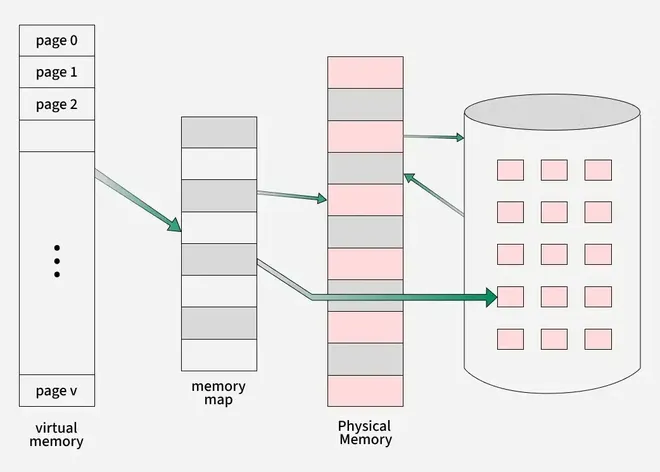

Virtual Memory

### 9. Explain the main purpose of an Operating System.

An [operating system (OS)](https://www.geeksforgeeks.org/operating-systems/operating-systems/) is system software that acts as an interface between the user and the computer hardware. It manages hardware resources, executes programs, and provides a convenient and efficient environment for users and applications.

- Manages hardware resources such as CPU, memory, and I/O devices.
- Provides an interface between users, applications, and hardware.
- Ensures efficient execution of programs and overall system operation.

### 10. What is demand paging and how it works?

The [process](https://www.geeksforgeeks.org/operating-systems/process-in-operating-system/) of loading the page into memory on demand (whenever a page fault occurs) is known as [demand paging](https://www.geeksforgeeks.org/operating-systems/what-is-demand-paging-in-operating-system/).

Working of Demand paging:

- Process: Only the required memory pages of a process are loaded into RAM when needed, not the entire process.
- Page Table: Keeps track of which pages are in memory and which are on disk.
- Page Fault: Occurs when a referenced page is not in RAM, the OS loads it from secondary storage.
- Loading: The missing page is brought into an empty frame in memory, and the page table is updated.
- Execution Resumes: After the page is loaded, the process continues execution from where it was interrupted.

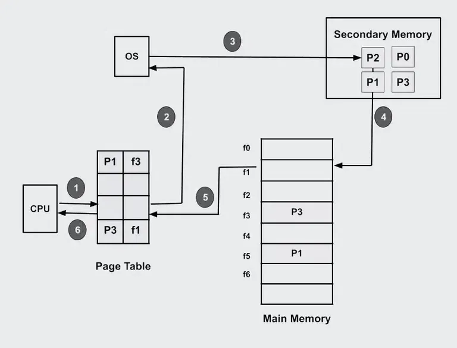

Working structure of demand paging

### 11. What is a Kernel?

A [**kernel**](https://www.geeksforgeeks.org/operating-systems/kernel-in-operating-system/) is the core component of an operating system that manages communication between software and hardware. It controls system resources such as the CPU, memory, and input/output devices, ensuring that programs run efficiently and securely.

- Manages CPU, memory, and I/O devices.
- Acts as a bridge between applications and hardware.
- Provides essential services through system calls and process management.

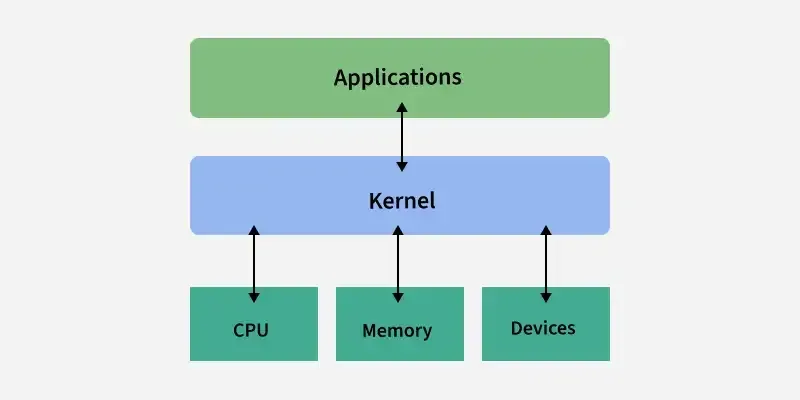

Kernal

### 12. What are the different scheduling algorithms?

1. [First-Come, First-Served (FCFS) Scheduling](https://www.geeksforgeeks.org/dsa/first-come-first-serve-cpu-scheduling-non-preemptive/): Processes are executed in the order in which they arrive.
2. [Shortest-Job-Next (SJN) Scheduling](https://www.geeksforgeeks.org/operating-systems/shortest-job-next-sjn-in-operating-system/): The process with the shortest CPU burst is executed first.
3. [Priority Scheduling](https://www.geeksforgeeks.org/operating-systems/priority-scheduling-in-operating-system/): The process with the highest priority is selected for execution.
4. [Shortest Remaining Time](https://www.geeksforgeeks.org/dsa/shortest-remaining-time-first-preemptive-sjf-scheduling-algorithm/): The process with the least remaining execution time is chosen next.
5. [Round Robin(RR) Scheduling](https://www.geeksforgeeks.org/dsa/round-robin-scheduling-with-different-arrival-times/): Each process gets a fixed time quantum in a cyclic order.
6. [Multiple-Level Queues Scheduling](https://www.geeksforgeeks.org/operating-systems/multilevel-queue-mlq-cpu-scheduling/): Processes are divided into different queues, each with its own scheduling policy.

### 13. Describe the objective of Multiprogramming.

The main objective of [multiprogramming](https://www.geeksforgeeks.org/operating-systems/multiprogramming-in-operating-system/) is to maximize CPU utilization by keeping multiple programs in main memory at the same time. When one process is waiting for an I/O operation, the CPU is allocated to another process, reducing idle time and improving system efficiency.

- Maximizes CPU utilization.
- Keeps multiple programs in main memory simultaneously.
- Reduces CPU idle time by executing another process during I/O waits.

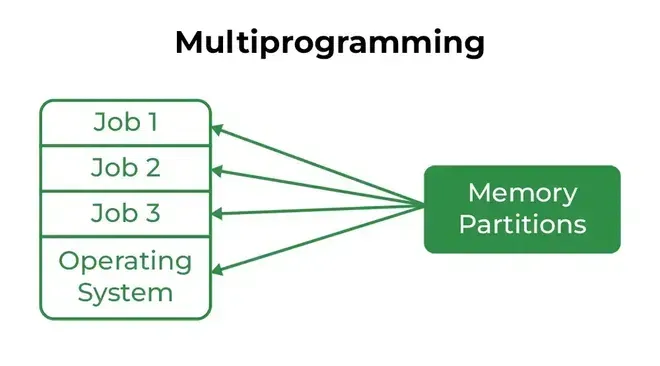

Multiprogramming

### 14. What is a Time-Sharing System?

A [time-sharing system](https://www.geeksforgeeks.org/operating-systems/time-sharing-operating-system/) is an operating system that allows multiple users or processes to share the CPU by allocating a small time slice (time quantum) to each process. Rapid switching between processes enables users to interact with their programs as if each has its own dedicated CPU.

- Allows multiple users to use the system simultaneously.
- Allocates CPU time in small time slices to each process.
- Provides fast response time and interactive computing.

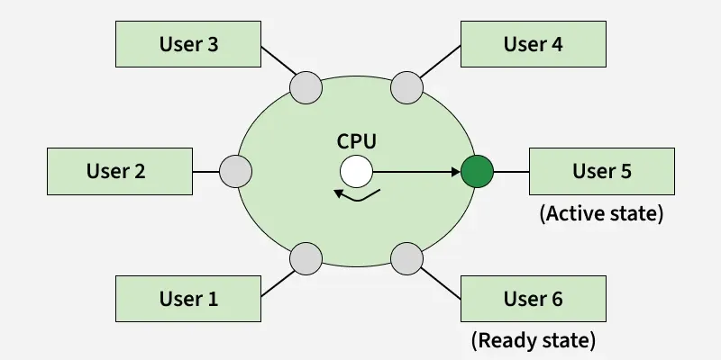

Time sharing

### 15. How do message-passing and shared-memory IPC differ?

**Message passing**

- Uses pipes, sockets, message queues
- OS involved in every communication
- Safer and easier to program
- Slower due to kernel overhead

**Shared memory**

- Processes access the same memory region
- Very fast communication
- Requires synchronization (mutex, semaphore)
- Best for large data sharing

### 16.  What problem we face in computer system without OS?

- Poor resource management
- Lack of User Interface
- No File System
- No Networking
- Error handling

### 17. Briefly explain FCFS.

[**FCFS (First Come, First Served**](https://www.geeksforgeeks.org/dsa/first-come-first-serve-cpu-scheduling-non-preemptive/)**)** is a non-preemptive CPU scheduling algorithm in which the process that arrives first in the ready queue is executed first. Once a process gets the CPU, it continues executing until it finishes or enters the waiting state.

- Processes are executed in the order of their arrival.
- It is a non-preemptive scheduling algorithm.
- Simple to implement but may cause long waiting times for shorter processes.

### 18. What is the RR scheduling algorithm?

A [round-robin scheduling algorithm](https://www.geeksforgeeks.org/operating-systems/round-robin-scheduling-in-operating-system/) is used to schedule the process fairly for each job in a time slot or quantum and interrupting the job if it is not completed by then the job comes after the other job which is arrived in the quantum time makes these scheduling fairly.

- Round-robin is cyclic in nature, so starvation doesn't occur
- Round-robin is a variant of first-come, first-served scheduling
- No priority or special importance is given to any process or task
- RR scheduling is also known as Time slicing scheduling

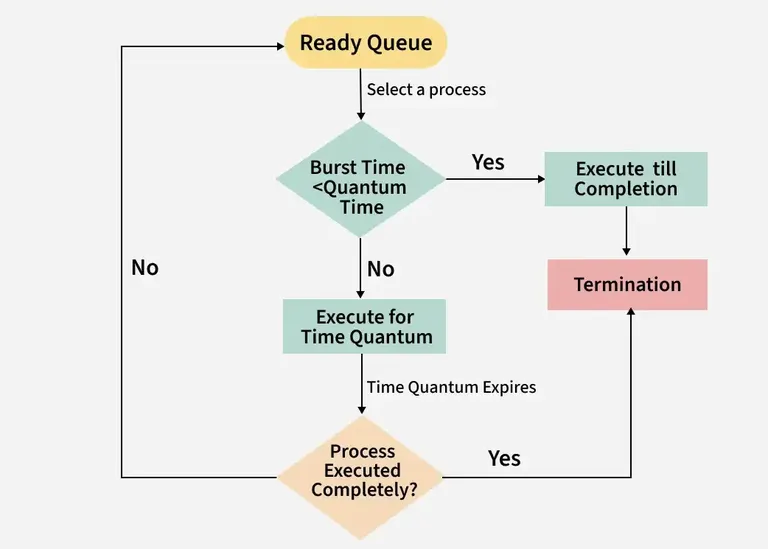

### 19. Enumerate the different RAID levels?

A redundant array of independent disks is a set of several physical disk drives that the operating system sees as a single logical unit. It played a significant role in narrowing the gap between increasingly fast processors and slow disk drives. RAID has different levels:

- **RAID 0:** Data striping for improved performance; no fault tolerance.
- **RAID 1:** Disk mirroring for high data reliability.
- **RAID 2:** Bit-level striping with Hamming code for error correction.
- **RAID 3:** Byte-level striping with a dedicated parity disk.
- **RAID 4:** Block-level striping with a dedicated parity disk.
- **RAID 5:** Block-level striping with distributed parity.
- **RAID 6:** Similar to RAID 5 but uses double distributed parity for higher fault tolerance.

### 20. What is Banker's Algorithm?

[Banker's Algorithm](https://www.geeksforgeeks.org/operating-systems/bankers-algorithm-in-operating-system-2/) is a deadlock avoidance algorithm used by the operating system to allocate resources safely. Before granting a resource request, it checks whether the allocation will leave the system in a safe state, ensuring that all processes can complete without causing a deadlock.

- Used for resource allocation and deadlock avoidance.
- Grants resources only if the system remains in a safe state.
- Prevents deadlocks by checking the maximum resource requirements before allocation.

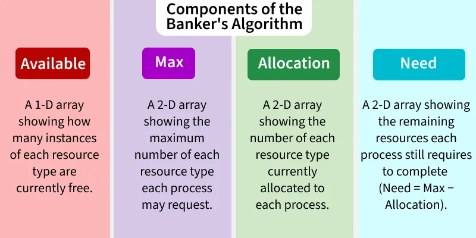

### 21. State the main difference between logical and physical address space?

**Logical Address**

- A logical address is generated by the CPU.
- Logical address space is the set of all logical addresses generated by the CPU for a program.
- Users can see and use logical addresses while running a program.
- The logical address is used to access memory, and it is later translated into a physical address.

**Physical Address**

- A physical address is the actual address in main memory (RAM).
- Physical address space is the set of all actual memory locations corresponding to logical addresses.
- Users generally cannot directly see or access physical addresses.
- The physical address is computed by the Memory Management Unit (MMU) from the logical address.

### 22. How does Dynamic Loading Aid in better memory space utilization?

Dynamic loading is a [memory management technique](https://www.geeksforgeeks.org/operating-systems/memory-management-in-operating-system/) in which a program module is loaded into memory only when it is required during execution. Since unused routines remain on disk until they are needed, it reduces memory usage and allows more programs to reside in memory.

- Loads routines only when they are called.
- Saves memory by avoiding the loading of unused code.
- Improves overall memory utilization.

### 23. What are Overlays?

[Overlays](https://www.geeksforgeeks.org/operating-systems/overlays-in-memory-management/) are a technique used to execute programs that are larger than the available main memory. Instead of loading the entire program, only the required part is loaded into memory. When that part finishes execution, it is replaced by another required part.

Key Points:

- Only the required program module is loaded into memory.
- One module replaces another during execution.
- Enables large programs to run with limited memory.

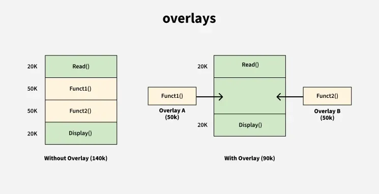

### 24. What is Fragmentation?

[Fragmentation](https://www.geeksforgeeks.org/operating-systems/what-is-fragmentation-in-operating-system/) is a condition in which memory becomes divided into small, scattered free blocks after repeated allocation and deallocation of memory. These small blocks may be insufficient to satisfy new memory requests, resulting in inefficient memory utilization.

**Types of Fragmentation:**

- Internal Fragmentation: Wasted space inside an allocated memory block.
- External Fragmentation: Free memory is scattered into small non-contiguous blocks.

Reduces the efficiency of memory allocation.

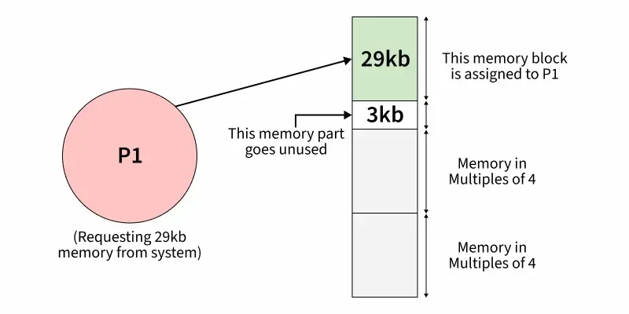

Internal fragmentation

### 25. What is the basic function of Paging?

[Paging](https://www.geeksforgeeks.org/operating-systems/paging-in-operating-system/) is a memory management technique that divides virtual memory into fixed-size pages and physical memory into fixed-size frames. The operating system loads the pages of a process into any available frames, allowing efficient memory allocation without requiring contiguous memory.

- Eliminates the need for contiguous memory allocation.
- Divides memory into fixed-size pages and frames.
- Improves memory utilization and supports virtual memory.

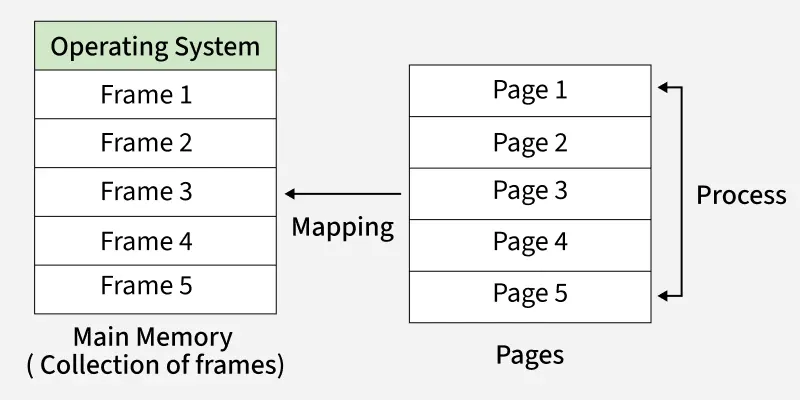

### 26. How does Swapping result in better memory management?

[Swapping](https://www.geeksforgeeks.org/operating-systems/swapping-in-operating-system/) is a memory management technique in which the operating system temporarily moves inactive or blocked processes from main memory (RAM) to secondary storage (disk) and brings them back when they are ready to execute. This frees up RAM for other processes, allowing the system to run more programs efficiently.

Benefits of Swapping:

- Frees main memory by moving inactive processes to disk.
- Increases CPU utilization by keeping more processes available.
- Allows more processes to run than can fit in physical memory.

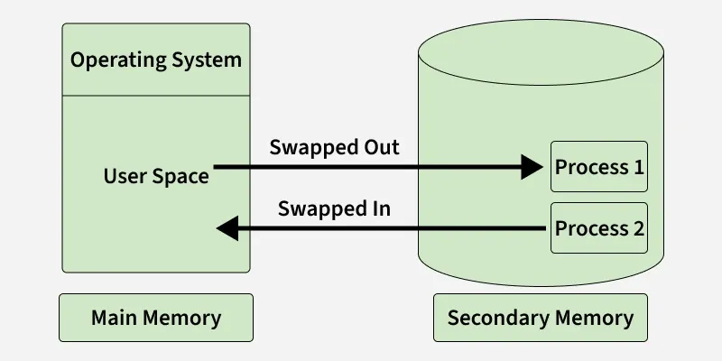

Swapping

### 27. Name the Classic Synchronization Problems.

The following are the classic synchronization problems used to illustrate process synchronization concepts in operating systems:

- **Bounded-Buffer (Producer–Consumer) Problem:** Ensures producers and consumers access a shared buffer without conflicts.
- **Readers–Writers Problem:** Manages access to shared data, allowing multiple readers or one writer at a time.
- **Dining Philosophers Problem:** Demonstrates resource allocation and deadlock when multiple processes compete for shared resources.
- **Sleeping Barber Problem:** Models process synchronization between a service provider and multiple waiting customers.

### 28. What is the Direct Access Method?

The [Direct Access Method](https://www.geeksforgeeks.org/operating-systems/file-access-methods-in-operating-system/) is a file access technique that allows data to be read or written directly at any location without accessing previous records. It is commonly used with disk storage for fast and efficient data retrieval.

- Allows direct access to any block or record.
- Does not require sequential reading.
- Suitable for large files and databases.

### 29. What is the Best Page Size when designing an Operating System?

There is no single best page size for all operating systems. The ideal page size depends on factors such as memory usage, page table size, and system performance. Operating systems choose a page size that provides the best balance between memory efficiency and performance.

### 30. What is Multitasking?

[Multitasking](https://www.geeksforgeeks.org/operating-systems/multitasking-operating-system/) is an operating system capability that allows multiple programs or tasks to run concurrently by sharing CPU time. The operating system rapidly switches the CPU between tasks, giving the impression that they are running simultaneously.

- Allows multiple tasks to execute concurrently.
- Shares CPU time among different processes.
- Improves system responsiveness and CPU utilization.

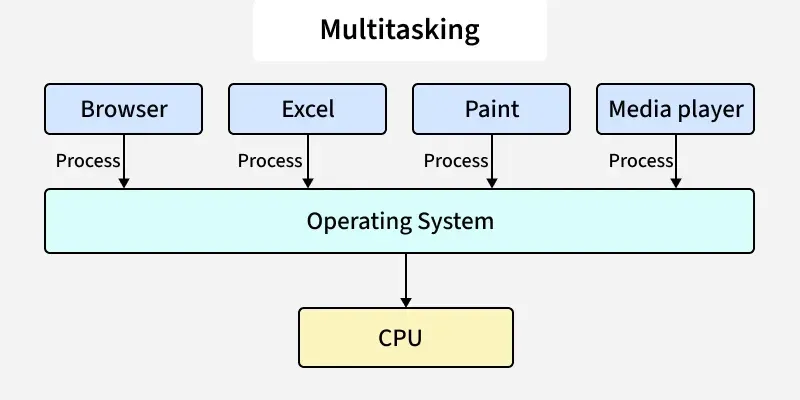

Multitasking

### 31. What is Caching?

[Caching](https://www.geeksforgeeks.org/system-design/caching-system-design-concept-for-beginners/) is a technique in which frequently accessed data is stored in a small, high-speed memory called cache memory. This reduces the time required to access data from the main memory, improving overall system performance.

- Stores frequently used data for faster access.
- Reduces the average memory access time.
- Improves overall system performance.

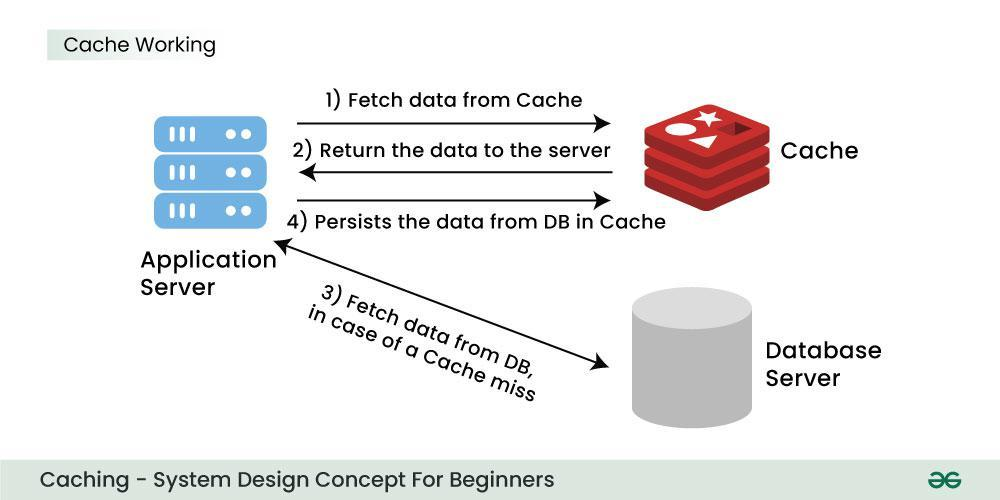

Working of Caching

### 32. What is Spooling?

[Spooling](https://www.geeksforgeeks.org/operating-systems/spooling-in-operating-system/) (Simultaneous Peripheral Operations On-Line) is a technique in which data or jobs are temporarily stored in a buffer, usually on a disk, before being sent to an input/output device. It allows the CPU and I/O devices to work simultaneously, improving system efficiency.

- Temporarily stores data or jobs before I/O processing.
- Allows the CPU to continue executing other tasks while I/O is in progress.
- Improves the efficiency of slow devices such as printers.

### 33. What is the functionality of an Assembler?

An assembler is system software that translates a program written in assembly language into machine code, which the processor can understand and execute.

- Converts assembly language instructions into machine code.
- Generates object code for execution.
- Translates mnemonic instructions into binary code.

### 34. What are Interrupts?

An [interrupt](https://www.geeksforgeeks.org/operating-systems/interrupts/) is a signal generated by hardware or software that informs the CPU that an event requires immediate attention. The processor temporarily pauses the current task, executes an Interrupt Service Routine (ISR), and then resumes the interrupted task.

Key Points:

- Can be generated by hardware or software.
- Temporarily interrupts the current process.
- Executes an Interrupt Service Routine (ISR).
- Improves system responsiveness.

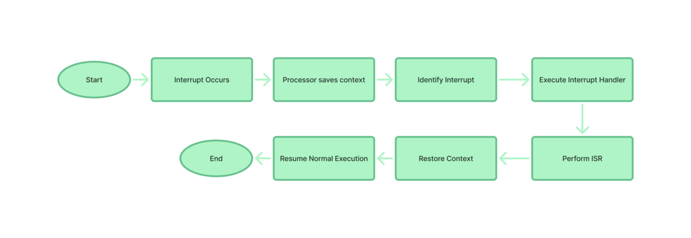

### 35. What is GUI?

A Graphical User Interface (GUI) allows users to interact with a computer using graphical elements instead of text commands.

- Uses windows, icons, menus, and buttons.
- Makes the system user-friendly.
- Reduces the need to remember commands.
- Commonly used in Windows, macOS, and Linux desktops.
- Improves the overall user experience.

### 36. What is Preemptive Multitasking?

In preemptive multitasking, the operating system can interrupt a running process and assign the CPU to another process. This ensures efficient CPU utilization and better responsiveness.

- The OS can preempt a running process.
- CPU time is shared among multiple processes.
- Improves responsiveness.
- Ensures fair CPU scheduling.

### 37. What is a Pipe and when is it used?

A pipe is an inter-process communication (IPC) mechanism that allows one process to send data directly to another. It provides a one-way communication channel between related processes.

**Uses of a Pipe:**

- Transfers data from one process to another.
- Supports one-way communication.
- Commonly used in command-line operations.

### 38. What are the advantages of Semaphores?

Semaphores are synchronization tools used to coordinate access to shared resources among multiple processes or threads.

- Prevent race conditions.
- Ensure mutual exclusion.
- Easy to implement and machine-independent.
- Support synchronization of multiple processes.
- Improve resource utilization by avoiding conflicts.

### 39. What is a Bootstrap Program in an Operating System?

A bootstrap program, also known as a bootloader, is the first program that runs when a computer is powered on. It initializes the hardware, performs basic system checks, and loads the operating system into main memory.

**Functions of a Bootstrap Program:**

- Initializes hardware components.
- Performs startup checks (POST).
- Loads the operating system into memory.
- Starts the execution of the operating system.

### 40. What is IPC?

Inter-Process Communication (IPC) is a mechanism that enables processes to communicate and synchronize with each other. It allows processes to exchange data and coordinate their execution efficiently.

- Enables communication between processes.
- Supports synchronization of process execution.
- Facilitates data sharing and cooperation among processes.

### 41. What are the different IPC mechanisms?

Operating systems provide several IPC mechanisms for communication and synchronization between processes.

- **Pipes (Same Process)**: This allows a flow of data in one direction only. Analogous to simplex systems (Keyboard). Data from the output is usually buffered until the input process receives it which must have a common origin.
- **Named Pipes (Different Processes)**: This is a pipe with a specific name it can be used in processes that don’t have a shared common process origin. E.g. FIFO where the details written to a pipe are first named.
- **Message Queuing**: This allows messages to be passed between processes using either a single queue or several message queues. This is managed by the system kernel these messages are coordinated using an API.
- **Semaphores**: This is used in solving problems associated with synchronization and avoiding race conditions. These are integer values that are greater than or equal to 0.
- **Shared Memory**: This allows the interchange of data through a defined area of memory. Semaphore values have to be obtained before data can get access to shared memory.
- **Sockets**: This method is mostly used to communicate over a network between a client and a server. It allows for a standard connection which is computer and OS independent

### 42. What is the difference between Preemptive and Non-Preemptive Scheduling?

**Preemptive Scheduling**

- The operating system can interrupt a running process and give the CPU to another process.
- It is suitable for time-sharing and interactive systems.
- It provides better responsiveness to users.
- Context switching happens more frequently, so scheduling overhead is higher.
- Examples: Round Robin (RR), Shortest Remaining Time First (SRTF), and Preemptive Priority Scheduling.

**Non-Preemptive Scheduling**

- A process keeps the CPU until it finishes execution or becomes blocked.
- It is suitable for batch processing systems.
- It is simpler to implement but less responsive.
- Context switching occurs less frequently, so scheduling overhead is lower.
- Examples: FCFS, Non-Preemptive SJF, and Non-Preemptive Priority Scheduling.

### 43. What is the difference between cooperative multitasking and preemptive multitasking?

**Cooperative multitasking:** Process gives up CPU voluntarily.

- Simpler OS design
- Fewer context switches
- Better cache performance
- One faulty process can freeze the system

**Preemptive multitasking:** OS can interrupt a process and give CPU to another.

- Better responsiveness
- Fair CPU sharing
- More complex scheduler
- Higher context-switch overhead

### 44. What is a Zombie Process?

A [zombie process](https://www.geeksforgeeks.org/operating-systems/zombie-processes-prevention/) is a process that has completed its execution but still has an entry in the process table because its parent process has not yet collected its exit status.

- Has finished execution but is not completely removed.
- Remains in the process table until the parent reads its exit status.
- Occupies only a process table entry, not CPU or memory resources.

### 45. What are Orphan Processes?

An [orphan process](https://www.geeksforgeeks.org/operating-systems/orphan-processes/) is a child process whose parent process has terminated before the child finishes execution. The operating system assigns the orphan process to the init/systemd process, which becomes its new parent.

Key Points:

- Created when the parent process terminates first.
- Adopted by the init (or systemd) process.
- Continues execution until completion.

### 46. What are Starvation and Aging in an Operating System?

Starvation occurs when a process waits indefinitely for CPU or other resources because higher-priority processes keep getting served. Aging is a scheduling technique used to prevent starvation by gradually increasing the priority of waiting processes. [( Starvation and Aging in Operating System )](https://www.geeksforgeeks.org/operating-systems/starvation-and-aging-in-operating-systems/)

**Starvation:**

- A process waits indefinitely for resources.
- Caused by continuous preference to higher-priority processes.

**Aging:**

- Gradually increases the priority of waiting processes.
- Prevents starvation and ensures fairness.

### 47. Write about the Monolithic Kernel.

A [Monolithic Kernel](https://www.geeksforgeeks.org/operating-systems/monolithic-kernel-and-key-differences-from-microkernel/) is a kernel architecture in which all core operating system services run in the same kernel space. Since these services communicate directly, it provides high performance but results in a larger kernel.

- All OS services execute in kernel space.
- Provides fast communication between system components.
- Offers services such as process scheduling, memory management, and file management.
- Larger kernel size compared to a microkernel.

### 48. What is Context Switching?

[Context switching](https://www.geeksforgeeks.org/operating-systems/context-switch-in-operating-system/) is the process of saving the state of the currently running process and loading the state of another process so that the CPU can switch execution between them. The process state is stored in the Process Control Block (PCB), allowing the interrupted process to resume later.

- Saves the state of the current process.
- Loads the state of the next process from its PCB.
- Enables multitasking by sharing the CPU among processes.
- Introduces a small overhead because no useful work is done during the switch.

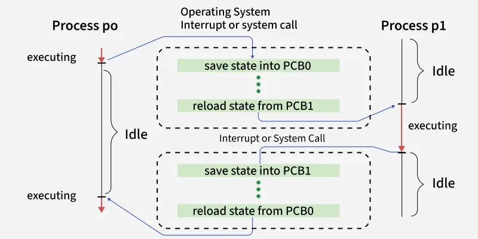

### 49. What is the difference between an Operating System and a Kernel?

**Operating System (OS)**

- An operating system is the complete system software that manages the computer.
- It provides a user interface and system services for users and applications.
- It includes the kernel, system utilities, libraries, and application support.
- Examples: Windows, Linux, and macOS.

**Kernel**

- The kernel is the core component of the operating system.
- It directly manages CPU, memory, devices, and processes.
- It acts as a bridge between software and hardware.
- Examples: Linux Kernel, Windows NT Kernel, and XNU Kernel.

### 50. What is PCB?

A [Process Control Block (PCB)](https://www.geeksforgeeks.org/operating-systems/process-control-block-in-os/) is a data structure maintained by the operating system to store all the information related to a process. It helps the OS manage, schedule, and resume processes during execution.

- Stores the process ID (PID), process state, and program counter.
- Contains CPU registers, scheduling information, and memory details.
- Used during context switching to save and restore the process state.

### 51. When is a System in a Safe State?

A system is said to be in a safe state if there exists at least one sequence in which all processes can execute and complete without causing a deadlock. A safe state guarantees that every process can obtain the required resources eventually.

Key Points:

- There is at least one safe execution sequence.
- All processes can complete successfully.
- Deadlock will not occur.

### 52. What is Cycle Stealing?

[Cycle stealing](https://www.geeksforgeeks.org/computer-organization-architecture/modes-of-dma-transfer/) is a technique used by Direct Memory Access (DMA) in which the DMA controller temporarily takes control of the system bus to transfer data between an I/O device and main memory without CPU intervention.

- Used during DMA operations.
- Transfers data directly between memory and I/O devices.
- Improves data transfer efficiency by reducing CPU involvement.
- The CPU is paused only for the memory access cycle.

### 53. What are Trap and Trapdoor?

**Trap**

- A trap is a software-generated interrupt.
- It occurs due to an exception, error, or system call
- It transfers control from the running program to the operating system.
- It is used for handling exceptions and system calls and is managed by the operating system.

**Trapdoor (Backdoor)**

- A trapdoor is a hidden or undocumented entry point in a program.
- It is used to bypass normal authentication or security checks.
- It allows access without following the usual security procedures.
- An unauthorized trapdoor is generally considered a security risk.

### 54. Write the difference between a Program and a Process.

**Program**

- A program is a set of instructions stored on disk.
- It is a passive entity and does not execute by itself.
- It is stored in secondary memory such as a hard disk or SSD.
- It does not require CPU, memory, or I/O resources until execution starts.
- One program can create multiple processes when it runs multiple times.

**Process**

- A process is a program that is currently executing.
- It is an active entity.
- It is loaded into main memory (RAM) during execution.
- It requires CPU time, memory, I/O devices, and other system resources.
- Each process has its own Process Control Block (PCB) and execution state.

### 55. What is a Dispatcher?

A [dispatcher](https://www.geeksforgeeks.org/operating-systems/difference-between-dispatcher-and-scheduler/) is the operating system module that transfers CPU control to the process selected by the short-term scheduler. It prepares the CPU so that the selected process can begin or resume execution.

- Performs context switching.
- Switches the CPU from kernel mode to user mode.
- Transfers control to the selected process.

### 56. Define the term Dispatch Latency.

Dispatch latency is the time taken by the operating system to stop one process and start executing another process after it has been selected by the scheduler. Lower dispatch latency improves system responsiveness, especially in real-time systems.

- Measures the delay in starting a scheduled process.
- Includes the time required for context switching.
- Lower latency results in faster system response.
- Important for real-time operating systems.

### 57. What are the goals of CPU Scheduling?

The primary goal of CPU scheduling is to utilize the CPU efficiently while providing good performance and fairness to all processes.

Goals of CPU Scheduling:

- Maximize CPU utilization.
- Maximize throughput.
- Minimize turnaround time.
- Minimize waiting time.
- Minimize response time.
- Ensure fair CPU allocation.

### 58. What is a Critical Section?

A [critical section](https://www.geeksforgeeks.org/operating-systems/critical-section-in-synchronization/) is a part of a program where shared data or resources are accessed. Only one process or thread should execute the critical section at a time to prevent data inconsistency and race conditions.

- Contains shared resources or variables.
- Requires mutual exclusion.
- Prevents race conditions and maintains data consistency.

### 59. Name the Synchronization Techniques.

[Synchronization](https://www.geeksforgeeks.org/operating-systems/introduction-of-process-synchronization/) techniques are used to coordinate multiple processes or threads while accessing shared resources.

- Mutex: Ensures that only one process or thread accesses a resource at a time.
- Condition Variables: Allow threads to wait until a specific condition becomes true.
- Semaphores: Control access to shared resources using signaling mechanisms.
- File Locks: Prevent multiple processes from modifying the same file simultaneously.

### 60. Write a difference between a user-level thread and a kernel-level thread?

**User-Level Thread**

- User-level threads are created and managed by the user or a thread library.
- The operating system does not recognize these threads directly.
- Context switching is faster because it happens in user space.
- If one user-level thread performs a blocking operation, the entire process may become blocked.

**Kernel-Level Thread**

- Kernel-level threads are created and managed by the operating system.
- The operating system recognizes and schedules these threads directly.
- Context switching is slower because the kernel is involved in switching.
- If one kernel-level thread is blocked, other threads of the same process can continue execution.

### 61. Difference between Multithreading and Multitasking?

**Multi-threading**

- In multi-threading, multiple threads of the same program run at the same time.
- The CPU switches between threads of a single process.
- It is a lightweight mechanism because threads share memory and resources.
- It is mainly a feature of a process used to perform multiple tasks inside one application.

**Multi-tasking**

- In multi-tasking, multiple programs or processes run concurrently.
- The CPU switches between different tasks or processes.
- It is a heavier mechanism because each process has its own resources.
- It is a feature provided by the operating system to run several applications together.

### 62. What are the drawbacks of Semaphores?

Although [semaphores](https://www.geeksforgeeks.org/operating-systems/semaphores-in-process-synchronization/) are effective synchronization mechanisms, improper use can lead to several issues that affect system performance and correctness.

**Drawbacks:**

- Can cause priority inversion, where a high-priority process waits for a lower-priority one.
- Incorrect use of `wait()` and `signal()` may lead to programming errors.
- May result in deadlocks if resources are not released properly.
- Difficult to debug and maintain in large concurrent systems.

### 63. How does the OS implement fairness in semaphore-based synchronization to avoid starvation?

In a fair semaphore implementation, the OS maintains a waiting queue for blocked processes or threads. When the semaphore is released, the process that has been waiting the longest is awakened first.

This FIFO-style ordering prevents a process from being repeatedly bypassed by newer requests. As a result, every waiting process eventually gets a chance to enter the critical section, which avoids starvation and provides bounded waiting.

A simple example is a print queue: jobs are usually served in the order they arrived rather than randomly.

### 64. What is Peterson's Approach?

[Peterson's Algorithm](https://www.geeksforgeeks.org/dsa/petersons-algorithm-in-process-synchronization/) is a software-based synchronization algorithm that provides mutual exclusion between two processes sharing a critical section. It uses two shared variables: a flag array to indicate interest and a turn variable to decide which process gets access.

- Works only for two processes.
- Ensures mutual exclusion, progress, and bounded waiting.
- Uses `flag[]` and `turn` variables for synchronization.

### 65. Define the term Bounded Waiting.

Bounded waiting is a condition that guarantees every process requesting entry into a critical section will be allowed to enter within a finite number of turns. It prevents indefinite waiting (starvation).

- Prevents starvation.
- Guarantees a finite waiting time.
- One of the requirements for a correct critical section solution.

### 66. What are the solutions to the Critical Section Problem?

1. **Software Solutions:** Use software techniques such as Peterson’s Algorithm to control access to shared resources.
2. **Hardware Solutions:** Use special hardware instructions like Test-and-Set or Compare-and-Swap for synchronization.
3. **Semaphores:** Use wait() and signal() operations to synchronize processes or threads and manage shared resources.

### 67. What is Concurrency?

[Concurrency](https://www.geeksforgeeks.org/operating-systems/concurrency-in-operating-system/) is the ability of an operating system to execute multiple processes or threads by overlapping their execution. It improves CPU utilization and enables multiple tasks to make progress during the same period.

- Allows multiple tasks to execute concurrently.
- Improves CPU utilization.
- Forms the basis of multitasking and multithreading.

### 68. What is a barrier in concurrency? Explain a scenario where barriers can cause deadlock.

A barrier is a synchronization point where all threads or processes must arrive before any of them can continue. It is commonly used in parallel programs where work is divided into phases.

A deadlock-like situation occurs if one thread never reaches the barrier, for example because it crashes, enters an infinite loop, or gets blocked indefinitely. All other threads wait forever at the barrier, so the whole program stops making progress.

**Example:** In parallel matrix multiplication, every thread computes part of the matrix and waits at a barrier before combining results. If one thread fails before reaching the barrier, all remaining threads wait forever.

### 69. Write the drawbacks of Concurrency.

While concurrency improves performance, it also introduces several challenges in process management and synchronization.

- Requires synchronization to avoid race conditions.
- Increases system complexity.
- Introduces context-switching overhead.
- May lead to deadlocks and starvation.
- Too many concurrent processes can reduce overall performance.

### 70. What are the necessary conditions for deadlock?

A [deadlock](https://www.geeksforgeeks.org/operating-systems/introduction-of-deadlock-in-operating-system/) can occur only if all four Coffman conditions are satisfied simultaneously.

1. **Mutual Exclusion:** At least one resource can be used by only one process at a time.
2. **Hold and Wait:** A process holds one resource while waiting for another.
3. **No Preemption:** Resources cannot be forcibly taken away from a process.
4. **Circular Wait:** A circular chain of processes exists, where each process waits for a resource held by the next process.

### 71. What are the issues related to concurrency?

- **Non-atomic**: Operations that are non-atomic but interruptible by multiple processes can cause problems.
- [Race conditions](https://www.geeksforgeeks.org/operating-systems/race-condition-vulnerability/): A race condition occurs of the outcome depends on which of several processes gets to a point first.
- **Blocking**: Processes can block waiting for resources. A process could be blocked for a long period of time waiting for input from a terminal. If the process is required to periodically update some data, this would be very undesirable.
- [Starvation](https://www.geeksforgeeks.org/operating-systems/starvation-and-aging-in-operating-systems/): It occurs when a process does not obtain service to progress.
- [Deadlock](https://www.geeksforgeeks.org/operating-systems/introduction-of-deadlock-in-operating-system/): It occurs when two processes are blocked and hence neither can proceed to execute

### 72. Why do we use Precedence Graphs?

A precedence graph is a Directed Acyclic Graph (DAG) used to represent the execution order and dependency among different tasks or statements. It helps determine which operations can execute in parallel and which must wait for others to complete.

- Each node represents a task or program statement.
- A directed edge indicates the execution order between two tasks.
- Used to analyze dependencies and identify opportunities for parallel execution.

### 73. Explain the Resource Allocation Graph (RAG).

A [Resource Allocation Graph (RAG](https://www.geeksforgeeks.org/operating-systems/resource-allocation-graph-rag-in-operating-system/)) is a directed graph used to represent the allocation of resources to processes and the resources being requested. It helps analyze the system's state and detect possible deadlocks.

Components of a RAG:

- Processes are represented by circles.
- Resources are represented by rectangles.
- Edges show resource requests and allocations.
- A cycle in the graph may indicate a deadlock.

### 74. What is a Deadlock?

A [deadlock](https://www.geeksforgeeks.org/operating-systems/introduction-of-deadlock-in-operating-system/) is a situation in which two or more processes are permanently blocked because each process is waiting for a resource held by another process. As a result, none of the processes can continue execution.

**Example:** Two processes each hold one resource and wait indefinitely for the resource held by the other.

**Key Points:**

- Processes wait indefinitely for one another.
- Occurs due to improper resource allocation.
- Prevents the involved processes from completing their execution.
- Can be avoided, prevented, detected, or recovered using deadlock management techniques.

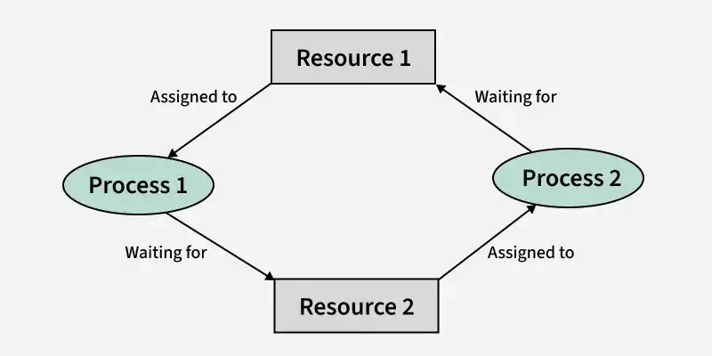

### 75. What are the goals and functionalities of Memory Management?

Memory management is one of the primary functions of an operating system. It manages the allocation, protection, and organization of memory so that multiple processes can execute efficiently and safely.

1. **Relocation:** The operating system can move a process from one memory location to another during execution without affecting its operation.
2. **Protection:** It prevents one process from accessing or modifying the memory allocated to another process, ensuring system security and stability.
3. **Sharing** Memory management allows multiple processes to share the same memory region when appropriate, improving resource utilization and enabling inter-process communication.
4. **Logical Organization:** It organizes programs into logical modules or segments, making programs easier to manage, develop, and maintain.
5. **Physical Organization:** It manages the efficient allocation and deallocation of physical memory (RAM) and secondary storage, ensuring optimal memory utilization.

### 76. How does the OS ensure atomicity when multiple processes request the same I/O device?

The OS ensures that only one process uses a critical device resource at a time.

Methods used:

- Mutexes / semaphores / locks
- I/O request queues
- Device-driver synchronization
- Interrupt-based completion handling

**Example:** Two processes printing together are queued and printed one after another.

### 77. How does the OS ensure data consistency in a multi-user environment with simultaneous I/O requests?

In a multi-user system, several processes may try to access the same file at the same time. The operating system maintains data consistency by coordinating these accesses.

- Uses file locking to control concurrent access.
- Allows multiple readers but restricts writers when required.
- Uses atomic write operations for small updates.
- Maintains buffer/page cache synchronization.
- Uses journaling or write-ahead logging to recover after crashes.
- Schedules I/O requests to avoid conflicting operations.

For example, if two users edit the same file simultaneously, the OS can lock the file or serialize the write operations so that one update completes before the other begins, preventing corruption.

### 78. Explain Address Binding.

[Address binding](https://www.geeksforgeeks.org/operating-systems/address-binding-and-its-types/) is the process of mapping a program's logical addresses to physical memory addresses. It associates program instructions and data with actual locations in main memory so they can be executed by the CPU.

### 79. Write different types of Address Binding.

Address binding is classified into the following three types:

- **Compile-time Address Binding:** Physical addresses are determined during compilation. The program must be recompiled if the memory location changes.
- **Load-time Address Binding:** Physical addresses are assigned when the program is loaded into memory. The program can be loaded at different memory locations.
- **Execution-time Address Binding:** Physical addresses are generated during program execution, allowing a process to be moved between memory locations while it is running.

### 80. What is locality of reference and why is it important in memory management?

Locality of reference means that a program tends to access the same memory locations repeatedly or access nearby memory locations within a short period of time.

There are two main types:

- **Temporal locality:** Recently used data is likely to be used again soon.
- **Spatial locality:** Memory locations near a recently accessed location are likely to be accessed next.

This concept is very important because caches, TLBs, and virtual memory systems are designed assuming locality. When locality is good, the required data is often already in cache or memory, which reduces page faults and improves execution speed. Programs with poor locality usually experience more cache misses and slower performance.

### 81. Write an advantage of Dynamic Allocation Algorithms.

[Dynamic allocation algorithms](https://www.geeksforgeeks.org/c/dynamic-memory-allocation-in-c-using-malloc-calloc-free-and-realloc/) allocate memory during program execution, making memory management more flexible and efficient.

**Advantages:**

- Memory is allocated only when required.
- Supports dynamic data structures such as linked lists and trees.
- Makes better use of available memory.
- Allows programs to handle data whose size is unknown in advance.
- Simplifies insertion and deletion operations by manipulating memory addresses.

### 82. Write a difference between internal fragmentation and external fragmentation?

**Internal Fragmentation**

- Internal fragmentation occurs when memory is divided into fixed-size partitions or blocks.
- A process may not use the entire allocated block, so some memory remains unused inside the partition.
- The unused space is the difference between the allocated memory and the memory actually required by the process.
- It is common in systems that use fixed partition memory allocation.

**External Fragmentation**

- External fragmentation occurs when memory is allocated in variable-size partitions.
- After processes are loaded and removed, free memory becomes scattered into small non-contiguous blocks.
- Although total free memory may be sufficient, a new process may not get memory because the free space is not available in one continuous block.
- External fragmentation can be reduced using compaction, paging, or segmentation techniques.

### 83. What is an inverted page table and how is it different from a conventional page table?

A conventional page table stores one entry for every virtual page of a process. For large address spaces, these page tables can consume a significant amount of memory.

An inverted page table stores one entry for each physical frame in the system instead of each virtual page. Each entry records which process and which virtual page currently occupy that frame.

**Main differences:**

- Conventional page table: larger memory usage, faster direct indexing.
- Inverted page table: smaller memory usage, but address translation is more complex and often uses hashing.

Inverted page tables are useful in systems with very large virtual address spaces because they reduce page-table memory overhead.

### 84. Define Compaction.

[Compaction](https://www.geeksforgeeks.org/operating-systems/compaction-in-operating-system/) is a memory management technique used to reduce external fragmentation by relocating processes so that all free memory is combined into one contiguous block. This creates a larger continuous space for allocating memory to new processes.

- Eliminates external fragmentation.
- Combines scattered free memory into one large block.
- Improves memory utilization and allocation efficiency.

### 85. Write the advantages and disadvantages of a Hashed Page Table.

A [hashed page table](https://www.geeksforgeeks.org/operating-systems/hashed-page-tables-in-operating-system/) is a page table structure used in virtual memory systems, especially for large address spaces. It uses a hash function to quickly locate page table entries.

#### Advantages

- Provides fast address translation using hashing.
- More memory-efficient for large virtual address spaces.
- Faster page lookup compared to traditional page tables in many cases.

#### Disadvantages

- Hash collisions can occur, reducing performance.
- Performance degrades when the number of collisions increases.
- Additional overhead is required to handle collisions.

### 86. Write a difference between paging and segmentation?

**Paging**

- In paging, a program is divided into fixed-size pages and memory is divided into frames of the same size.
- The operating system and hardware are responsible for managing pages and frames.
- The logical address is divided into a page number and page offset for address translation.
- A page table is maintained to store the mapping between pages and memory frames.
- Paging is generally faster, but it can lead to internal fragmentation.

**Segmentation**

- In segmentation, a program is divided into variable-size segments such as code, data, and stack.
- The segment sizes are based on the logical structure of the program and are visible to the programmer.
- The logical address is divided into a segment number and segment offset for address translation.
- A segment table is maintained to store information about each segment.
- Segmentation is usually slower than paging and may cause external fragmentation.

### 87. Write a definition of  Associative Memory and  Cache Memory?

**Associative Memory**

- Associative memory is a memory that is accessed by its content instead of an address.
- It can search all stored words simultaneously and quickly find the required data.
- It is mainly used where very fast searching is required.
- Its important feature is the matching logic circuit that compares input data with stored data.
- It reduces the time needed to locate an item stored in memory.

**Cache Memory**

- Cache memory is a small and very fast memory placed between the CPU and main memory.
- Data is accessed using its memory address.
- It stores frequently used data and instructions so that they can be accessed quickly.
- It is useful when the same data or instructions are used repeatedly.
- Its main feature is high-speed access, which reduces the average memory access time.

### 88. What is Locality of Reference?

[Locality of Reference](https://www.geeksforgeeks.org/computer-organization-architecture/locality-of-reference-and-cache-operation-in-cache-memory/) is the tendency of a program to repeatedly access the same memory locations or nearby memory locations within a short period. Operating systems use this principle to improve the performance of cache memory and virtual memory.

**Types of Locality:**

- **Temporal Locality:** Recently accessed data is likely to be accessed again.
- **Spatial Locality:** Memory locations near a recently accessed location are likely to be accessed soon.

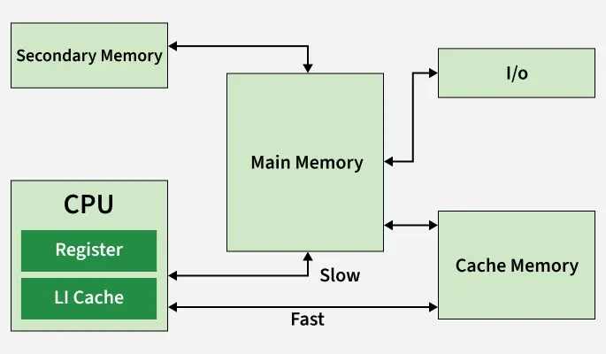

**Applications:**

- Improves cache hit ratio.
- Reduces memory access time.
- Increases overall system performance.

### 89. Write down the advantages of Virtual Memory.

[Virtual memory](https://www.geeksforgeeks.org/operating-systems/virtual-memory-in-operating-system/) extends the available memory by using secondary storage as an extension of RAM. It allows the operating system to execute large programs efficiently, even when physical memory is limited.

**Advantages:**

- Supports a higher degree of multiprogramming.
- Allows programs larger than physical memory to execute.
- Eliminates external fragmentation.
- Improves memory utilization through paging.
- Simplifies memory allocation.
- Enables efficient process swapping.
- Reduces unnecessary I/O operations

### 90. How is performance calculated in Virtual Memory?

The performance of a virtual memory system mainly depends on the **page fault rate**. A lower page fault rate results in better performance because accessing RAM is much faster than accessing secondary storage.

The **Effective Access Time (EAT)** is calculated as:

> **EAT = (1 − p) × Memory Access Time + p × Page Fault Time**

where:

- **p** = Probability of a page fault
- **Memory Access Time** = Time required to access RAM
- **Page Fault Time** = Time required to service a page fault

A higher page fault rate increases the Effective Access Time, reducing system performance.

### 91. Write down the basic concept of the File System.

A [file system](https://www.geeksforgeeks.org/operating-systems/file-systems-in-operating-system/) is the method used by an operating system to organize, store, retrieve, and manage files on secondary storage devices. It provides a logical structure for storing data and maintains information about files and directories.

**Functions of a File System:**

- Organizes files and directories.
- Manages storage allocation.
- Controls file access and permissions.
- Supports file creation, deletion, and modification.

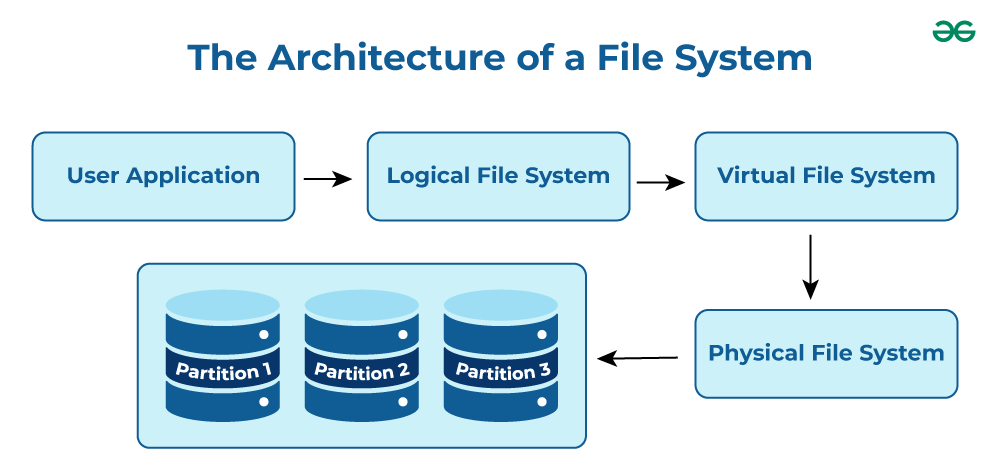

### 92. What is the difference between block devices and character devices, and how does the OS manage I/O for each?

Block devices transfer data in fixed-size blocks and support random access. Examples are HDDs, SSDs, and USB drives. The OS uses block device drivers, buffering, caching, and I/O scheduling to improve performance.

Character devices transfer data as a stream of characters and usually support sequential access only. Examples are keyboards, mice, and serial ports. The OS uses character device drivers and interrupt-driven I/O with little or no buffering.

**Main difference:** Block devices are optimized for storage access, while character devices are optimized for real-time stream-oriented input/output.

### 93. Write the names of different operations on a File.

The operating system provides several operations to manage files efficiently.

- Create
- Open
- Read
- Write
- Append
- Rename
- Delete
- Truncate
- Close

### 94. Define the Term Bit Vector.

A Bit Vector (Bitmap) is a free-space management technique in which each disk block is represented by a single bit. The operating system uses the bitmap to determine whether a disk block is free or allocated.

- **0** → Allocated block
- **1** → Free block

**Advantages:**

- Easy to implement.
- Efficient for locating free disk blocks.
- Requires only one bit per disk block.

### 95. What is a File Allocation Table (FAT)?

The [File Allocation Table (FAT)](https://www.geeksforgeeks.org/operating-systems/fat-full-form/) is a disk data structure used by the operating system to keep track of file locations on a storage device. It stores information about the clusters occupied by each file, allowing the OS to locate and access files efficiently.

**Features:**

- Maps files to disk clusters.
- Keeps track of free and allocated clusters.
- Widely used in FAT12, FAT16, and FAT32 file systems.

### 96. What is Rotational Latency?

[Rotational latency](https://www.geeksforgeeks.org/operating-systems/rotational-latency/) is the time required for the desired disk sector to rotate under the read/write head after the disk arm has reached the correct track. It is one of the components of disk access time.

**Factors Affecting Rotational Latency:**

- Disk rotational speed (RPM).
- Position of the required sector.

Lower rotational latency improves disk performance.

### 97. What is Seek Time?

[Seek time](https://www.geeksforgeeks.org/operating-systems/seek-time-in-os/) is the time required for the disk arm to move the read/write head to the track where the requested data is stored. It is usually the largest component of disk access time.

**Key Points:**

- Depends on the distance the disk arm travels.
- Lower seek time results in faster data access.
- Plays a major role in the performance of disk scheduling algorithms.

### 98. What is Belady's Anomaly ?

[Belady's Anomaly](https://www.geeksforgeeks.org/operating-systems/beladys-anomaly-in-page-replacement-algorithms/) is a phenomenon in which increasing the number of page frames results in more page faults, instead of fewer. This unusual behavior occurs with the FIFO (First-In, First-Out) page replacement algorithm but does not occur with stack algorithms such as LRU or Optimal.

**Key Points:**

- Occurs mainly in the FIFO page replacement algorithm.
- More page frames can unexpectedly increase page faults.
- Does not occur in LRU and Optimal page replacement algorithms.

### 99. What happens if a Non-Recursive Mutex is locked more than once?

A non-recursive mutex cannot be locked multiple times by the same thread. If the thread attempts to lock it again before unlocking it, the thread waits indefinitely for itself to release the mutex, resulting in a deadlock.

**Key Points:**

- The same thread cannot lock the mutex twice.
- The thread blocks while waiting for the mutex it already owns.
- Results in self-deadlock unless a recursive mutex is used.

### 100. What are the advantages of a Multiprocessor System?

A [multiprocessor system](https://www.geeksforgeeks.org/computer-organization-architecture/introduction-of-multiprocessor-and-multicomputer/) consists of two or more processors that work together to execute tasks. It improves system performance by allowing multiple processes or threads to run simultaneously.

**Advantages:**

- Improves overall system performance.
- Increases throughput by executing multiple tasks in parallel.
- Supports efficient multitasking.
- Allows hardware resources to be shared among processors.
- Provides higher reliability and availability.

### 101. What are Real-Time Systems?

A [real-time system](https://www.geeksforgeeks.org/computer-science-fundamentals/real-time-systems/) is an operating system in which tasks must be completed within a specified time limit. The correctness of the system depends not only on producing the correct result but also on producing it within the required deadline.

Types of Real-Time Systems:

- Hard Real-Time System: Missing a deadline is unacceptable (e.g., aircraft control systems).
- Soft Real-Time System: Missing an occasional deadline is acceptable (e.g., multimedia applications).

### 102. How can a System Recover from a deadlock?

Once a deadlock has occurred, the operating system can recover using one of the following techniques:

1. **Process Termination:** Terminate one or more deadlocked processes until the deadlock is removed.
2. **Resource Preemption:** Temporarily take resources from selected processes and allocate them to others.
3. **Victim Selection:** Choose the process whose termination or resource preemption results in the lowest system cost.

### 103. What factors determine whether a Deadlock Detection Algorithm should be used?

The decision to use a [deadlock detection algorithm](https://www.geeksforgeeks.org/operating-systems/deadlock-detection-algorithm-in-operating-system/) depends on the likelihood of deadlocks and the cost of recovering from them.

**Factors Considered:**

- Frequency with which deadlocks are expected to occur.
- Number of processes that may be affected.
- Cost of detecting and recovering from deadlocks.
- Overall impact on system performance.

### Relevant Resources

To do well in interviews, you need to understand core concepts, memory management, Synchronization, I/O and Disk management.

**1. Core Concepts:** [Kernel](https://www.geeksforgeeks.org/operating-systems/kernel-in-operating-system/), [System Call](https://www.geeksforgeeks.org/operating-systems/introduction-of-system-call/), [Process](https://www.geeksforgeeks.org/operating-systems/introduction-of-process-management/), [Threads](https://www.geeksforgeeks.org/operating-systems/thread-in-operating-system/), [CPU Scheduling](https://www.geeksforgeeks.org/operating-systems/cpu-scheduling-in-operating-systems/), [Paging](https://www.geeksforgeeks.org/operating-systems/paging-in-operating-system/), [Segmentation](https://www.geeksforgeeks.org/operating-systems/segmentation-in-operating-system/), [Page Replacement Algorithms](https://www.geeksforgeeks.org/operating-systems/page-replacement-algorithms-in-operating-systems/), [Virtual Memory](https://www.geeksforgeeks.org/operating-systems/virtual-memory-in-operating-system/), [Disk Scheduling](https://www.geeksforgeeks.org/operating-systems/disk-scheduling-algorithms/).

**2. Advanced Topics:** [Inter Process Communication](https://www.geeksforgeeks.org/operating-systems/inter-process-communication-ipc/), [Process Synchronization](https://www.geeksforgeeks.org/operating-systems/introduction-of-process-synchronization/), [Semaphores](https://www.geeksforgeeks.org/operating-systems/semaphores-in-process-synchronization/), [IPC Problems](https://www.geeksforgeeks.org/operating-systems/classical-ipc-problems/), [Deadlock](https://www.geeksforgeeks.org/operating-systems/introduction-of-deadlock-in-operating-system/), [Multithreading](https://www.geeksforgeeks.org/operating-systems/multithreading-in-operating-system/), [File systems](https://www.geeksforgeeks.org/operating-systems/file-systems-in-operating-system/).
