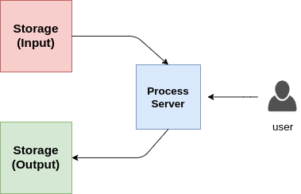

# devops-exercises: System Design

> Copied from <https://github.com/bregman-arie/devops-exercises#system-design> (CC BY-NC-ND 3.0, by Arie Bregman and contributors). Questions and answers are the source's own; nothing was answered or rewritten here.

## System Design

Explain what a "single point of failure" is. 
 <b>
A "single point of failure", in a system or organization, if it were to fail would cause the entire system to fail or significantly disrupt it's operation. In other words, it is a vulnerability where there
is no backup in place to compensate for the failure.
</b>

What is CDN?
 <b>

CDN (Content Delivery Network) responsible for distributing content geographically. Part of it, is what is known as edge locations, aka cache proxies, that allows users to get their content quickly due to cache features and geographical distribution.
</b>

Explain Multi-CDN
 <b>

In single CDN, the whole content is originated from content delivery network. 
In multi-CDN, content is distributed across multiple different CDNs, each might be on a completely different provider/cloud.
</b>

What are the benefits of Multi-CDN over a single CDN?
 <b>

* Resiliency: Relying on one CDN means no redundancy. With multiple CDNs you don't need to worry about your CDN being down
* Flexibility in Costs: Using one CDN enforces you to specific rates of that CDN. With multiple CDNs you can take into consideration using less expensive CDNs to deliver the content.
* Performance: With Multi-CDN there is bigger potential in choosing better locations which more close to the client asking the content
* Scale: With multiple CDNs, you can scale services to support more extreme conditions
</b>

Explain "3-Tier Architecture" (including pros and cons)
 <b>
A "3-Tier Architecture" is a pattern used in software development for designing and structuring applications. It divides the application into 3 interconnected layers: Presentation, Business logic and Data storage.  
PROS: 
* Scalability
* Security
* Reusability
CONS:
* Complexity
* Performance overhead
* Cost and development time
</b>

Explain Mono-repo vs. Multi-repo.What are the cons and pros of each approach?
 <b>
In a Mono-repo, all the code for an organization is stored in a single,centralized repository.
PROS (Mono-repo):
* Unified tooling
* Code Sharing
CONS (Mono-repo):
* Increased complexity
* Slower cloning

In a Multi-repo setup, each component is stored in it's own separate repository. Each repository has it's own version control history.
PROS (Multi-repo):
* Simpler to manage
* Different teams and developers can work on different parts of the project independently, making parallel development easier.
CONS (Multi-repo):
* Code duplication
* Integration challenges
</b>

What are the drawbacks of monolithic architecture?
 <b>

* Not suitable for frequent code changes and the ability to deploy new features
* Not designed for today's infrastructure (like public clouds)
* Scaling a team to work monolithic architecture is more challenging
* If a single component in this architecture fails, then the entire application fails.
</b>

What are the advantages of microservices architecture over a monolithic architecture?
 <b>

* Each of the services individually fail without escalating into an application-wide outage.
* Each service can be developed and maintained by a separate team and this team can choose its own tools and coding language
</b>

What's a service mesh?
 <b>
It is a layer that facilitates communication management and control between microservices in a containerized application. It handles tasks such as load balancing, encryption, and monitoring.
</b>

Explain "Loose Coupling"
 <b>
In "Loose Coupling", components of a system communicate with each other with a little understanding of each other's internal workings. This improves scalability and ease of modification in complex systems.
</b>

What is a message queue? When is it used?
 <b>
It is a communication mechanism used in distributed systems to enable asynchronous communication between different components. It is generally used when the systems use a microservices approach.
</b>

#### Scalability

Explain Scalability
 <b>

The ability easily grow in size and capacity based on demand and usage.
</b>

Explain Elasticity
 <b>

The ability to grow but also to reduce based on what is required
</b>

Explain Disaster Recovery
 <b>

Disaster recovery is the process of restoring critical business systems and data after a disruptive event. The goal is to minimize the impact and resume normal business activities quickly. This involves creating a plan, testing it, backing up critical data, and storing it in safe locations. In case of a disaster, the plan is then executed, backups are restored, and systems are hopefully brought back online. The recovery process may take hours or days depending on the damages of infrastructure. This makes business planning important, as a well-designed and tested disaster recovery plan can minimize the impact of a disaster and keep operations going.
</b>

Explain Fault Tolerance and High Availability
 <b>

Fault Tolerance - The ability to self-heal and return to normal capacity. Also the ability to withstand a failure and remain functional.

High Availability - Being able to access a resource (in some use cases, using different platforms)
</b>

What is the difference between high availability and Disaster Recovery?
 <b>

[wintellect.com](https://www.wintellect.com/high-availability-vs-disaster-recovery): "High availability, simply put, is eliminating single points of failure and disaster recovery is the process of getting a system back to an operational state when a system is rendered inoperative. In essence, disaster recovery picks up when high availability fails, so HA first."
</b>

Explain Vertical Scaling
 <b>

Vertical Scaling is the process of adding resources to increase power of existing servers. For example, adding more CPUs, adding more RAM, etc.
</b>

What are the disadvantages of Vertical Scaling?
 <b>

With vertical scaling alone, the component still remains a single point of failure.
In addition, it has hardware limit where if you don't have more resources, you might not be able to scale vertically.
</b>

Which type of cloud services usually support vertical scaling?
 <b>

Databases, cache. It's common mostly for non-distributed systems.
</b>

Explain Horizontal Scaling
 <b>

Horizontal Scaling is the process of adding more resources that will be able handle requests as one unit
</b>

What is the disadvantage of Horizontal Scaling? What is often required in order to perform Horizontal Scaling?
 <b>

A load balancer. You can add more resources, but if you would like them to be part of the process, you have to serve them the requests/responses.
Also, data inconsistency is a concern with horizontal scaling.
</b>

Explain in which use cases will you use vertical scaling and in which use cases you will use horizontal scaling
 <b>
</b>

Explain Resiliency and what ways are there to make a system more resilient
 <b>
</b>

Explain "Consistent Hashing"
 <b>
</b>

How would you update each of the services in the following drawing without having app (foo.com) downtime? 

 <b>
</b>

What is the problem with the following architecture and how would you fix it? 

 <b>

The load on the producers or consumers may be high which will then cause them to hang or crash. 
Instead of working in "push mode", the consumers can pull tasks only when they are ready to handle them. It can be fixed by using a streaming platform like Kafka, Kinesis, etc. This platform will make sure to handle the high load/traffic and pass tasks/messages to consumers only when the ready to get them.

</b>

Users report that there is huge spike in process time when adding little bit more data to process as an input. What might be the problem? 

 <b>
</b>

How would you scale the architecture from the previous question to hundreds of users?
 <b>
</b>

#### Cache

What is "cache"? In which cases would you use it?
 <b>
</b>

What is "distributed cache"?
 <b>
</b>

What is a "cache replacement policy"?
 <b>

Take a look [here](https://en.wikipedia.org/wiki/Cache_replacement_policies)
</b>

Which cache replacement policies are you familiar with?
 <b>

You can find a list [here](https://en.wikipedia.org/wiki/Cache_replacement_policies)
</b>

Explain the following cache policies:

  * FIFO
  * LIFO
  * LRU
 <b>

Read about it [here](https://en.wikipedia.org/wiki/Cache_replacement_policies)
</b>

Why not writing everything to cache instead of a database/datastore?
 <b>
Caching and databases serve different purposes and are optimized for different use cases.

Caching is used to speed up read operations by storing frequently accessed data in memory or on a fast storage medium. By keeping data close to the application, caching reduces the latency and overhead of accessing data from a slower, more distant storage system such as a database or disk.

On the other hand, databases are optimized for storing and managing persistent data. Databases are designed to handle concurrent read and write operations, enforce consistency and integrity constraints, and provide features such as indexing and querying.
</b>

#### Migrations

How you prepare for a migration? (or plan a migration)
 <b>

You can mention:

roll-back & roll-forward
cut over
dress rehearsals
DNS redirection
</b>

Explain "Branch by Abstraction" technique
 <b>
</b>

#### Design a system

Can you design a video streaming website?
 <b>
</b>

Can you design a photo upload website?
 <b>
</b>

How would you build a URL shortener?
 <b>
</b>

#### More System Design Questions

Additional exercises can be found in [system-design-notebook repository](https://github.com/bregman-arie/system-design-notebook).

