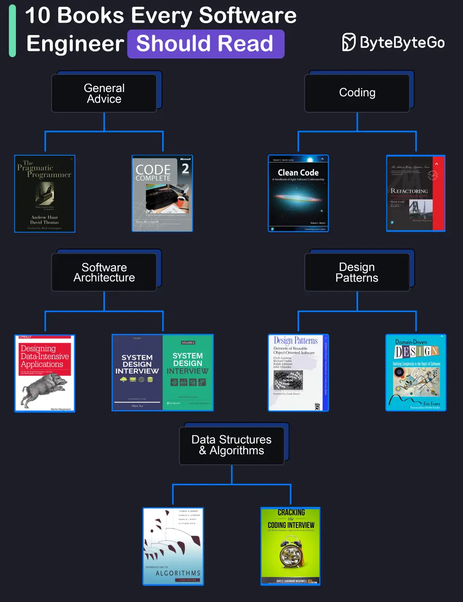

# ByteByteGo System Design 101: 10 Books for Software Developers

> Copied from <https://github.com/ByteByteGoHq/system-design-101> (CC BY-NC-ND 4.0, by ByteByteGo). Questions and answers are the source's own; nothing was answered or rewritten here.

## General Advice

*   **The Pragmatic Programmer** by Andrew Hunt and David Thomas

*   **Code Complete** by Steve McConnell: Often considered a bible for software developers, this comprehensive book covers all aspects of software development, from design and coding to testing and maintenance.

## Coding

*   **Clean Code** by Robert C. Martin

*   **Refactoring** by Martin Fowler

## Software Architecture

*   **Designing Data-Intensive Applications** by Martin Kleppmann

*   **System Design Interview** (our own book :))

## Design Patterns

*   **Design Patterns** by Eric Gamma and Others

*   **Domain-Driven Design** by Eric Evans

## Data Structures and Algorithms

*   **Introduction to Algorithms** by Cormen, Leiserson, Rivest, and Stein

*   **Cracking the Coding Interview** by Gayle Laakmann McDowell
