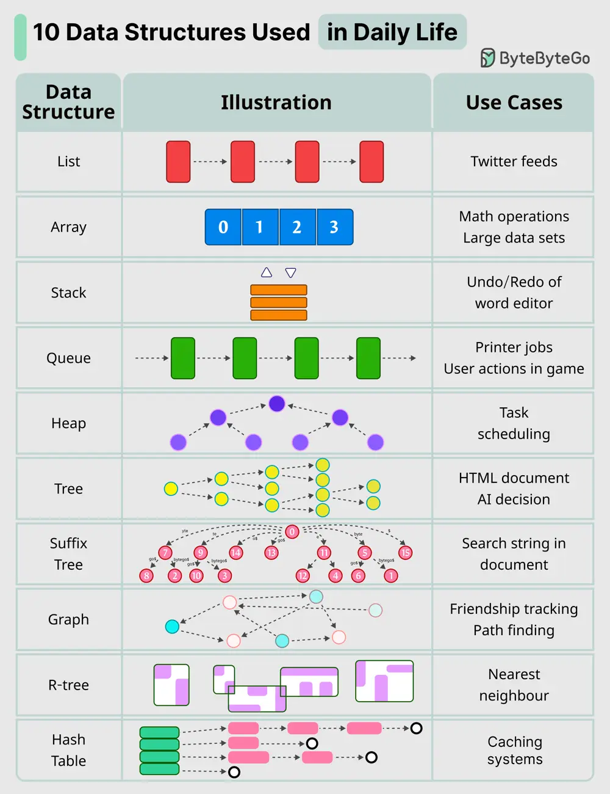

# ByteByteGo System Design 101: 10 Key Data Structures We Use Every Day

> Copied from <https://github.com/ByteByteGoHq/system-design-101> (CC BY-NC-ND 4.0, by ByteByteGo). Questions and answers are the source's own; nothing was answered or rewritten here.

Here are 10 key data structures we use every day:

*   **List**: Keep your Twitter feeds

*   **Stack**: Support undo/redo of the word editor

*   **Queue**: Keep printer jobs, or send user actions in-game

*   **Hash Table**: Caching systems

*   **Array**: Math operations

*   **Heap**: Task scheduling

*   **Tree**: Keep the HTML document, or for AI decision

*   **Suffix Tree**: For searching string in a document

*   **Graph**: For tracking friendship, or path finding

*   **R-Tree**: For finding the nearest neighbor

*   **Vertex Buffer**: For sending data to GPU for rendering
