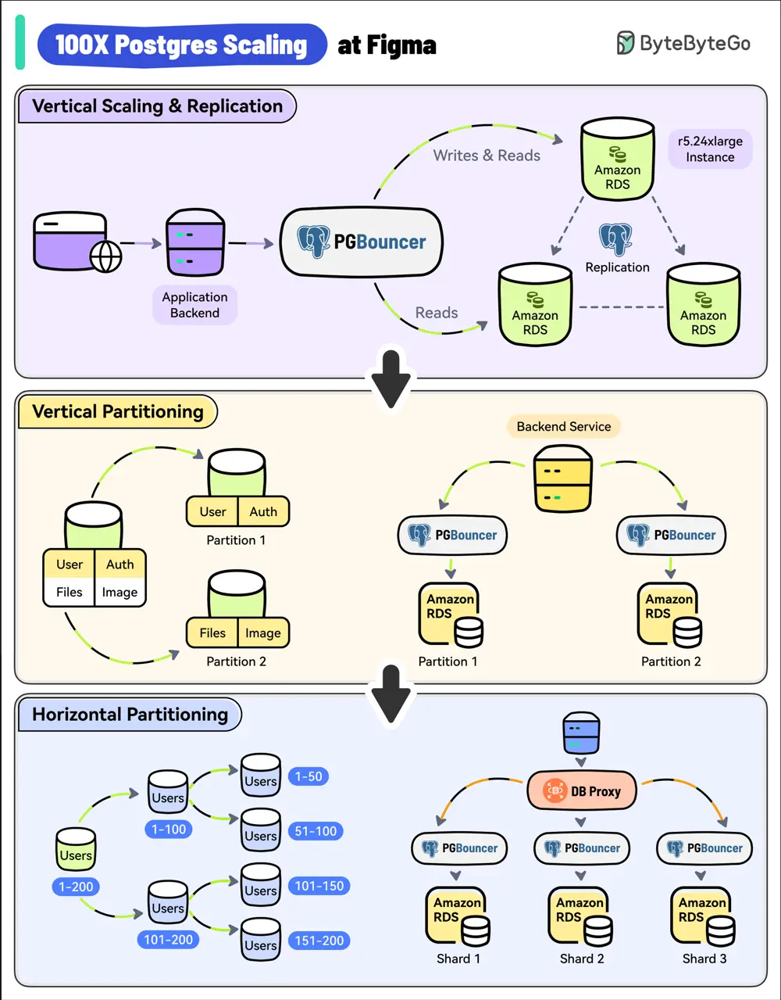

# ByteByteGo System Design 101: 100X Postgres Scaling at Figma

> Copied from <https://github.com/ByteByteGoHq/system-design-101> (CC BY-NC-ND 4.0, by ByteByteGo). Questions and answers are the source's own; nothing was answered or rewritten here.

With 3 million monthly users, Figma’s user base has increased by 200% since 2018.

As a result, its Postgres database witnessed a whopping 100X growth.

*   **Vertical Scaling and Replication**

    Figma used a single, large Amazon RDS database.

    As a first step, they upgraded to the largest instance available (from r5.12xlarge to r5.24xlarge).

    They also created multiple read replicas to scale read traffic and added PgBouncer as a connection pooler to limit the impact of a growing number of connections.

*   **Vertical Partitioning**

    The next step was vertical partitioning.

    They migrated high-traffic tables like “Figma Files” and “Organizations” into their separate databases.

    Multiple PgBouncer instances were used to manage the connections for these separate databases.

*   **Horizontal Partitioning**

    Over time, some tables crossed several terabytes of data and billions of rows.

    Postgres Vacuum became an issue and max IOPS exceeded the limits of Amazon RDS at the time.

    To solve this, Figma implemented horizontal partitioning by splitting large tables across multiple physical databases.

    A new DBProxy service was built to handle routing and query execution.
