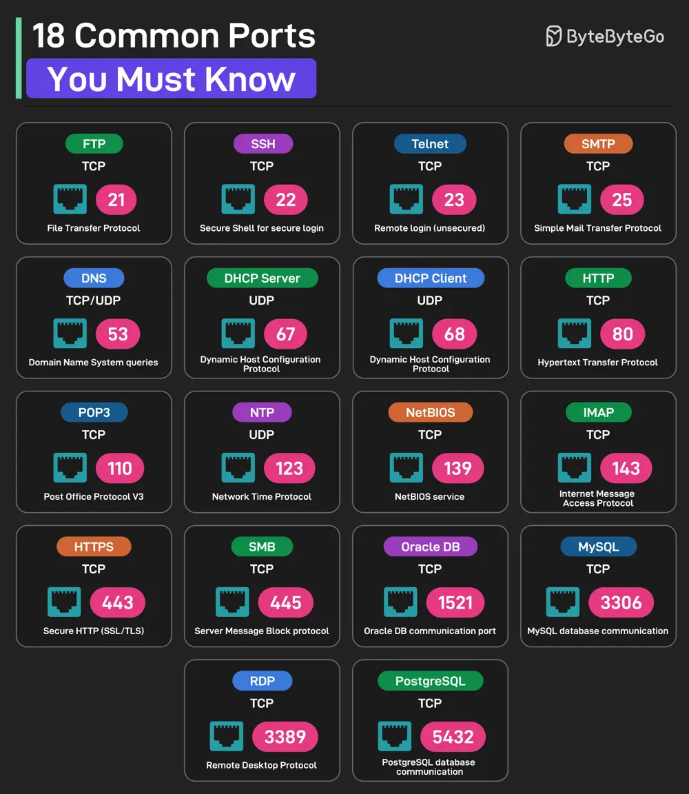

# ByteByteGo System Design 101: 18 Common Ports Worth Knowing

> Copied from <https://github.com/ByteByteGoHq/system-design-101> (CC BY-NC-ND 4.0, by ByteByteGo). Questions and answers are the source's own; nothing was answered or rewritten here.

*   **FTP (File Transfer Protocol):** Uses TCP Port 21
*   **SSH (Secure Shell for Login):** Uses TCP Port 22
*   **Telnet:** Uses TCP Port 23 for remote login
*   **SMTP (Simple Mail Transfer Protocol):** Uses TCP Port 25
*   **DNS:** Uses UDP or TCP on Port 53 for DNS queries
*   **DHCP Server:** Uses UDP Port 67
*   **DHCP Client:** Uses UDP Port 68
*   **HTTP (Hypertext Transfer Protocol):** Uses TCP Port 80
*   **POP3 (Post Office Protocol V3):** Uses TCP Port 110
*   **NTP (Network Time Protocol):** Uses UDP Port 123
*   **NetBIOS:** Uses TCP Port 139 for NetBIOS service
*   **IMAP (Internet Message Access Protocol):** Uses TCP Port 143
*   **HTTPS (Secure HTTP):** Uses TCP Port 443
*   **SMB (Server Message Block):** Uses TCP Port 445
*   **Oracle DB:** Uses TCP Port 1521 for Oracle database communication port
*   **MySQL:** Uses TCP Port 3306 for MySQL database communication port
*   **RDP:** Uses TCP Port 3389 for Remote Desktop Protocol
*   **PostgreSQL:** Uses TCP Port 5432 for PostgreSQL database communication
