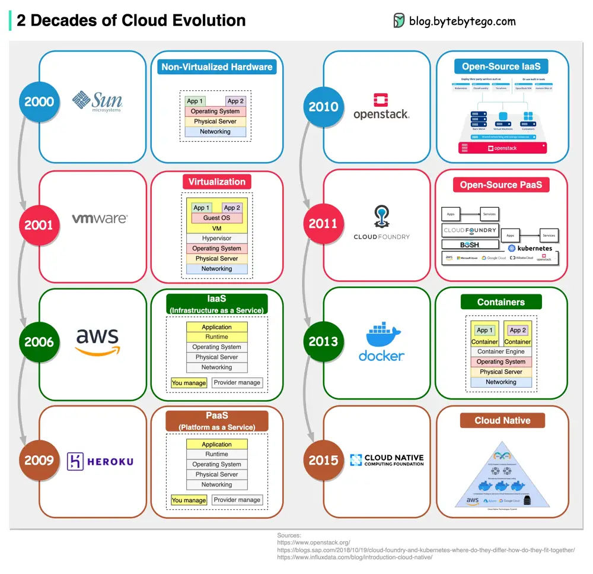

# ByteByteGo System Design 101: 2 Decades of Cloud Evolution

> Copied from <https://github.com/ByteByteGoHq/system-design-101> (CC BY-NC-ND 4.0, by ByteByteGo). Questions and answers are the source's own; nothing was answered or rewritten here.

IaaS, PaaS, Cloud Native… How do we get here? The diagram below shows two decades of cloud evolution.

## Cloud Evolution Timeline

*   2001 - VMWare - Virtualization via hypervisor

*   2006 - AWS - IaaS (Infrastructure as a Service)

*   2009 - Heroku - PaaS (Platform as a Service)

*   2010 - OpenStack - Open-source IaaS

*   2011 - CloudFoundry - Open-source PaaS

*   2013 - Docker - Containers

*   2015 - CNCF (Cloud Native Computing Foundation) - Cloud Native
