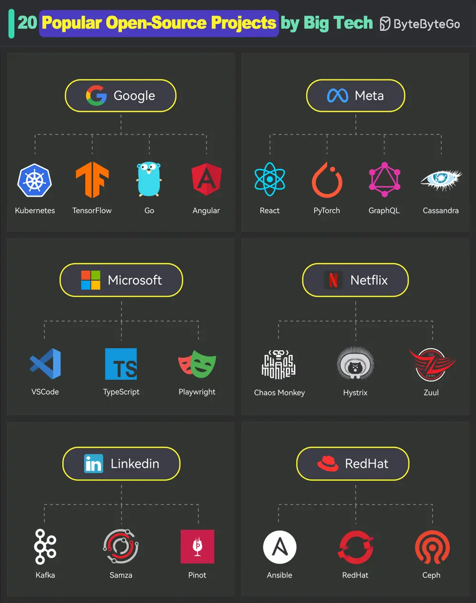

# ByteByteGo System Design 101: 20 Popular Open Source Projects Started by Big Companies

> Copied from <https://github.com/ByteByteGoHq/system-design-101> (CC BY-NC-ND 4.0, by ByteByteGo). Questions and answers are the source's own; nothing was answered or rewritten here.

## 1. Google

*   Kubernetes
*   TensorFlow
*   Go
*   Angular

## 2. Meta

*   React
*   PyTorch
*   GraphQL
*   Cassandra

## 3. Microsoft

*   VSCode
*   TypeScript
*   Playwright

## 4. Netflix

*   Chaos Monkey
*   Hystrix
*   Zuul

## 5. LinkedIn

*   Kafka
*   Samza
*   Pinot

## 6. RedHat

*   Ansible
*   OpenShift
*   Ceph Storage
