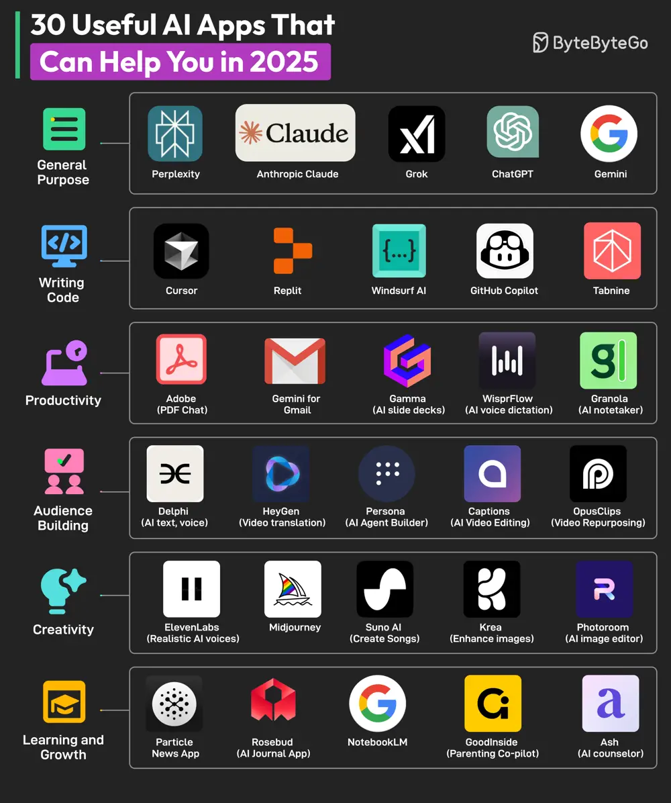

# ByteByteGo System Design 101: 30 Useful AI Apps That Can Help You in 2025

> Copied from <https://github.com/ByteByteGoHq/system-design-101> (CC BY-NC-ND 4.0, by ByteByteGo). Questions and answers are the source's own; nothing was answered or rewritten here.

AI apps are taking over the world. There’s an AI app for every conceivable use case. Here are some AI apps for different categories:

## General Purpose

*   Perplexity
*   Anthropic Claude
*   Grok
*   ChatGPT
*   Gemini

## Writing Code

*   Cursor
*   Replit
*   Windsurf AI
*   Github Copilot
*   Tabnine

## Productivity

*   Adobe (PDF Chat)
*   Gemini for Gmail
*   Gamma (AI slide deck)
*   WisprFlow (AI voice dictation)
*   Granola (AI notetaker)

## Audience Building

*   Delphi (AI text, voice)
*   HeyGen (video translation)
*   Persona (AI agent builder)
*   Captions (AI video editing)
*   OpusClips (Video repurposing)

## Creativity

*   ElevenLabs (realistic AI voices)
*   Midjourney
*   Suno AI (music generation)
*   Krea (enhance images)
*   Photoroom (AI image editing)

## Learning and Growth

*   Particle News App
*   Rosebud (AI journal app)
*   NotebookLM
*   GoodInside (parenting co-pilot)
*   Ash (AI counselor)
