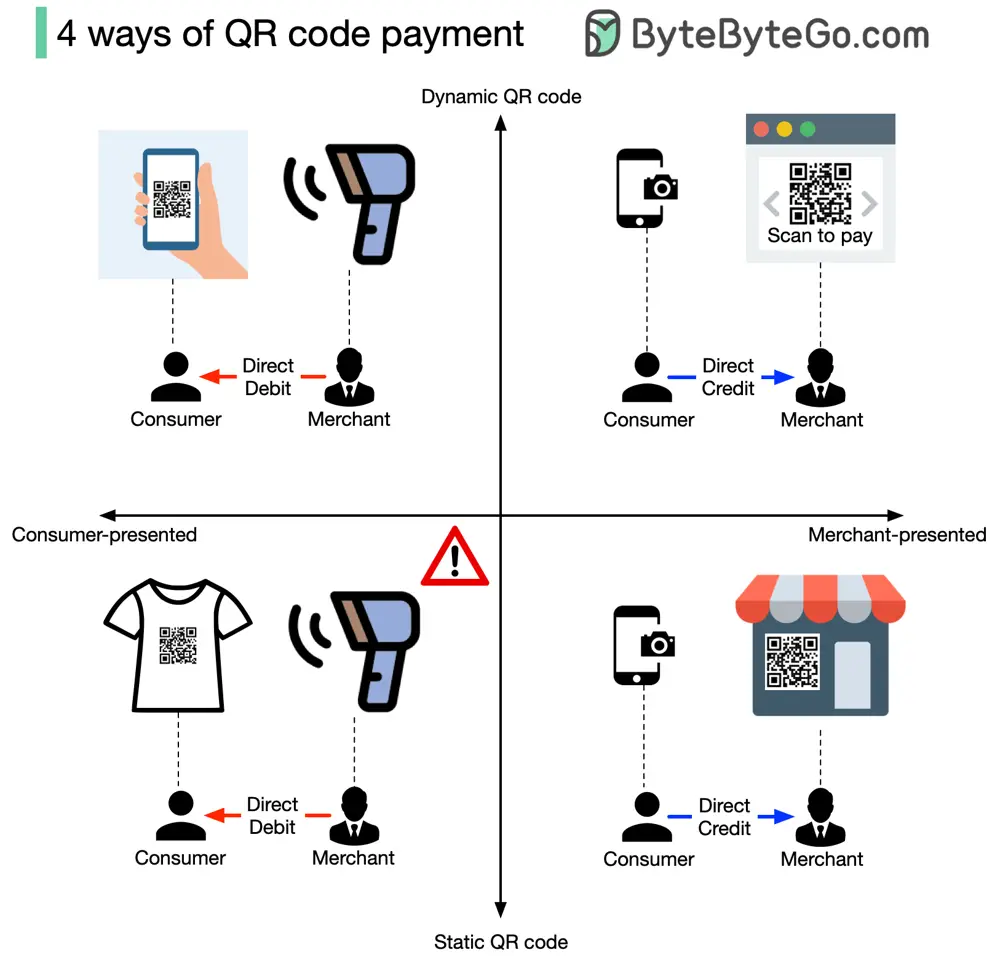

# ByteByteGo System Design 101: 4 Ways of QR Code Payment

> Copied from <https://github.com/ByteByteGoHq/system-design-101> (CC BY-NC-ND 4.0, by ByteByteGo). Questions and answers are the source's own; nothing was answered or rewritten here.

Payment through scanning QR code is very common, but do you know how many ways there are to do it?

There are 4 ways, no matter whether you’re using PayPal, Stripe, Paytm, WeChat, or Alipay. Is this surprising to you? To understand this, we will answer two questions.

## Who Presents the QR Code?

1.  You can present the QR code, and the merchant scans the code for payment. This is called ‘consumer-presented mode,’ and what the merchant does is direct debit your account.

2.  Obviously, the other way is that the merchant presents the QR code for you to scan to pay the due amount. This is called ‘merchant-presented mode,’ and you grant the direct credit from your account.

## Is the QR Code Dynamic or Static?

1.  A dynamic QR code means the QR code will be generated when you present it, or it will automatically regenerate every few seconds. Because it is dynamically generated, it may contain rich information, such as the amount due, transaction type, etc.

2.  A static QR code is generated once and used everywhere. Usually, it only contains the account information.

So there are 2*2=4 ways to scan a QR code, which are:

*   Consumer-presented mode + static QR code
*   Consumer-presented mode + dynamic QR code
*   Merchant-presented mode + static QR code
*   Merchant-presented mode + dynamic QR code
