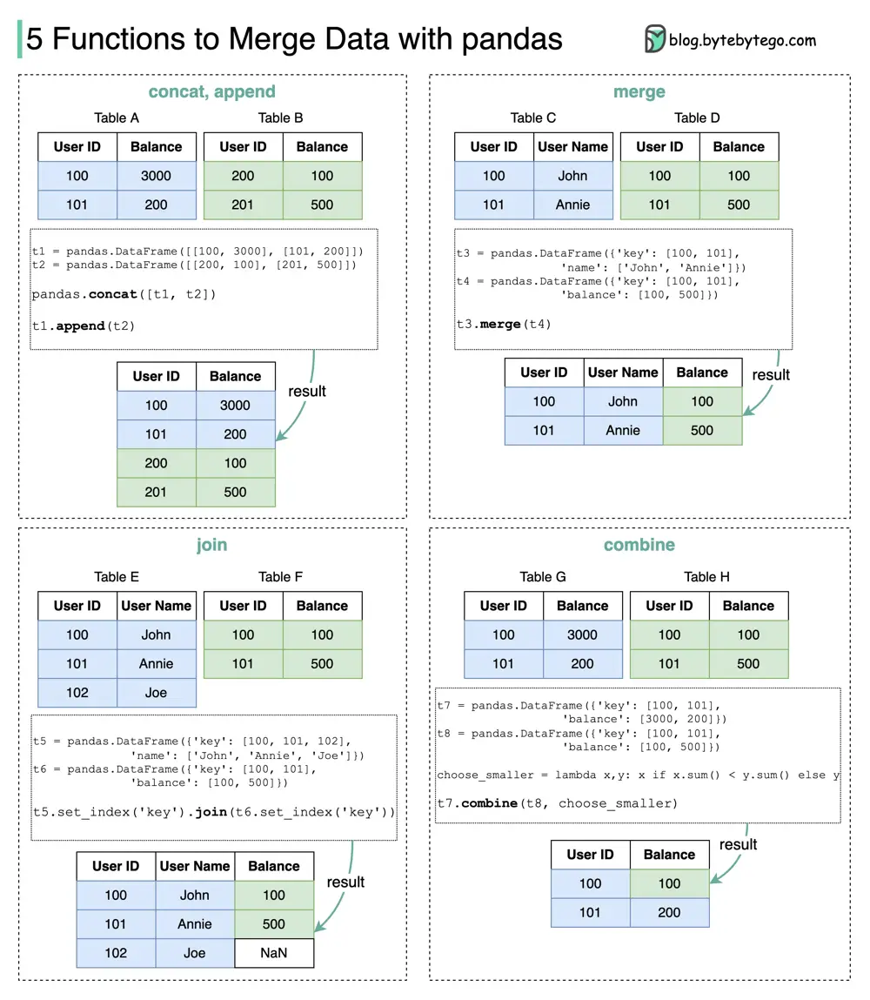

# ByteByteGo System Design 101: 5 Functions to Merge Data with Pandas

> Copied from <https://github.com/ByteByteGoHq/system-design-101> (CC BY-NC-ND 4.0, by ByteByteGo). Questions and answers are the source's own; nothing was answered or rewritten here.

How do we quickly merge data without Microsoft Excel?

Here are 5 useful pandas functions for production data analysis.

- **Concat:** this function supports the vertical and horizontal combination of two tables. Concat can quickly combine the data from different shards.
- **Append:** this function supports the adding of data to an existing table. Append can be used in web crawlers. The new data can be appended to the table when it is crawled.
- **Merge:** this function supports horizontal combination on keys. It works similarly to database joins. Merge can be used to combine data from different domains with the same keys.
- **Join:** this function works similarly to database outer joins.
- **Combine:** this function can apply calculations while combining two tables. The example below chooses the smaller value for the cell. Combine is useful for a data cleansing process.
