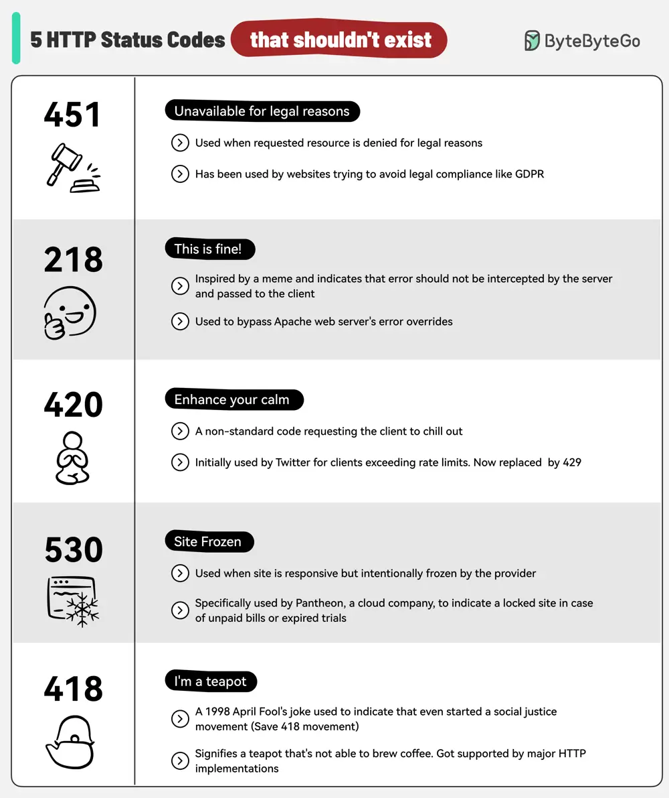

# ByteByteGo System Design 101: 5 HTTP Status Codes That Should Never Have Been Created

> Copied from <https://github.com/ByteByteGoHq/system-design-101> (CC BY-NC-ND 4.0, by ByteByteGo). Questions and answers are the source's own; nothing was answered or rewritten here.

*   **451 Unavailable for Legal Reasons:** Access denied due to legal issues.
*   **218 This is Fine:** Inspired by the meme, bypasses server error overrides.
*   **420 Enhance Your Calm:** Twitter’s old code for exceeding rate limits. Now changed to 429.
*   **530 Site Frozen:** Used by Pantheon for locked sites, often unpaid bills.
*   **418 I'm a Teapot:** A classic April Fool's joke indicating a server's limitations.
