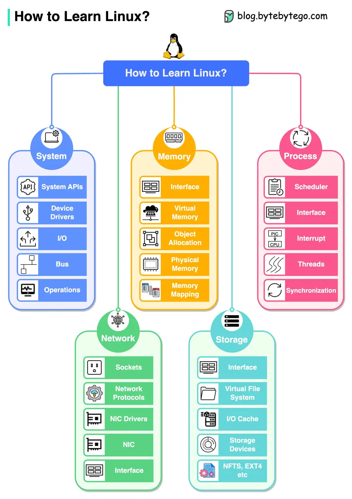

# ByteByteGo System Design 101: 5 Important Components of Linux

> Copied from <https://github.com/ByteByteGoHq/system-design-101> (CC BY-NC-ND 4.0, by ByteByteGo). Questions and answers are the source's own; nothing was answered or rewritten here.

Here are the five important components of Linux:

*   **System**

    In the system component, we need to learn modules like system APIs, device drivers, I/O, buses, etc.

*   **Memory**

    In memory management, we need to learn modules like physical memory, virtual memory, memory mappings, object allocation, etc.

*   **Process**

    In process management, we need to learn modules like process scheduling, interrupts, threads, synchronization, etc.

*   **Network**

    In the network component, we need to learn important modules like network protocols, sockets, NIC drivers, etc.

*   **Storage**

    In system storage management, we need to learn modules like file systems, I/O caches, different storage devices, file system implementations, etc.
