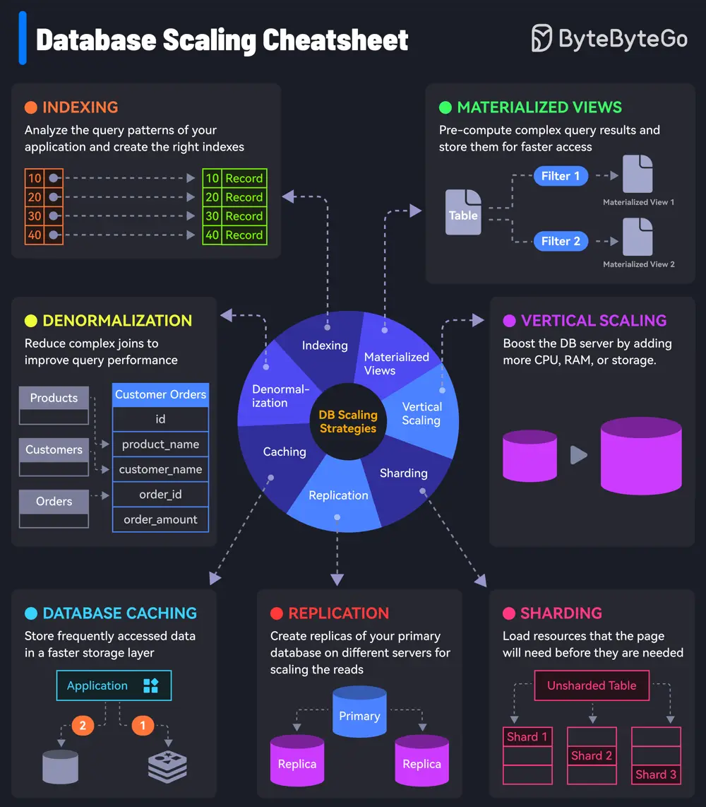

# ByteByteGo System Design 101: 7 Must-Know Strategies to Scale Your Database

> Copied from <https://github.com/ByteByteGoHq/system-design-101> (CC BY-NC-ND 4.0, by ByteByteGo). Questions and answers are the source's own; nothing was answered or rewritten here.

## 1. Indexing

Check the query patterns of your application and create the right indexes.

## 2. Materialized Views

Pre-compute complex query results and store them for faster access.

## 3. Denormalization

Reduce complex joins to improve query performance.

## 4. Vertical Scaling

Boost your database server by adding more CPU, RAM, or storage.

## 5. Caching

Store frequently accessed data in a faster storage layer to reduce database load.

## 6. Replication

Create replicas of your primary database on different servers for scaling the reads.

## 7. Sharding

Split your database tables into smaller pieces and spread them across servers. Used for scaling the writes as well as the reads.
