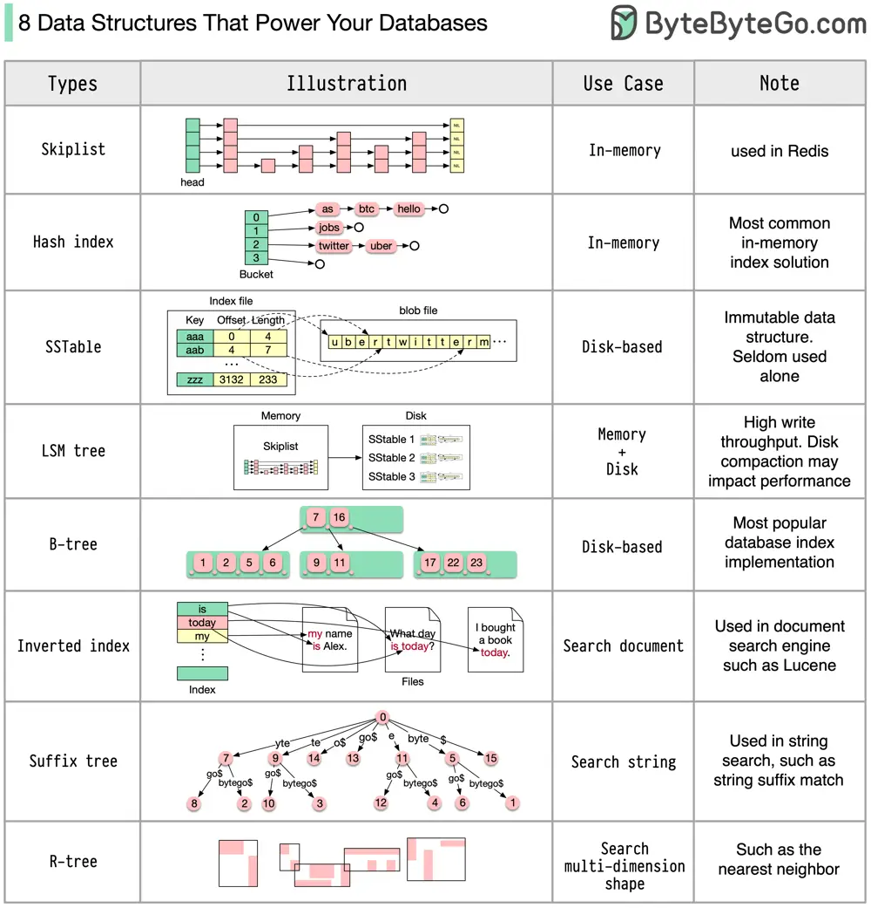

# ByteByteGo System Design 101: 8 Data Structures That Power Your Databases

> Copied from <https://github.com/ByteByteGoHq/system-design-101> (CC BY-NC-ND 4.0, by ByteByteGo). Questions and answers are the source's own; nothing was answered or rewritten here.

The answer will vary depending on your use case. Data can be indexed in memory or on disk. Similarly, data formats vary, such as numbers, strings, geographic coordinates, etc. The system might be write-heavy or read-heavy. All of these factors affect your choice of database index format.

The following are some of the most popular data structures used for indexing data:

*   **Skiplist:** a common in-memory index type. Used in Redis

*   **Hash index:** a very common implementation of the “Map” data structure (or “Collection”)

*   **SSTable:** immutable on-disk “Map” implementation

*   **LSM tree:** Skiplist + SSTable. High write throughput

*   **B-tree:** disk-based solution. Consistent read/write performance

*   **Inverted index:** used for document indexing. Used in Lucene

*   **Suffix tree:** for string pattern search

*   **R-tree:** multi-dimension search, such as finding the nearest neighbor

This is not an exhaustive list of all database index types.
