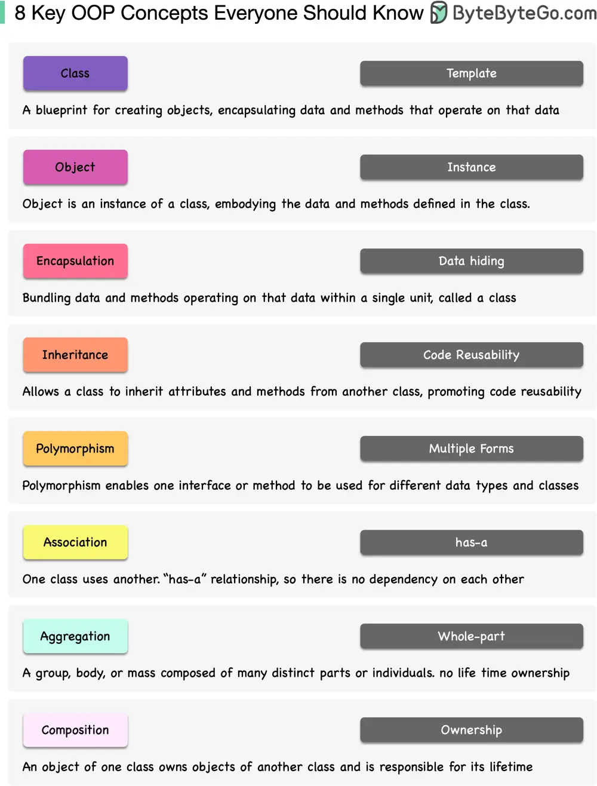

# ByteByteGo System Design 101: 8 Key OOP Concepts Every Developer Should Know

> Copied from <https://github.com/ByteByteGoHq/system-design-101> (CC BY-NC-ND 4.0, by ByteByteGo). Questions and answers are the source's own; nothing was answered or rewritten here.

Object-Oriented Programming (OOP) has been around since the 1960s, but it really took off in the 1990s with languages like Java and C++.

Why is OOP Important? OOP allows you to create blueprints (called classes) for digital objects, and these objects know how to communicate with one another to make amazing things happen in your software. Having a well-organized toolbox rather than a jumbled drawer of tools makes your code tidier and easier to change.

In order to get to grips with OOP, think of it as creating digital Lego blocks that can be combined in countless ways. Take a book or watch some tutorials, and then practice writing code - there's no better way to learn than to practice!

Don't be afraid of OOP - it's a powerful tool in your coder's toolbox, and with some practice, you'll be able to develop everything from nifty apps to digital skyscrapers!
