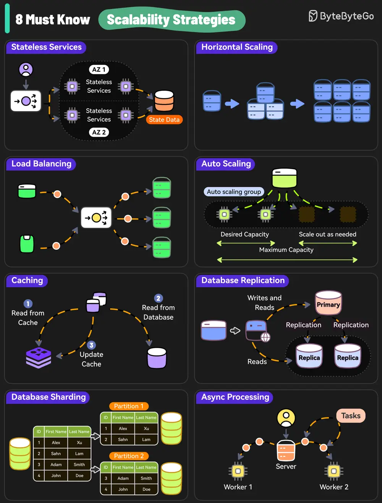

# ByteByteGo System Design 101: 8 Must-Know Scalability Strategies

> Copied from <https://github.com/ByteByteGoHq/system-design-101> (CC BY-NC-ND 4.0, by ByteByteGo). Questions and answers are the source's own; nothing was answered or rewritten here.

What do Amazon, Netflix, and Uber have in common? They are extremely good at scaling their system whenever needed.

Here are 8 must-know strategies to scale your system.

*   Stateless Services

    Design stateless services because they don’t rely on server-specific data and are easier to scale.

*   Horizontal Scaling

    Add more servers so that the workload can be shared.

*   Load Balancing

    Use a load balancer to distribute incoming requests evenly across multiple servers.

*   Auto Scaling

    Implement auto-scaling policies to adjust resources based on real-time traffic.

*   Caching

    Use caching to reduce the load on the database and handle repetitive requests at scale.

*   Database Replication

    Replicate data across multiple nodes to scale the read operations while improving redundancy.

*   Database Sharding

    Distribute data across multiple instances to scale the writes as well as reads.

*   Async Processing

    Move time-consuming and resource-intensive tasks to background workers using async processing to scale out new requests.
