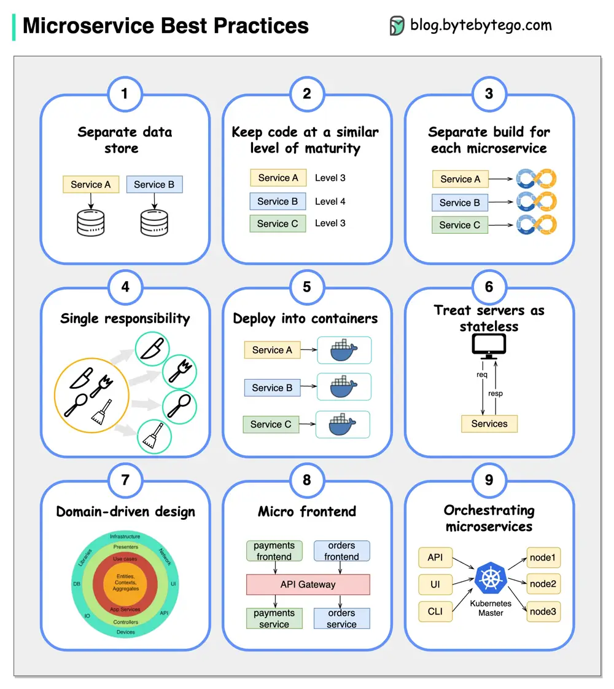

# ByteByteGo System Design 101: 9 Best Practices for Developing Microservices

> Copied from <https://github.com/ByteByteGoHq/system-design-101> (CC BY-NC-ND 4.0, by ByteByteGo). Questions and answers are the source's own; nothing was answered or rewritten here.

When developing microservices, it's crucial to follow these best practices:

## Best Practices

*   **Use separate data storage for each microservice**

*   **Keep code at a similar level of maturity**

*   **Separate build for each microservice**

*   **Assign each microservice with a single responsibility**

*   **Deploy into containers**

*   **Design stateless services**

*   **Adopt domain-driven design**

*   **Design micro frontend**

*   **Orchestrating microservices**
