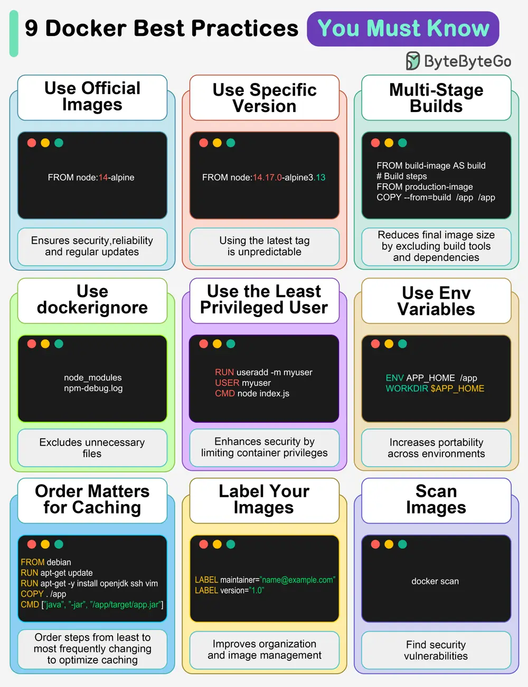

# ByteByteGo System Design 101: 9 Docker Best Practices You Must Know

> Copied from <https://github.com/ByteByteGoHq/system-design-101> (CC BY-NC-ND 4.0, by ByteByteGo). Questions and answers are the source's own; nothing was answered or rewritten here.

## 1. Use official images

This ensures security, reliability, and regular updates.

## 2. Use a specific image version

The default latest tag is unpredictable and causes unexpected behavior.

## 3. Multi-Stage builds

Reduces final image size by excluding build tools and dependencies.

## 4. Use .dockerignore

Excludes unnecessary files, speeds up builds, and reduces image size.

## 5. Use the least privileged user

Enhances security by limiting container privileges.

## 6. Use environment variables

Increases flexibility and portability across different environments.

## 7. Order matters for caching

Order your steps from least to most frequently changing to optimize caching.

## 8. Label your images

It improves organization and helps with image management.

## 9. Scan images

Find security vulnerabilities before they become bigger problems.

Over to you: Which other Docker best practices will you add to the list?
