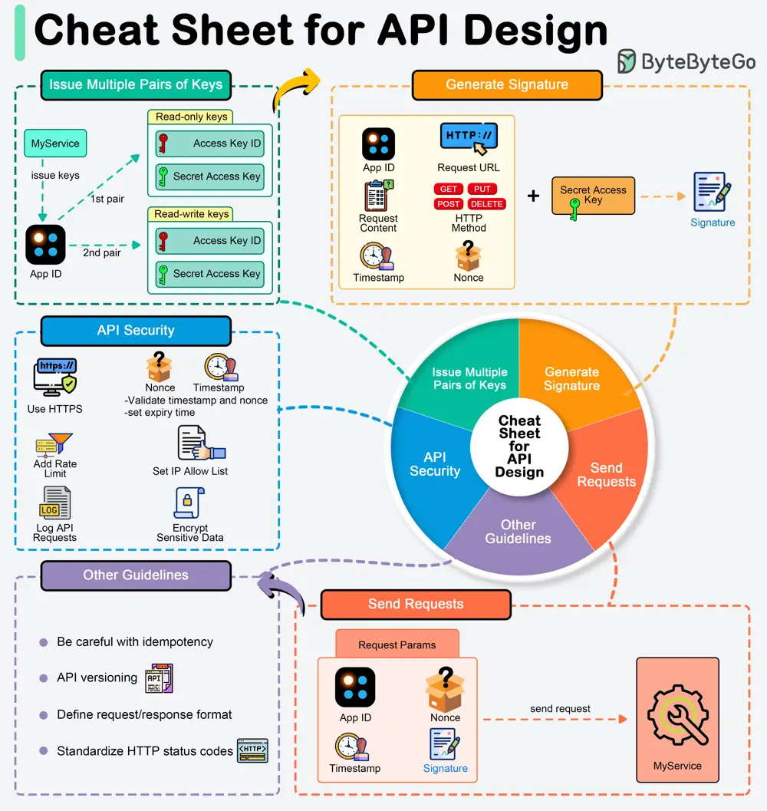

# ByteByteGo System Design 101: A cheat sheet for API designs

> Copied from <https://github.com/ByteByteGoHq/system-design-101> (CC BY-NC-ND 4.0, by ByteByteGo). Questions and answers are the source's own; nothing was answered or rewritten here.

APIs expose business logic and data to external systems, so designing them securely and efficiently is important.

## API key generation

We normally generate one unique app ID for each client and generate different pairs of public key (access key) and private key (secret key) to cater to different authorizations. For example, we can generate one pair of keys for read-only access and another pair for read-write access.

## Signature generation

Signatures are used to verify the authenticity and integrity of API requests. They are generated using the secret key and typically involve the following steps:

*   Collect parameters
*   Create a string to sign
*   Hash the string: Use a cryptographic hash function, like HMAC (Hash-based Message Authentication Code) in combination with SHA-256, to hash the string using the secret key.
*   Send the requests

When designing an API, deciding what should be included in HTTP request parameters is crucial. Include the following in the request parameters:

*   Authentication Credentials
*   Timestamp: To prevent replay attacks.
*   Request-specific Data: Necessary to process the request, such as user IDs, transaction details, or search queries.
*   Nonces: Randomly generated strings included in each request to ensure that each request is unique and to prevent replay attacks.

## Security guidelines

To safeguard APIs against common vulnerabilities and threats, adhere to these security guidelines.
