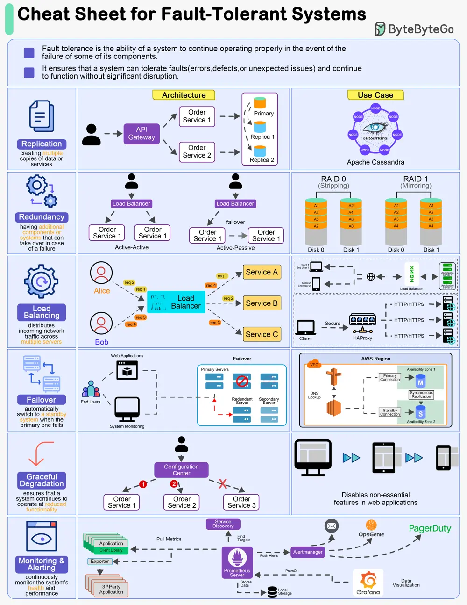

# ByteByteGo System Design 101: A Cheat Sheet for Designing Fault-Tolerant Systems

> Copied from <https://github.com/ByteByteGoHq/system-design-101> (CC BY-NC-ND 4.0, by ByteByteGo). Questions and answers are the source's own; nothing was answered or rewritten here.

Designing fault-tolerant systems is crucial for ensuring high availability and reliability in various applications. Here are six top principles of designing fault-tolerant systems:

## Replication

Replication involves creating multiple copies of data or services across different nodes or locations.

## Redundancy

Redundancy refers to having additional components or systems that can take over in case of a failure.

## Load Balancing

Load balancing distributes incoming network traffic across multiple servers to ensure no single server becomes a point of failure.

## Failover Mechanisms

Failover mechanisms automatically switch to a standby system or component when the primary one fails.

## Graceful Degradation

Graceful degradation ensures that a system continues to operate at reduced functionality rather than completely failing when some components fail.

## Monitoring and Alerting

Continuously monitor the system's health and performance, and set up alerts for any anomalies or failures.
