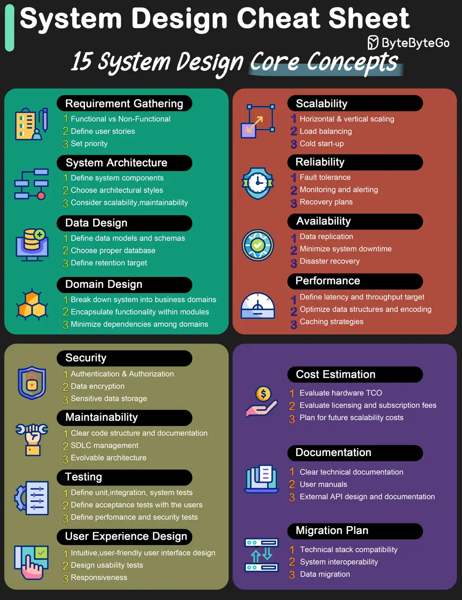

# ByteByteGo System Design 101: A cheat sheet for system designs

> Copied from <https://github.com/ByteByteGoHq/system-design-101> (CC BY-NC-ND 4.0, by ByteByteGo). Questions and answers are the source's own; nothing was answered or rewritten here.

The diagram below lists 15 core concepts when we design systems. The cheat sheet is straightforward to go through one by one. Save it for future reference!

*   Requirement gathering
*   System architecture
*   Data design
*   Domain design
*   Scalability
*   Reliability
*   Availability
*   Performance
*   Security
*   Maintainability
*   Testing
*   User experience design
*   Cost estimation
*   Documentation
*   Migration plan
