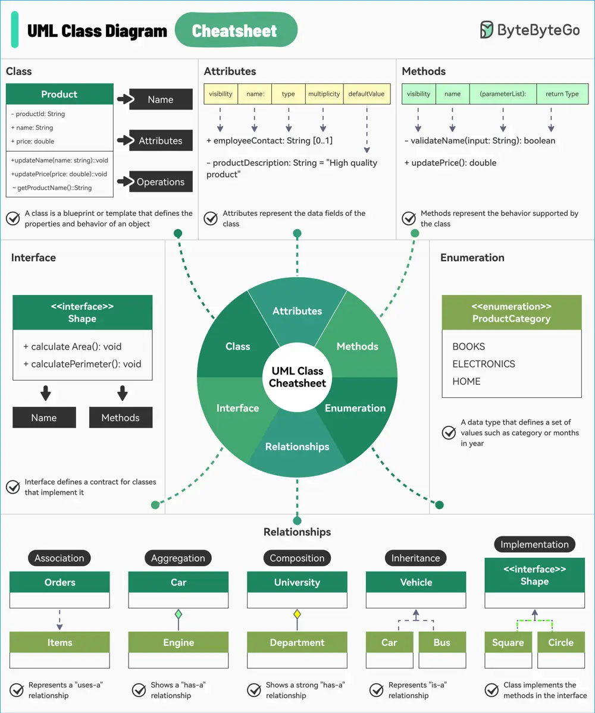

# ByteByteGo System Design 101: UML Class Diagrams Cheatsheet

> Copied from <https://github.com/ByteByteGoHq/system-design-101> (CC BY-NC-ND 4.0, by ByteByteGo). Questions and answers are the source's own; nothing was answered or rewritten here.

UML is a standard way to visualize the design of your system and class diagrams are used across the industry.

They consist of:

*   **Class**

    Acts as the blueprint that defines the properties and behavior of an object.

*   **Attributes**

    Attributes in a UML class diagram represent the data fields of the class.

*   **Methods**

    Methods in a UML class diagram represent the behavior that a class can perform.

*   **Interfaces**

    Defines a contract for classes that implement it. Includes a set of methods that the implementing classes must provide.

*   **Enumeration**

    A special data type that defines a set of named values such as product category or months in a year.

*   **Relationships**

    Determines how one class is related to another. Some common relationships are as follows:

    *   Association
    *   Aggregation
    *   Composition
    *   Inheritance
    *   Implementation
