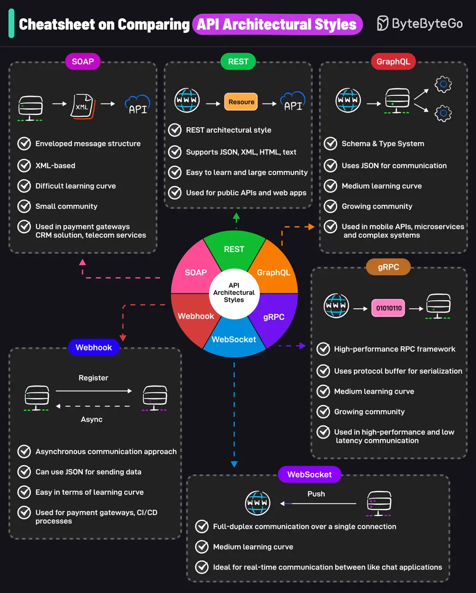

# ByteByteGo System Design 101: A Cheatsheet on Comparing API Architectural Styles

> Copied from <https://github.com/ByteByteGoHq/system-design-101> (CC BY-NC-ND 4.0, by ByteByteGo). Questions and answers are the source's own; nothing was answered or rewritten here.

It covers the 6 most popular API architectural styles:

* SOAP
* REST
* GraphQL
* gRPC
* WebSocket
* Webhook
