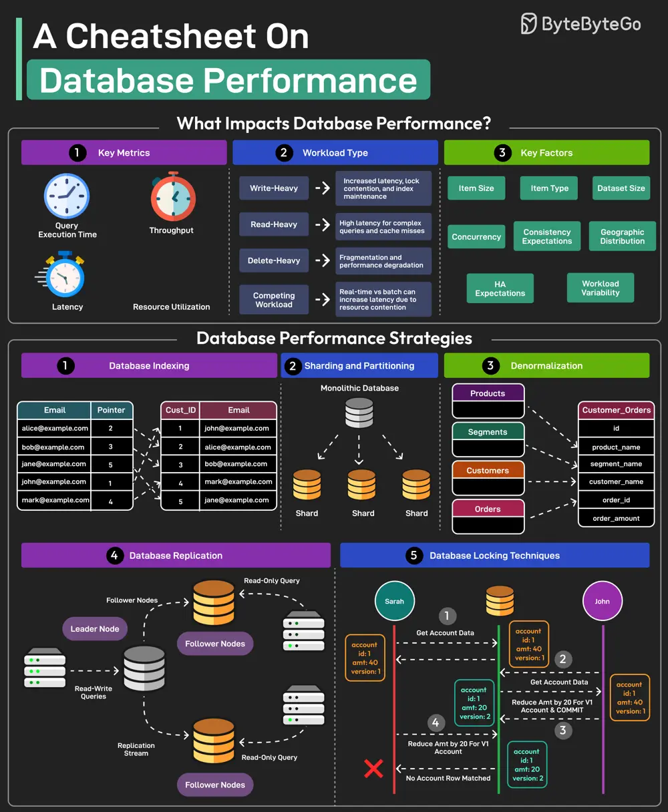

# ByteByteGo System Design 101: A Cheatsheet on Database Performance

> Copied from <https://github.com/ByteByteGoHq/system-design-101> (CC BY-NC-ND 4.0, by ByteByteGo). Questions and answers are the source's own; nothing was answered or rewritten here.

## Database Performance Cheatsheet

Here's a cheatsheet on database performance:

### **1. Indexing**

*   **Purpose**: Speed up data retrieval.
*   **Considerations**:
    *   Over-indexing can slow down writes.
    *   Regularly review and optimize indexes.

### **2. Query Optimization**

*   **Techniques**:
    *   Use `EXPLAIN` to analyze query plans.
    *   Avoid `SELECT *`.
    *   Write efficient `WHERE` clauses.

### **3. Connection Pooling**

*   **Benefits**:
    *   Reduces overhead of establishing new connections.
    *   Improves response times.

### **4. Caching**

*   **Levels**:
    *   Application-level (e.g., Memcached, Redis).
    *   Database-level (query cache).

### **5. Sharding**

*   **Definition**: Distribute data across multiple databases.
*   **Use Cases**:
    *   Handling large datasets.
    *   Improving write performance.

### **6. Replication**

*   **Types**:
    *   Master-slave.
    *   Master-master.
*   **Purpose**:
    *   Read scaling.
    *   High availability.

### **7. Hardware**

*   **Considerations**:
    *   Sufficient RAM.
    *   Fast storage (SSD).
    *   Adequate CPU.

### **8. Monitoring**

*   **Metrics**:
    *   Query response times.
    *   CPU usage.
    *   Disk I/O.

### **9. Normalization/Denormalization**

*   **Normalization**: Reduces redundancy.
*   **Denormalization**: Improves read performance (trade-off with redundancy).

### **10. Partitioning**

*   **Types**:
    *   Horizontal.
    *   Vertical.
*   **Purpose**:
    *   Improve query performance.
    *   Easier data management.
