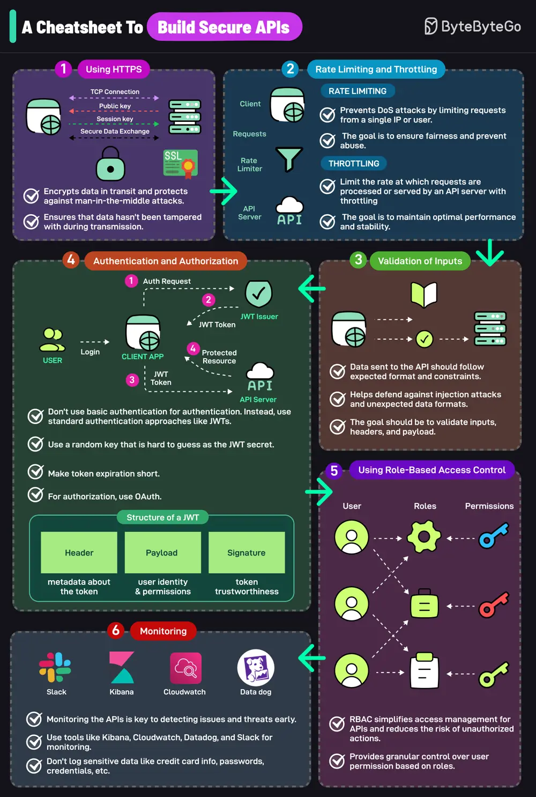

# ByteByteGo System Design 101: A Cheatsheet to Build Secure APIs

> Copied from <https://github.com/ByteByteGoHq/system-design-101> (CC BY-NC-ND 4.0, by ByteByteGo). Questions and answers are the source's own; nothing was answered or rewritten here.

An insecure API can compromise your entire application. Follow these strategies to mitigate the risk:

## Using HTTPS

- Encrypts data in transit and protects against man-in-the-middle attacks.
- This ensures that data hasn’t been tampered with during transmission.

## Rate Limiting and Throttling
- Rate limiting prevents DoS attacks by limiting requests from a single IP or user.
- The goal is to ensure fairness and prevent abuse.

## Validation of Inputs
- Defends against injection attacks and unexpected data format.
- Validate headers, inputs, and payload.

## Authentication and Authorization
- Don’t use basic auth for authentication.
- Instead, use a standard authentication approach like JWTs
  * Use a random key that is hard to guess as the JWT secret
  * Make token expiration short
-For authorization, use OAuth

## Using Role-based Access Control
- RBAC simplifies access management for APIs and reduces the risk of unauthorized actions.
- Granular control over user permission based on roles.

## Monitoring
- Monitoring the APIs is the key to detecting issues and threats early.
  - Use tools like Kibana, Cloudwatch, Datadog, and Slack for monitoring 
  - Don’t log sensitive data like credit card info, passwords, credentials, etc.
