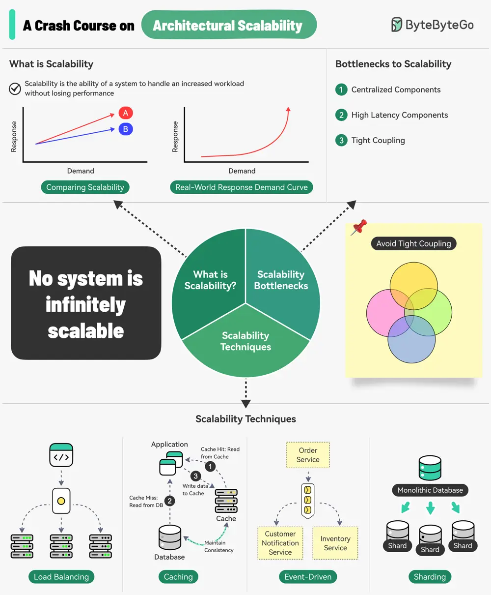

# ByteByteGo System Design 101: A Crash Course on Architectural Scalability

> Copied from <https://github.com/ByteByteGoHq/system-design-101> (CC BY-NC-ND 4.0, by ByteByteGo). Questions and answers are the source's own; nothing was answered or rewritten here.

Scalability is the ability of a system to handle an increased workload without losing performance.

However, we can also look at scalability in terms of the scaling strategy.

Scalability is the system’s ability to handle an increased workload by repeatedly applying a cost-effective strategy. This means it can be difficult to scale a system beyond a certain point if the scaling strategy is not financially viable.

Three main bottlenecks to scalability are:

1. Centralized components: This can become a single point of failure
2. High Latency Components: These are components that perform time-consuming operations.
3. Tight Coupling: Makes the components difficult to scale

Therefore, to build a scalable system, we should follow the principles of statelessness, loose coupling, and asynchronous processing.

Some common techniques for improving scalability are as follows:

* Load Balancing: Spread requests across multiple servers to prevent a single server from becoming a bottleneck.
* Caching: Store the most commonly request information in memory.
* Event-Driven Processing: Use an async processing approach to process long-running tasks.
* Sharding: Split a large dataset into smaller subsets called shards for horizontal scalability.
