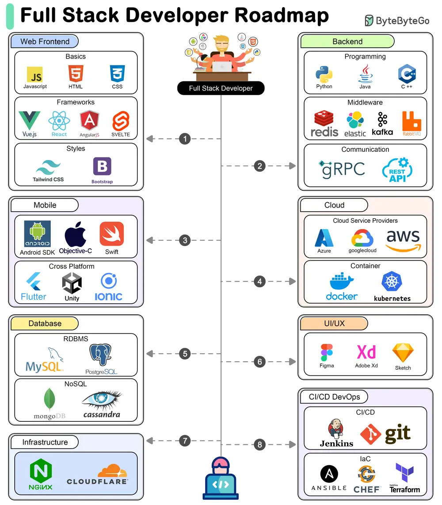

# ByteByteGo System Design 101: A Roadmap for Full-Stack Development

> Copied from <https://github.com/ByteByteGoHq/system-design-101> (CC BY-NC-ND 4.0, by ByteByteGo). Questions and answers are the source's own; nothing was answered or rewritten here.

A full-stack developer needs to be proficient in a wide range of technologies and tools across different areas of software development. Here’s a comprehensive look at the technical stacks required for a full-stack developer.

## Technical Stacks for Full-Stack Development

*   **Frontend Development**

    Frontend development involves creating the user interface and user experience of a web application.

*   **Backend Development**

    Backend development involves managing the server-side logic, databases, and integration of various services.

*   **Database Development**

    Database development involves managing data storage, retrieval, and manipulation.

*   **Mobile Development**

    Mobile development involves creating applications for mobile devices.

*   **Cloud Computing**

    Cloud computing involves deploying and managing applications on cloud platforms.

*   **UI/UX Design**

    UI/UX design involves designing the user interface and experience of applications.

*   **Infrastructure and DevOps**

    Infrastructure and DevOps involve managing the infrastructure, deployment, and continuous integration/continuous delivery (CI/CD) of applications.
