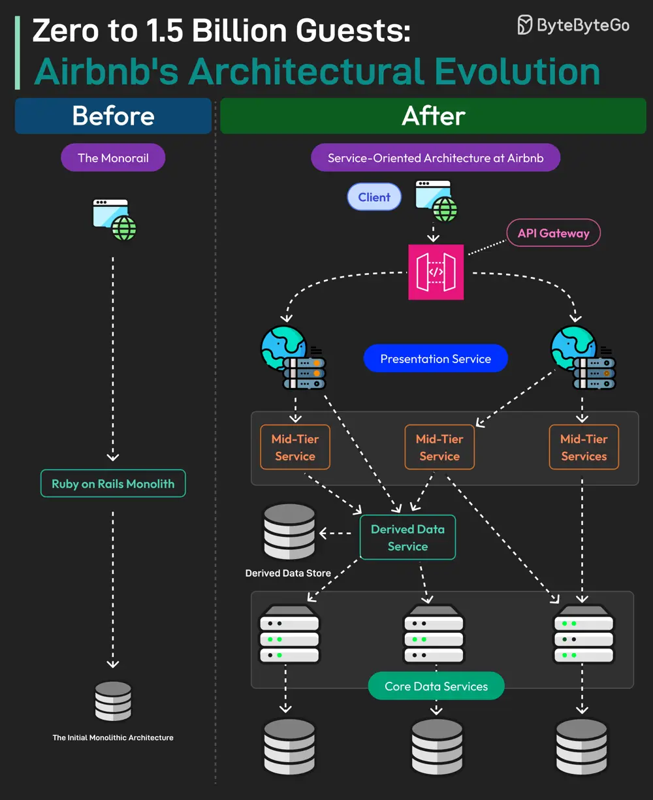

# ByteByteGo System Design 101: 0 to 1.5 Billion Guests: Airbnb's Architectural Evolution

> Copied from <https://github.com/ByteByteGoHq/system-design-101> (CC BY-NC-ND 4.0, by ByteByteGo). Questions and answers are the source's own; nothing was answered or rewritten here.

Airbnb operates in 200+ countries and has helped 4 million hosts welcome over 1.5 billion guests across the world.

What powers Airbnb technically?

Airbnb started as a monolithic application. It was built using Ruby-on-Rails and was internally known as the Monorail.

The monolith was a single-tier unit responsible for both client and server-side functionality.

However, as Airbnb went into hypergrowth, the Monorail started facing issues. This is when they began a migration journey to move from monolithic to Service-Oriented Architecture.

For Airbnb, SOA is a network of loosely coupled services where clients make their requests to a gateway and the gateway routes these requests to multiple services and databases.

Various types of services were built such as:

*   **Data Service:** This is the bottom layer and acts as the entry point for all read and write operations on the data entities.
*   **Derived Data Service:** These services read from data services and apply basic business logic.
*   **Middle Tier Service:** They manage important business logic that doesn’t fit at the data service level or derived data service level.
*   **Presentation Service:** They aggregate data from all other services and also apply some frontend-specific business logic.

After the migration, the Monorail was eliminated and all reads/writes were migrated to the new services.
