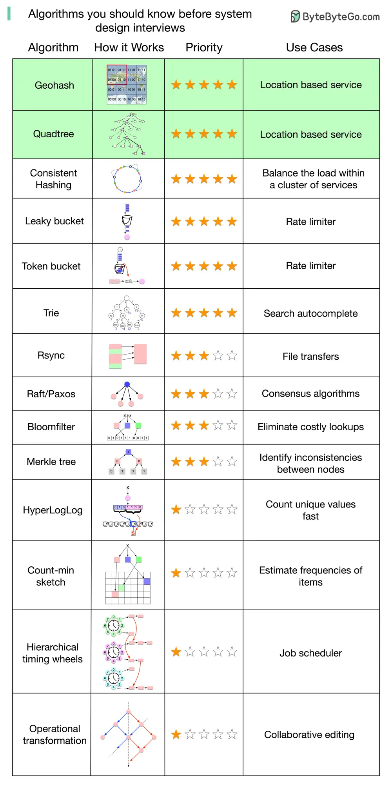

# ByteByteGo System Design 101: Algorithms for System Design Interviews

> Copied from <https://github.com/ByteByteGoHq/system-design-101> (CC BY-NC-ND 4.0, by ByteByteGo). Questions and answers are the source's own; nothing was answered or rewritten here.

What are some of the algorithms you should know before taking system design interviews?

I put together a list and explained why they are important. Those algorithms are not only useful for interviews but good to understand for any software engineer.

One thing to keep in mind is that understanding “how those algorithms are used in real-world systems” is generally more important than the implementation details in a system design interview.

What do the stars mean in the diagram?

It’s very difficult to rank algorithms by importance objectively. I’m open to suggestions and making adjustments.

Five-star: Very important. Try to understand how it works and why.

Three-star: Important to some extent. You may not need to know the implementation details.

One-star: Advanced. Good to know for senior candidates.
