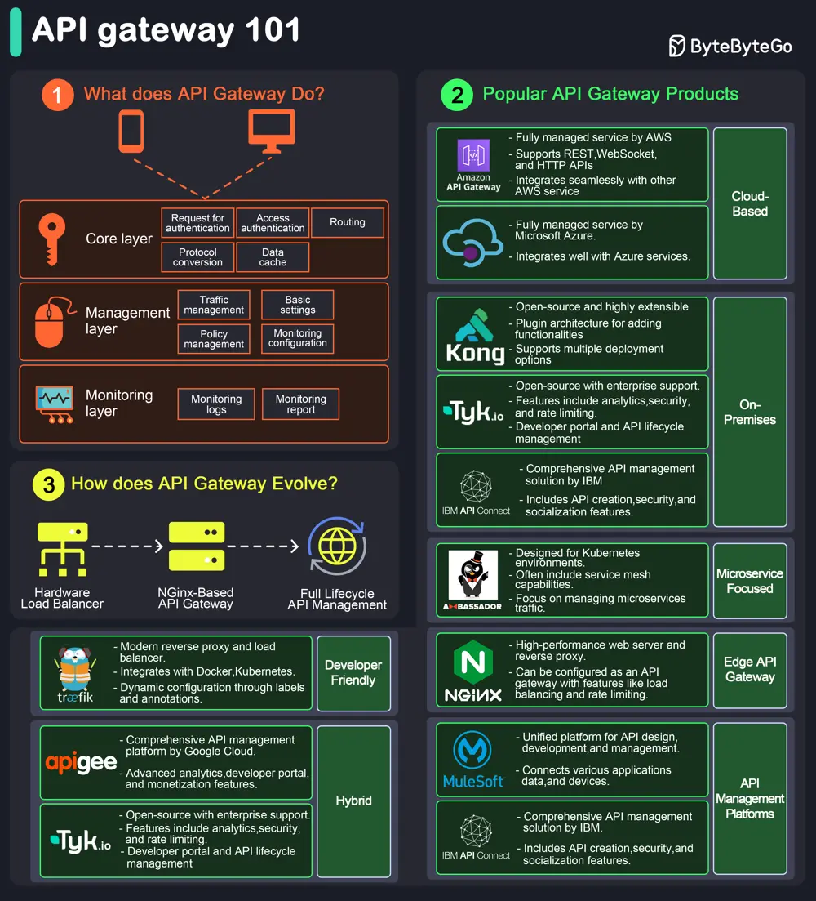

# ByteByteGo System Design 101: API Gateway 101

> Copied from <https://github.com/ByteByteGoHq/system-design-101> (CC BY-NC-ND 4.0, by ByteByteGo). Questions and answers are the source's own; nothing was answered or rewritten here.

An API gateway is a server that acts as an API front-end, receiving API requests, enforcing throttling and security policies, passing requests to the back-end service, and then returning the appropriate result to the client.

It is essentially a middleman between the client and the server, managing and optimizing API traffic.

**Key Functions of an API Gateway**

*   **Request Routing:** Directs incoming API requests to the appropriate backend service.
*   **Load Balancing:** Distributes requests across multiple servers to ensure no single server is overwhelmed.
*   **Security:** Implements security measures like authentication, authorization, and data encryption.
*   **Rate Limiting and Throttling:** Controls the number of requests a client can make within a certain period.
*   **API Composition:** Combines multiple backend API requests into a single frontend request to optimize performance.
*   **Caching:** Stores responses temporarily to reduce the need for repeated processing.
