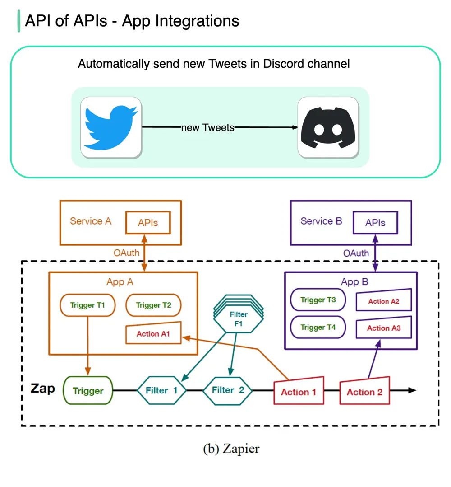

# ByteByteGo System Design 101: API of APIs - App Integrations

> Copied from <https://github.com/ByteByteGoHq/system-design-101> (CC BY-NC-ND 4.0, by ByteByteGo). Questions and answers are the source's own; nothing was answered or rewritten here.

No-code tools such as Zapier, IFTTT, etc., allow anyone to build apps and automate workflows using a visual interface.

The flowchart below shows how it works.

Image source: Paper: IFTTT vs. Zapier: A Comparative Study of Trigger-Action Programming Frameworks
