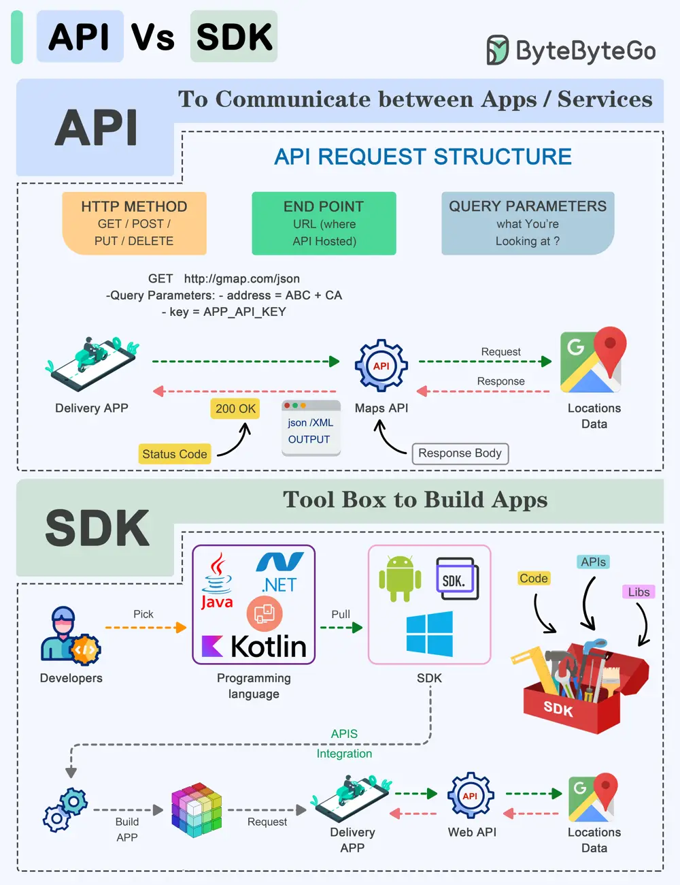

# ByteByteGo System Design 101: API vs SDK

> Copied from <https://github.com/ByteByteGoHq/system-design-101> (CC BY-NC-ND 4.0, by ByteByteGo). Questions and answers are the source's own; nothing was answered or rewritten here.

API (Application Programming Interface) and SDK (Software Development Kit) are essential tools in the software development world, but they serve distinct purposes:

**API:**

An API is a set of rules and protocols that allows different software applications and services to communicate with each other.

*   It defines how software components should interact.
*   Facilitates data exchange and functionality access between software components.
*   Typically consists of endpoints, requests, and responses.

**SDK:**

An SDK is a comprehensive package of tools, libraries, sample code, and documentation that assists developers in building applications for a particular platform, framework, or hardware.

*   Offers higher-level abstractions, simplifying development for a specific platform.
*   Tailored to specific platforms or frameworks, ensuring compatibility and optimal performance on that platform.
*   Offer access to advanced features and capabilities specific to the platform, which might be otherwise challenging to implement from scratch.

The choice between APIs and SDKs depends on the development goals and requirements of the project.
