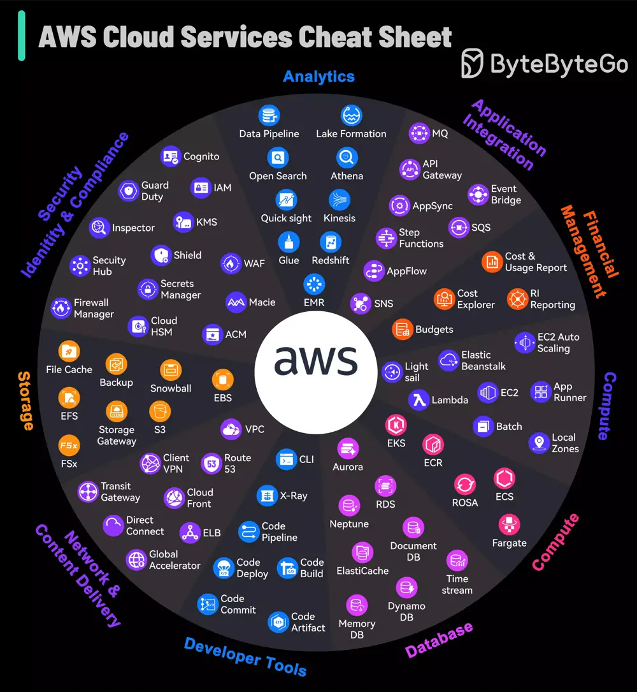

# ByteByteGo System Design 101: AWS Services Cheat Sheet

> Copied from <https://github.com/ByteByteGoHq/system-design-101> (CC BY-NC-ND 4.0, by ByteByteGo). Questions and answers are the source's own; nothing was answered or rewritten here.

AWS grew from an in-house project to the market leader in cloud services, offering so many different services that even experts can find it a lot to take in.

The platform not only caters to foundational cloud needs but also stays at the forefront of emerging technologies such as machine learning and IoT, establishing itself as a bedrock for cutting-edge innovation. AWS continuously refines its array of services, ensuring advanced capabilities for security, scalability, and operational efficiency are available.

For those navigating the complex array of options, this AWS Services Guide is a helpful visual aid.

It simplifies the exploration of AWS's expansive landscape, making it accessible for users to identify and leverage the right tools for their cloud-based endeavors.
