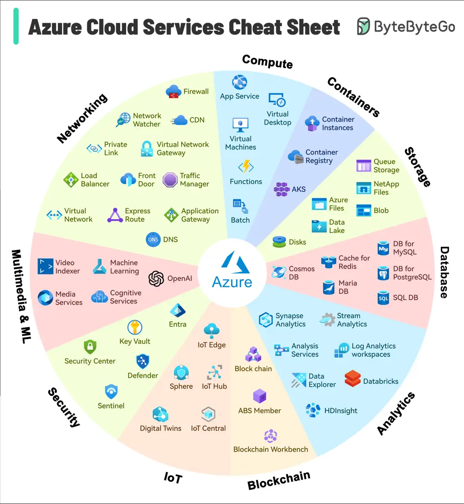

# ByteByteGo System Design 101: Azure Services Cheat Sheet

> Copied from <https://github.com/ByteByteGoHq/system-design-101> (CC BY-NC-ND 4.0, by ByteByteGo). Questions and answers are the source's own; nothing was answered or rewritten here.

Launched in 2010, Microsoft Azure has quickly grown to hold the No. 2 position in market share by evolving from basic offerings to a comprehensive, flexible cloud ecosystem.

Today, Azure not only supports traditional cloud applications but also caters to emerging technologies such as AI, IoT, and blockchain, making it a crucial platform for innovation and development.

As it evolves, Azure continues to enhance its capabilities to provide advanced solutions for security, scalability, and efficiency, meeting the demands of modern enterprises and startups alike. This expansion allows organizations to adapt and thrive in a rapidly changing digital landscape.

The attached illustration can serve as both an introduction and a quick reference for anyone aiming to understand Azure.
