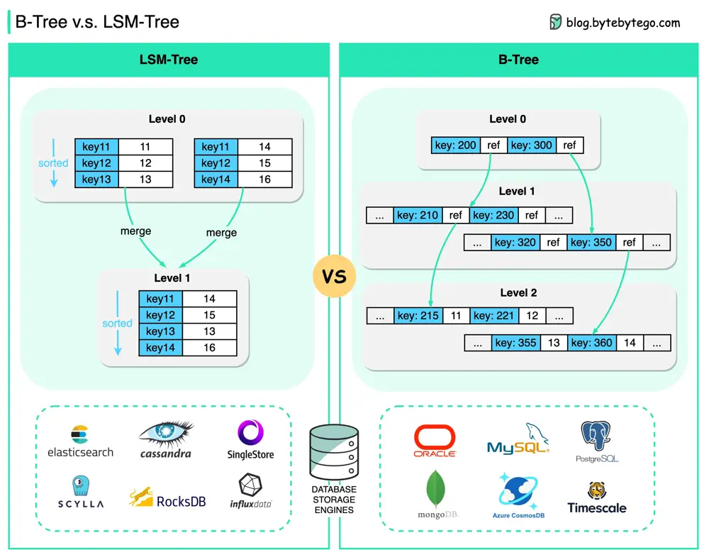

# ByteByteGo System Design 101: B-Tree vs. LSM-Tree

> Copied from <https://github.com/ByteByteGoHq/system-design-101> (CC BY-NC-ND 4.0, by ByteByteGo). Questions and answers are the source's own; nothing was answered or rewritten here.

## B-Tree

B-Tree is the most widely used indexing data structure in almost all relational databases.

The basic unit of information storage in B-Tree is usually called a “page”. Looking up a key traces down the range of keys until the actual value is found.

## LSM-Tree

LSM-Tree (Log-Structured Merge Tree) is widely used by many NoSQL databases, such as Cassandra, LevelDB, and RocksDB.

LSM-trees maintain key-value pairs and are persisted to disk using a Sorted Strings Table (SSTable), in which the keys are sorted.

Level 0 segments are periodically merged into Level 1 segments. This process is called **compaction.**

The biggest difference is probably this:

*   B-Tree enables faster reads

*   LSM-Tree enables fast writes
