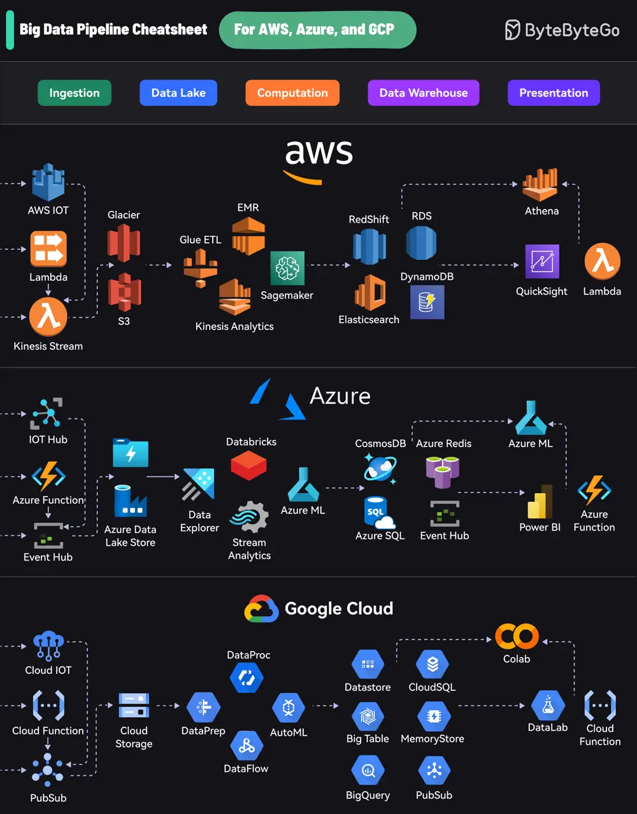

# ByteByteGo System Design 101: Big Data Pipeline Cheatsheet for AWS, Azure, and Google Cloud

> Copied from <https://github.com/ByteByteGoHq/system-design-101> (CC BY-NC-ND 4.0, by ByteByteGo). Questions and answers are the source's own; nothing was answered or rewritten here.

Each platform offers a comprehensive suite of services that cover the entire lifecycle:

*   Ingestion: Collecting data from various sources

*   Data Lake: Storing raw data

*   Computation: Processing and analyzing data

*   Data Warehouse: Storing structured data

*   Presentation: Visualizing and reporting insights

AWS uses services like Kinesis for data streaming, S3 for storage, EMR for processing, RedShift for warehousing, and QuickSight for visualization.

Azure’s pipeline includes Event Hubs for ingestion, Data Lake Store for storage, Databricks for processing, Cosmos DB for warehousing, and Power BI for presentation.

GCP offers PubSub for data streaming, Cloud Storage for data lakes, DataProc and DataFlow for processing, BigQuery for warehousing, and Data Studio for visualization.
