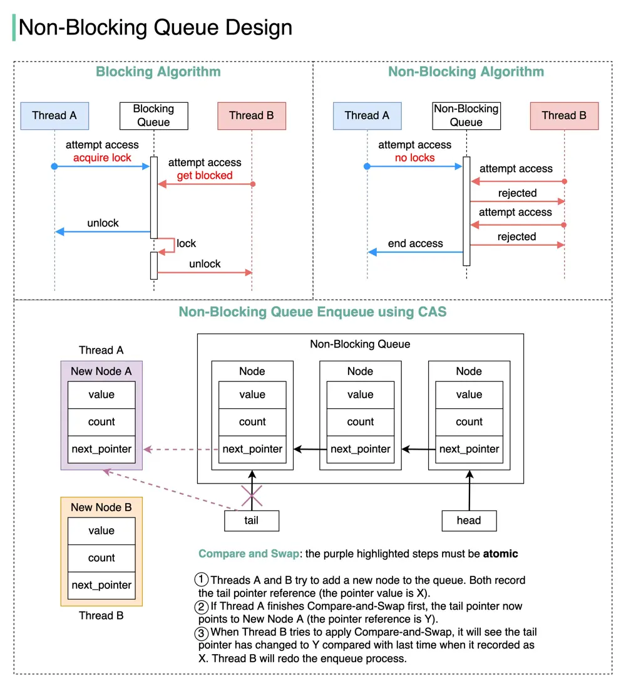

# ByteByteGo System Design 101: Blocking vs Non-Blocking Queue

> Copied from <https://github.com/ByteByteGoHq/system-design-101> (CC BY-NC-ND 4.0, by ByteByteGo). Questions and answers are the source's own; nothing was answered or rewritten here.

How do we implement a **non-blocking** queue? What are the differences between blocking and non-blocking algorithms?

The terms we use when discussing blocking and non-blocking algorithms can be confusing, so let’s start by reviewing the terminology in the concurrency area with a diagram.

## Blocking vs Non-Blocking Algorithms

*   **Blocking**

    The blocking algorithm uses locks. Thread A acquires the lock first, and Thread B might wait for arbitrary lengthy periods if Thread A gets suspended while holding the lock. This algorithm may cause Thread B to starve.

*   **Non-blocking**

    The non-blocking algorithm allows Thread A to access the queue, but Thread A must complete a task in a certain number of steps. Other threads like Thread B may still starve due to the rejections.

This is the main **difference** between blocking and non-blocking algorithms: The blocking algorithm blocks Thread B until the lock is released. A non-blocking algorithm notifies Thread B that access is rejected.

*   **Starvation-free**

    Thread Starvation means a thread cannot acquire access to certain shared resources and cannot proceed. Starvation-free means this situation does not occur.

*   **Wait-free**

    All threads can complete the tasks within a finite number of steps.

𝘞𝘢𝘪𝘵-𝘧𝘳𝘦𝘦 = 𝘕𝘰𝘯-𝘉𝘭𝘰𝘤𝘬𝘪𝘯𝘨 + 𝘚𝘵𝘢𝘳𝘷𝘢𝘵𝘪𝘰𝘯-𝘧𝘳𝘦𝘦

## Non-Blocking Queue Implementation

We can use Compare and Swap (CAS) to implement a non-blocking queue. The diagram below illustrates the algorithm.

## Benefits

1.  No thread suspension. Thread B can get a response immediately and then decide what to do next. In this way, the thread latency is greatly reduced.

2.  No deadlocks. Threads A and B do not wait for the lock to release, meaning that there is no possibility of a deadlock occurring.
