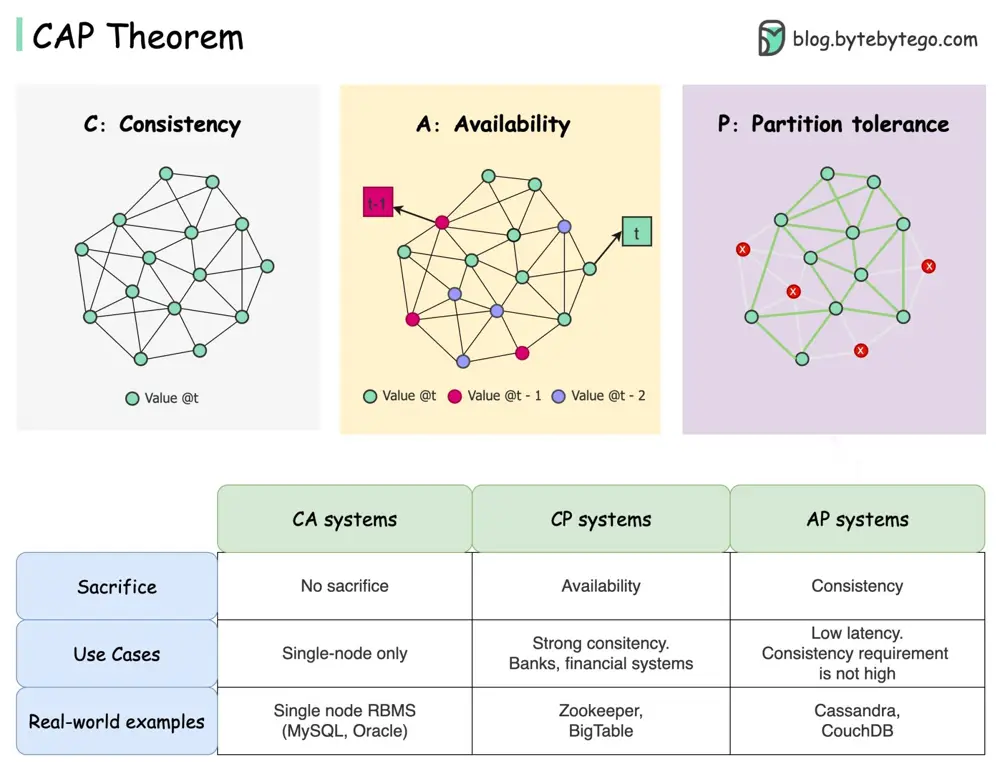

# ByteByteGo System Design 101: CAP Theorem: One of the Most Misunderstood Terms

> Copied from <https://github.com/ByteByteGoHq/system-design-101> (CC BY-NC-ND 4.0, by ByteByteGo). Questions and answers are the source's own; nothing was answered or rewritten here.

The CAP theorem is one of the most famous terms in computer science, but I bet different developers have different understandings. Let’s examine what it is and why it can be confusing.

CAP theorem states that a distributed system can't provide more than two of these three guarantees simultaneously.

## Consistency

Consistency means all clients see the same data at the same time no matter which node they connect to.

## Availability

Availability means any client which requests data gets a response even if some of the nodes are down.

## Partition Tolerance

Partition tolerance means the system continues to operate despite network partitions.

The “2 of 3” formulation can be useful, but this simplification could be misleading.

*   Picking a database is not easy. Justifying our choice purely based on the CAP theorem is not enough. For example, companies don't choose Cassandra for chat applications simply because it is an AP system. There is a list of good characteristics that make Cassandra a desirable option for storing chat messages. We need to dig deeper.

*   “CAP prohibits only a tiny part of the design space: perfect availability and consistency in the presence of partitions, which are rare”. Quoted from the paper: CAP Twelve Years Later: How the “Rules” Have Changed.

*   The theorem is about 100% availability and consistency. A more realistic discussion would be the trade-offs between latency and consistency when there is no network partition. See PACELC theorem for more details.

## Is the CAP theorem really useful?

I think it is still useful as it opens our minds to a set of tradeoff discussions, but it is only part of the story. We need to dig deeper when picking the right database.
