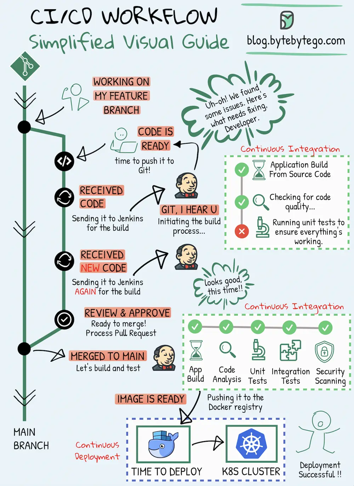

# ByteByteGo System Design 101: CI/CD Simplified Visual Guide

> Copied from <https://github.com/ByteByteGoHq/system-design-101> (CC BY-NC-ND 4.0, by ByteByteGo). Questions and answers are the source's own; nothing was answered or rewritten here.

Whether you're a developer, a DevOps specialist, a tester, or involved in any modern IT role, CI/CD pipelines have become an integral part of the software development process.

## Continuous Integration (CI)

Continuous Integration (CI) is a practice where code changes are frequently combined into a shared repository. This process includes automatic checks to ensure the new code works well with the existing code.

## Continuous Deployment (CD)

Continuous Deployment (CD) takes care of automatically putting these code changes into real-world use. It makes sure that the process of moving new code to production is smooth and reliable.

This visual guide is designed to help you grasp and enhance your methods for creating and delivering software more effectively.
