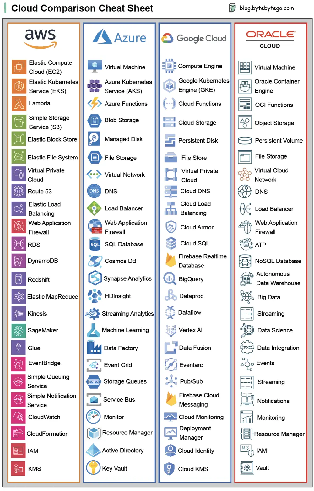

# ByteByteGo System Design 101: Cloud Comparison Cheat Sheet

> Copied from <https://github.com/ByteByteGoHq/system-design-101> (CC BY-NC-ND 4.0, by ByteByteGo). Questions and answers are the source's own; nothing was answered or rewritten here.

## Cloud comparison Cheat Sheet

A nice cheat sheet of different cloud services (2023 edition)!

Guest post by [Govardhana Miriyala Kannaiah](https://www.linkedin.com/in/govardhana-miriyala-kannaiah/).
