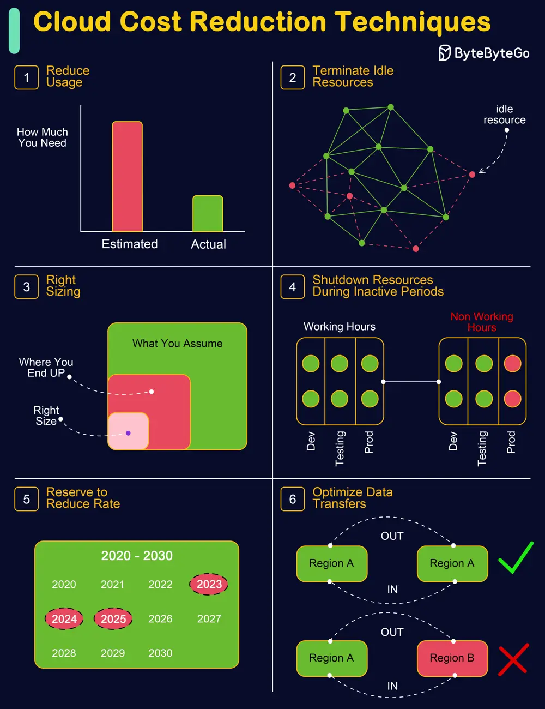

# ByteByteGo System Design 101: Cloud Cost Reduction Techniques

> Copied from <https://github.com/ByteByteGoHq/system-design-101> (CC BY-NC-ND 4.0, by ByteByteGo). Questions and answers are the source's own; nothing was answered or rewritten here.

Irrational Cloud Cost is the biggest challenge many organizations are battling as they navigate the complexities of cloud computing.
Efficiently managing these costs is crucial for optimizing cloud usage and maintaining financial health.

The following techniques can help businesses effectively control and minimize their cloud expenses.

*   **Reduce Usage:** Fine-tune the volume and scale of resources to ensure efficiency without compromising on the performance of applications (e.g., downsizing instances, minimizing storage space, consolidating services).

*   **Terminate Idle Resources:** Locate and eliminate resources that are not in active use, such as dormant instances, databases, or storage units.

*   **Right Sizing:** Adjust instance sizes to adequately meet the demands of your applications, ensuring neither underuse nor overuse.

*   **Shutdown Resources During Off-Peak Times:** Set up automatic mechanisms or schedules for turning off non-essential resources when they are not in use, especially during low-activity periods.

*   **Reserve to Reduce Rate:** Adopt cost-effective pricing models like Reserved Instances or Savings Plans that align with your specific workload needs.

    Bonus Tip: Consider using Spot Instances and lower-tier storage options for additional cost savings.

*   **Optimize Data Transfers:** Utilize methods such as data compression and Content Delivery Networks (CDNs) to cut down on bandwidth expenses, and strategically position resources to reduce data transfer costs, focusing on intra-region transfers.
