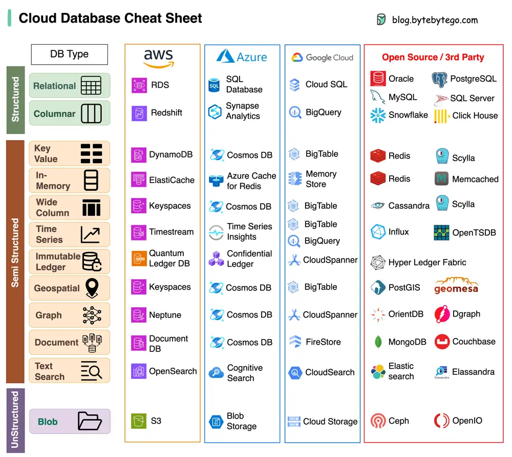

# ByteByteGo System Design 101: Cloud Database Cheat Sheet

> Copied from <https://github.com/ByteByteGoHq/system-design-101> (CC BY-NC-ND 4.0, by ByteByteGo). Questions and answers are the source's own; nothing was answered or rewritten here.

A cheat sheet of various databases in cloud services, along with their corresponding open-source/3rd-party options.

Choosing the right database for your project is a complex task. The multitude of database options, each suited to distinct use cases, can quickly lead to decision fatigue.

We hope this cheat sheet provides the high level direction to pinpoint the right service that aligns with your project's needs and avoid potential pitfalls.

Note: Google has limited documentation for their database use cases. Even though we did our best to look at what was available and arrived at the best option, some of the entries may be not accurate.
