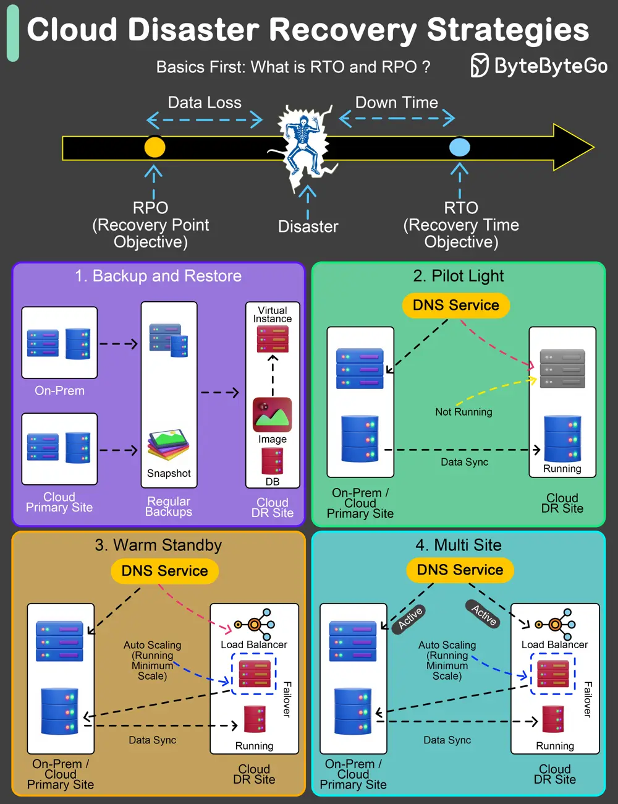

# ByteByteGo System Design 101: Cloud Disaster Recovery Strategies

> Copied from <https://github.com/ByteByteGoHq/system-design-101> (CC BY-NC-ND 4.0, by ByteByteGo). Questions and answers are the source's own; nothing was answered or rewritten here.

An effective Disaster Recovery (DR) plan is not just a precaution; it's a necessity.

The key to any robust DR strategy lies in understanding and setting two pivotal benchmarks: Recovery Time Objective (RTO) and Recovery Point Objective (RPO).

*   **Recovery Time Objective (RTO)** refers to the maximum acceptable length of time that your application or network can be offline after a disaster.

*   **Recovery Point Objective (RPO)**, on the other hand, indicates the maximum acceptable amount of data loss measured in time.

Let's explore four widely adopted DR strategies:

## Backup and Restore Strategy:

This method involves regular backups of data and systems to facilitate post-disaster recovery.

*   **Typical RTO:** From several hours to a few days.
*   **Typical RPO:** From a few hours up to the time of the last successful backup.

## Pilot Light Approach:

Maintains crucial components in a ready-to-activate mode, enabling rapid scaling in response to a disaster.

*   **Typical RTO:** From a few minutes to several hours.
*   **Typical RPO:** Depends on how often data is synchronized.

## Warm Standby Solution:

Establishes a semi-active environment with current data to reduce recovery time.

*   **Typical RTO:** Generally within a few minutes to hours.
*   **Typical RPO:** Up to the last few minutes or hours.

## Hot Site / Multi-Site Configuration:

Ensures a fully operational, duplicate environment that runs parallel to the primary system.

*   **Typical RTO:** Almost immediate, often just a few minutes.
*   **Typical RPO:** Extremely minimal, usually only a few seconds old.
