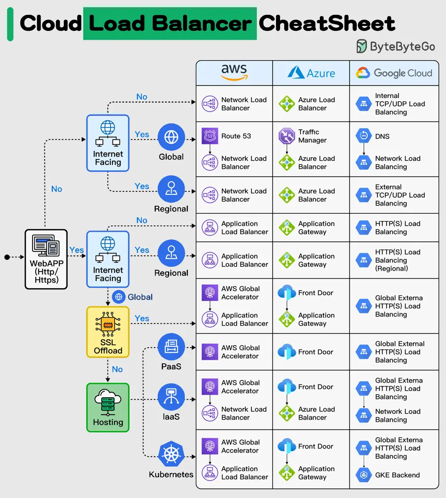

# ByteByteGo System Design 101: Cloud Load Balancer Cheat Sheet

> Copied from <https://github.com/ByteByteGoHq/system-design-101> (CC BY-NC-ND 4.0, by ByteByteGo). Questions and answers are the source's own; nothing was answered or rewritten here.

In today's multi-cloud landscape, mastering load balancing is essential to ensure seamless user experiences and maximize resource utilization, especially when orchestrating applications across multiple cloud providers. Having the right knowledge is key to overcoming these challenges and achieving consistent, reliable application delivery.

In selecting the appropriate load balancer type, it's essential to consider factors such as application traffic patterns, scalability requirements, and security considerations. By carefully evaluating your specific use case, you can make informed decisions that enhance your cloud infrastructure's efficiency and reliability.

This Cloud Load Balancer cheat sheet would help you in simplifying the decision-making process and helping you implement the most effective load balancing strategy for your cloud-based applications.
