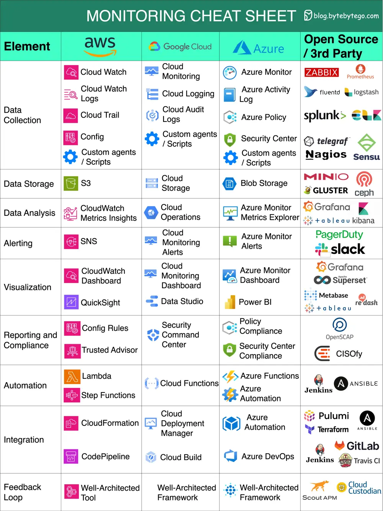

# ByteByteGo System Design 101: Cloud Monitoring Cheat Sheet

> Copied from <https://github.com/ByteByteGoHq/system-design-101> (CC BY-NC-ND 4.0, by ByteByteGo). Questions and answers are the source's own; nothing was answered or rewritten here.

A nice cheat sheet of different monitoring infrastructure in cloud services.

This cheat sheet offers a concise yet comprehensive comparison of key monitoring elements across the three major cloud providers and open-source / 3rd party tools.

Let's delve into the essential monitoring aspects covered:

*   **Data Collection:** Gather information from diverse sources to enhance decision-making.

*   **Data Storage:** Safely store and manage data for future analysis and reference.

*   **Data Analysis:** Extract valuable insights from data to drive informed actions.

*   **Alerting:** Receive real-time notifications about critical events or anomalies.

*   **Visualization:** Present data in a visually comprehensible format for better understanding.

*   **Reporting and Compliance:** Generate reports and ensure adherence to regulatory standards.

*   **Automation:** Streamline processes and tasks through automated workflows.

*   **Integration:** Seamlessly connect and exchange data between different systems or tools.

*   **Feedback Loops:** Continuously refine strategies based on feedback and performance analysis.
