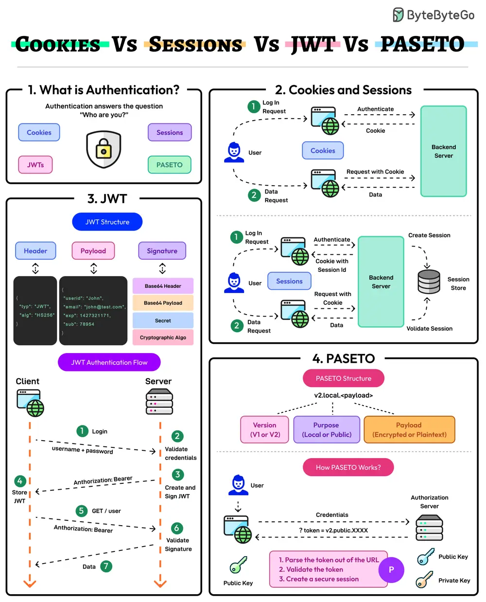

# ByteByteGo System Design 101: Cookies vs Sessions vs JWT vs PASETO

> Copied from <https://github.com/ByteByteGoHq/system-design-101> (CC BY-NC-ND 4.0, by ByteByteGo). Questions and answers are the source's own; nothing was answered or rewritten here.

Authentication ensures that only authorized users gain access to an application’s resources. It answers the question of the user’s identity i.e. “Who are you?”

The modern authentication landscape has multiple approaches: Cookies, Sessions, JWTs, and PASETO. Here’s what they mean:

## Cookies and Sessions

Cookies and sessions are authentication mechanisms where session data is stored on the server and referenced via a client-side cookie.

Sessions are ideal for applications requiring strict server-side control over user data. On the downside, sessions may face scalability challenges in distributed systems.

## JWT

JSON Web Token (JWT) is a stateless, self-contained authentication method that stores all user data within the token.

JWTs are highly scalable but require careful handling to mitigate the chances of token theft and manage token expiration.

## PASETO

Platform-Agnostic Security Tokens or PASETO improve upon JWT by enforcing stronger cryptographic defaults and eliminating algorithmic vulnerabilities.

PASETO simplifies token implementation by avoiding the risks associated with misconfiguration.
