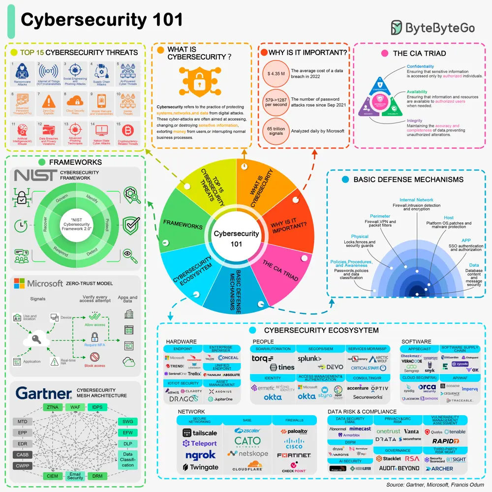

# ByteByteGo System Design 101: Cybersecurity 101

> Copied from <https://github.com/ByteByteGoHq/system-design-101> (CC BY-NC-ND 4.0, by ByteByteGo). Questions and answers are the source's own; nothing was answered or rewritten here.

## Introduction to Cybersecurity

## The CIA Triad

## Common Cybersecurity Threats

## Basic Defense Mechanisms

To combat these threats, several basic defense mechanisms are employed:

*   **Firewalls:** Network security devices that monitor and control incoming and outgoing network traffic.

*   **Antivirus Software:** Programs designed to detect and remove malware.

*   **Encryption:** The process of converting information into a code to prevent unauthorized access.

## Cybersecurity Frameworks
